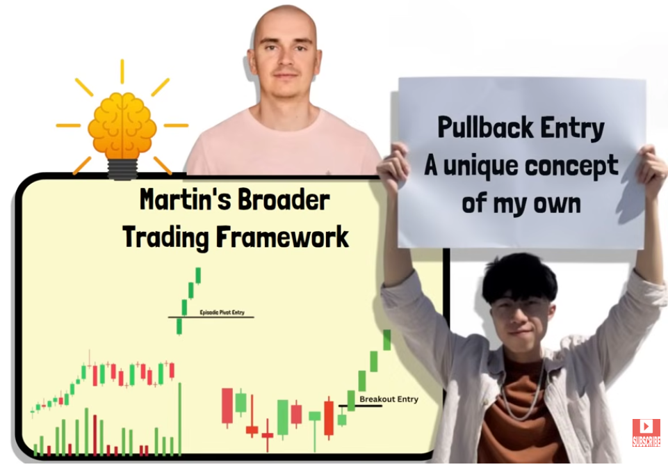
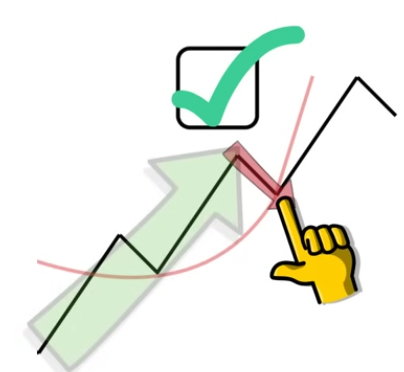
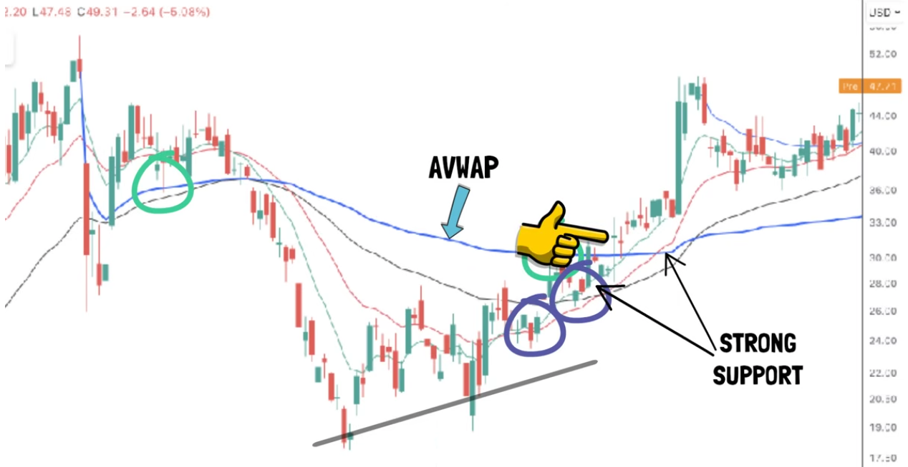
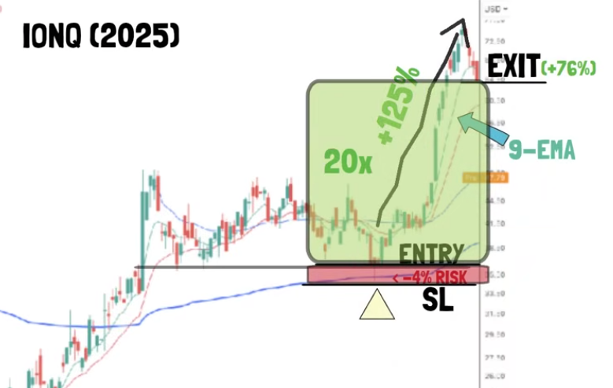
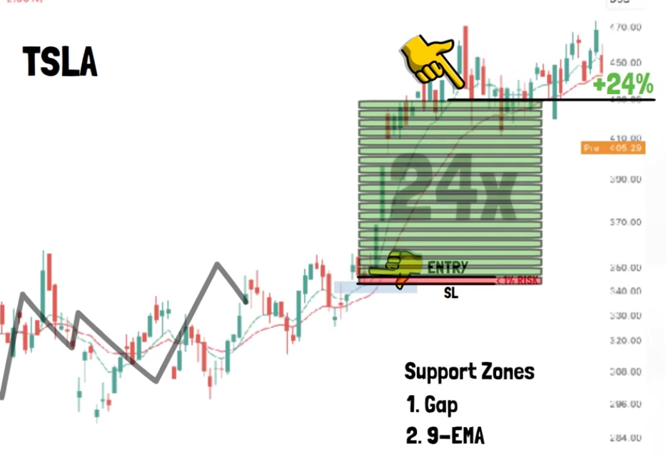
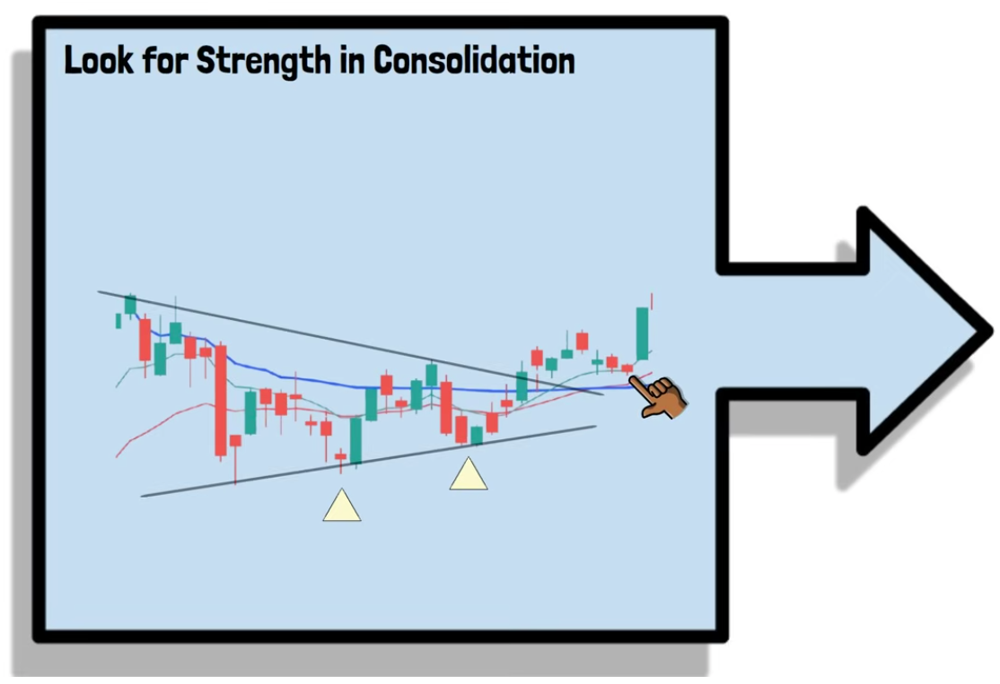
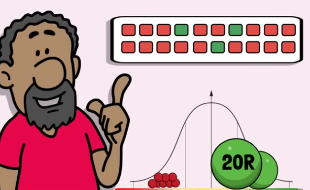

# Martin Luk’s Pullback Trading Strategy: How the 2025 U.S. Investing Champion Finds Low-Risk, High-Reward Entries

**Pobrano:** 2026-11-01  
**Opublikowano:** 2026-06-01  
**Źródło:** <https://www.financialwisdomtv.com/post/martin-luk-s-pullback-trading-strategy-how-the-2025-u-s-investing-champion-finds-low-risk-high-re>  
**Serwis:** Financial Wisdom TV

---

Updated: 4 days ago

Martin Luk’s Pullback Trading Strategy offers a framework for evaluating investment decisions. The central ideas still need to be considered alongside valuation, diversification, costs, evidence and individual risk capacity.

## **In This Guide**

- Key lessons and practical rules
- The original Financial Wisdom guide and media
- Evidence, limitations and risk controls
- Frequently asked questions
- Related guides and authoritative sources

## **Key Takeaways**

- Separate business quality from the price paid.
- Verify claims with financial statements and independent evidence.
- Include valuation, diversification, fees, taxes and holding period.
- Treat historical examples as evidence to examine, not guarantees.

## **Original Financial Wisdom Guide**

Learn how Martin Luk uses AVWAPs, [<u>moving averages</u>](https://www.financialwisdomtv.com/post/5-best-moving-average-strategies), and intraday pullbacks to create asymmetric [<u>risk-reward</u>](https://www.financialwisdomtv.com/post/risk-reward-trading) trades capable of generating outsized returns.

**Summary:**

*In this guide, we break down the pullback trading strategy used by 2025 U.S. Investing Championship winner Martin Luk. Unlike* <u>traditional breakout trading</u>*, Luk focuses on buying temporary weakness within strong uptrends, using support levels such as* <u>Anchored VWAPs</u>*, the 9 EMA, 21 EMA, and key price action zones. His objective is simple: minimise risk while maximising reward.*

*The strategy centres around finding strong momentum stocks that are consolidating, identifying areas where multiple support factors align, and entering during brief intraday flushes when price quickly reclaims support. By keeping* <u>stop losses</u> *extremely tight,often between 1% and 4%, Luk creates trades capable of producing 10x, 20x, or even 30x reward-to-risk outcomes.*

*While the win rate is relatively low, the large winners more than compensate for the frequent small losses, creating a highly* <u>positive expectancy system</u>*. The approach demonstrates how* <u>disciplined risk management</u>*, precise entries, and patience can lead to exceptional long-term trading performance.*

## Who Is Martin Luk?

Martin Luk has rapidly established himself as one of the most impressive traders in modern markets.

After enduring a painful 50% [<u>drawdown</u>](https://www.financialwisdomtv.com/post/limiting-drawdown) early in his trading career, he continued refining his methods before producing a reported 283% return in 2024, followed by an astonishing 969% return in the 2025 U.S. Investing Championship.

### **Practical Checkpoint**

- Define the setup, entry and invalidation level before acting.
- Compare the potential payoff with [<u>risk-reward planning</u>](https://www.financialwisdomtv.com/post/risk-reward-trading).
- Set the trade size using consistent [<u>position-sizing rules</u>](https://www.financialwisdomtv.com/post/risk-of-ruin-in-trading).

While many traders would have quit after suffering such a significant drawdown, Luk used the experience to improve his risk management and develop increasingly precise entry techniques.

His [<u>breakout and Episodic Pivot strategies</u>](https://www.financialwisdomtv.com/post/the-episodic-pivot-strategy-qullamaggie-s-high-momentum-setup-explained) have already gained significant attention. However, one of his lesser-known but highly effective methods is his pullback trading strategy.

## Why Martin Luk Focuses on Pullbacks

At the core of Martin's trading philosophy is a simple principle:

Risk as little as possible whilst allowing for maximum upside.

This concept creates what he describes as a "parabolic relationship" between <u>stop-loss size and reward multiples.</u>

For example:

- A 25% winning trade using a 3% stop produces roughly 8R.
- The same trade using a 1.5% stop can produce more than 16R.

As winners become larger, the benefits of tighter entries become even more dramatic.

This explains why Martin spends considerable effort refining his entries rather than simply buying obvious [<u>breakouts</u>](https://www.financialwisdomtv.com/post/breakout-strategy-screener).

## The Key Tools Martin Uses

Martin combines technical indicators with price action analysis to identify pullback opportunities.

### **Evidence Check**

- Is the sample broad enough to include difficult markets?
- Do the results include spreads, fees, slippage and failed signals?
- Could hindsight, survivorship or selective examples explain the result?

His primary tools include:

### Anchored VWAP (AVWAP)

Martin frequently anchors VWAPs to major swing highs and lows.

These often become powerful support and resistance levels that institutional traders monitor closely.

A really popular video on VWAP can be seen here:

### Exponential Moving Averages

The key moving averages he uses are:

- 9 EMA
- 21 EMA
- 50 EMA

These help identify trend strength and dynamic support.

### Horizontal Support Levels

Previous highs, lows and unfilled gaps often become important areas where buyers may step back into a stock.

## Step 1: Find Strong Stocks

Martin does not buy pullbacks in weak stocks.

He specifically looks for:

- Strong momentum stocks
- Stocks up at least 30% over 1, 3 or 6 months
- Stocks making <u>higher highs and higher lows</u>
- Stocks trading above rising moving averages

The objective is to buy weakness within strength.

As Martin often demonstrates:

Buy weakness in strength, not weakness in weakness.

## Step 2: Find Consolidations

Once strong stocks are identified, Martin searches for consolidations.

The best setups typically:

- Last eight weeks or longer
- Show clear support and resistance levels
- Develop near important AVWAPs
- Trade around rising moving averages

These consolidations often represent [<u>institutional accumulation</u>](https://www.financialwisdomtv.com/post/trading-price-action) before another major move higher.

## Step 3: Wait for Support Confluence

The most powerful setups occur when multiple support factors align.

Examples include:

- AVWAP + 9 EMA
- AVWAP + 21 EMA
- AVWAP + horizontal support
- Gap support + moving average support

The more factors supporting the same area, the stronger the setup becomes.

## IONQ: A Pullback Trading Example

One of Martin's strongest examples came from IONQ.

Following a lengthy consolidation, the stock reclaimed both an AVWAP anchored from a major high and its rising 9 EMA.

Two separate pullback opportunities developed:

- Price briefly moved below support
- Quickly reclaimed support
- Closed back above key levels

The risk on these entries ranged from roughly 4% to 7%.

The subsequent move generated gains exceeding 100%.

Using a 9 EMA trailing stop produced approximately 76% profit, representing a reward-to-risk ratio approaching 20:1.

## Tesla: Buying the Flush

Tesla provided another excellent example.

Following months of consolidation, the stock:

- Reclaimed key moving averages
- Built a tightening range
- Pulled back into support

During one session, price briefly flushed lower before reclaiming both gap support and the rising 9 EMA.

This allowed an entry with less than 1% risk.

The stock subsequently advanced approximately 24%, producing a reward-to-risk ratio exceeding 24:1.

## Why These Trades Work

Many traders focus on finding high win-rate systems.

Martin focuses on something more important:

### Positive Expectancy

Pullback entries often fail.

In fact, many fail more frequently than they succeed.

However, because the risk is so small, even a modest number of successful trades can generate exceptional performance.

Martin's own statistics show that:

- He can be wrong frequently
- Average losses remain tiny
- Winners become massive multiples of risk

This creates the positive expectancy required for long-term success.

## The Three Rules of Martin Luk's Pullback Strategy

### 1. Look For Strength

The stock should display:

- Higher lows
- <u>Rising EMAs</u>
- AVWAP reclamation
- Tightening price action

### 2. Wait For Multiple Support Levels

The best entries occur when:

- AVWAPs
- EMAs
- Horizontal support

All converge together.

### 3. Enter On Reclamation

Rather than buying blindly into weakness, Martin waits for:

- Price to reclaim support
- Buyers to demonstrate control
- A strong close or positive reversal

This dramatically improves probability whilst maintaining tight risk.

## Final Thoughts

Martin Luk's pullback strategy is a brilliant example of modern momentum trading.

Instead of chasing extended breakouts, he focuses on identifying low-risk entry points inside strong trends.

The strategy requires [<u>patience, discipline</u>](https://www.financialwisdomtv.com/post/trading-education-mindset-hub), and a willingness to accept frequent small losses. However, when successful, the reward-to-risk ratios can be extraordinary.

Most traders spend their careers searching for a high win-rate system.

Martin's results demonstrate that focusing on reward-to-risk may be far more important.

By combining AVWAPs, moving averages, support levels and disciplined risk management, he has built a framework capable of generating exceptional returns whilst risking very little on each individual trade.

For traders seeking asymmetric opportunities, it is certainly a strategy worth studying.

## Frequently Asked Questions

### What is Martin Luk's pullback trading strategy?

It is a momentum-based strategy that buys temporary pullbacks in strong stocks near key support levels such as AVWAPs and moving averages.

### What indicators does Martin Luk use?

Primarily Anchored VWAPs, the 9 EMA, 21 EMA, 50 EMA, and horizontal support and resistance levels.

### Why are the stop losses so small?

Small [<u>stop losses</u>](https://www.financialwisdomtv.com/post/the-importance-of-a-stop-loss) allow much larger reward-to-risk ratios when trades work.

### Does the strategy have a high win rate?

No. The strategy accepts frequent small losses in exchange for occasional large winners.

### What stocks work best?

Strong momentum stocks that have gained significantly over the previous 1, 3 or 6 months and are consolidating.

### What is an AVWAP?

Anchored Volume Weighted Average Price is a dynamic support and resistance tool anchored from a significant event or price point.

### Is this similar to Kristjan Kullamägi's strategy?

There are similarities, particularly regarding momentum and [<u>risk management</u>](https://www.financialwisdomtv.com/post/risk-management-position-sizing-hub), but Martin's pullback methodology is his own refinement.

### Can beginners use this strategy?

Yes, although it requires discipline and the ability to accept frequent small losses [<u>without becoming emotional</u>](https://www.financialwisdomtv.com/post/how-to-trade-with-discipline-without-emotion).
