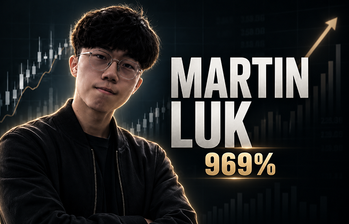

# Martin Luk – 969% w rok. Kim jest zwycięzca US Investing Championship i jak handluje?

**Pobrano:** 2026-11-01  
**Opublikowano:** 2026-09-09  
**Źródło:** <https://en.forexclub.pl/Martin-Luk-969-in-a-year-who-is-the-winner-of-the-US-Investing-Championship-and-how-does-he-trade/>  
**Serwis:** Forex Club (en.forexclub.pl)

---

Martin Luk is a name that has become one of the most frequently mentioned in the active trading community over the past two years. It's not because he runs a high-profile educational channel or sells courses. The reason is much simpler: his performance in the US Investing Championship, one of the oldest and most recognizable American investment competitions, is simply hard to ignore.

However, before we get to hundreds of percent per year, it's worth asking a question that is asked far too rarely in the case of such results: where did they come from, under what conditions were they achieved, and what can the average trader really get from them?

## Who is Martin Luk?

Martin Luk is from Hong Kong. In materials published after the 2024 US Investing Championship, he was portrayed as a 22-year-old trader. He holds a bachelor's degree in Global Economics and Finance from the University of Hong Kong, where he studied from 2020 to 2024.

He didn't follow the traditional path of an investment bank, hedge fund, or trading desk. He learned the markets on his own while still a student.

The beginning of his trading journey is well documented. In 2020, the Hong Kong government paid residents a one-time benefit of HK$10,000—the equivalent of about $1300 USD. Luk deposited the money into a brokerage account, and thus began his journey into the market.

In the euphoric environment of 2020, he tripled his account in about three months, trading primarily small caps and SPACs. But then reality set in. In 2021, he saw a roughly 50% increase. [Drawdown](https://en.forexclub.pl/drawdown-or-rate-of-return-set-your-priorities/) and made typical mistakes of a beginner trader – from [FOMO](https://en.forexclub.pl/fomo-what-is-the-fear-of-losing-an-opportunity-and-how-to-deal-with-it/) i [overtradingu](https://en.forexclub.pl/overtrading-forex-more-is-not-better/), through revenge trading, to ignoring [stop losses](https://en.forexclub.pl/stop-loss/).

What sets Luka apart from many young traders is the speed with which he began to systematize his approach. In 2021, he adopted a trading style **Kristjana Kullamägi**, more widely known as **Qullamaggie**, and made it the foundation of his method. He later declared that about 80% of his trading came from this approach.

## Verified Results at the US Investing Championship

Here we come to the most important point – and here you need to be particularly precise, because on social media, the numbers about the best traders very quickly take on a life of their own.

The US Investing Championship, or USIC for short, is a competition run by Norman Zadeh since 1983. Participants register a real brokerage account, and the organizer verifies results based on brokerage documentation. Therefore, it's not a paper trading or a simulator.

Luk competes in the Stock Division for accounts above $20,000. This category allows trading in stocks and ETFs, as well as the use of margin.

His results in subsequent editions are as follows:

- **2024 – sixth place with a result of +283,1%.**
This was Luke's debut in the US Investing Championship. For a very young trader, it was an impressive result, though not the best of the entire season. Judy Lai finished the year with a score of +449,1%, and Christian Flanders achieved +433,5%.

- **2025 – first place and +969,8%.**
A year later, Luke [was the winner of the 2025 edition](https://financial-competitions.com/previousstandings/2026/1/24/december-standings-2025) with a result of +969,8%. Second in the ranking, Rajnus Capital LLC achieved +382%. The advantage over the rest of the field was therefore huge.

- **2026 – again at the forefront.**
Według [official results for the first half of 2026](https://www.businesswire.com/news/home/20260728048545/en/United-States-Investing-Championship-First-Half-Results-17-Report-Profits) Luk was in third place with a result of +421,2%.

The latest available results for seven months, as of July 31, 2026, showed him in second place with a score of +868,6%. Tom Doube remained in the lead with a score of +982,3%. For comparison, after five months of 2026, Luka's score was +345,6%.

It's worth emphasizing that these numbers aren't provided solely by the trader himself or screenshots posted on social media. These are results officially reported as part of the competition and verified based on brokerage accounts.

## Where do these hundreds of percent come from? Instruments, strategy, and timing.

Martin Luk primarily trades US stocks—particularly technology companies and companies in sectors that are currently in the spotlight. He prefers stocks with a high ADR, or Average Daily Range—a wide range of average daily price movements.

In 2024, his transactions included companies from the semiconductor, artificial intelligence, nuclear energy, fintech, and new technologies sectors. Among his documented positions are tickers such as COIN, GME, SMCI, SOFI, SOUN, and LMND.

His approach can be reduced to two main pillars:

- **pullback trading** – buying a correction within a strong uptrend,
- **momentum selection** – selecting the strongest companies and sectors.

In practice, Luk spends about 30 minutes each day reviewing the market. He looks for stocks that have shown significant relative strength or strong openings with a gap. On the weekends, he analyzes the leaders from the past few weeks. He then creates watchlists and ranks companies based on, among other things, their price relationship to short-term moving averages, such as the 9 EMA, 21 EMA, and 50 EMA. When a strong stock corrects to an area he considers significant support—for example, the moving average, the anchored VWAP, or a previous swing high—he begins looking for an entry. Timing is a key element of his strategy. Luk utilizes multi-timeframe analysis. He identifies the broader trend and key levels on a daily or weekly chart, then tries to find the most precise entry point possible on a lower timeframe. His approach incorporates elements from both Qullamaggie and Brian Shannon.

## Risk management – discipline instead of bravado

Returns of several hundred percent annually can suggest an extreme propensity for gambling. In Luke's case, the picture is more complicated.

The trader repeatedly emphasized that **risk control is the foundation of its system**The declared risk per trade is typically around 0,5-1% of the portfolio value. A stop loss is determined before entering a position and set as a hard stop after the trade is opened. According to his 2024 trading summary, over 80% of trades had stop losses less than 3,5%. The maximum size of a single trade could reach approximately 35% of the portfolio. For companies with a larger ADR, the position size was reduced accordingly.

It's the combination of a tight stop loss with companies that can make a significant move that allows for high R values, which is the ratio of potential or actual profit to the previously assumed risk. For example, a position on COIN with a stop loss of around 2,87% was expected to yield around 12R. On GME, with a stop loss of around 3,23%, one transaction yielded a whopping 54R. On SOFI, with a stop loss of around 1,97%, it yielded around 19R. These are not typical trades. These are examples of exceptionally successful positions in which a small initial risk was combined with a very large price movement.

## How can you make money if you are only right one out of four times?

One of the most interesting features of Luka's trading is his very low win rate. In 2024, it was **about 25%**.

At first glance, this means that three out of four trades ended in losses. However, the percentage success rate alone says little about the quality of the system.

If a trader:

- loses 1R,
- loses 1R,
- loses 1R,
- and then earns 6R,

after four transactions his result is +3R, despite the effectiveness of only 25%.

This asymmetry between small losses and occasional very large profits is one of the most important elements of Luk's system. However, this comes at a price. With such low effectiveness, streaks of several, or even a dozen, losing trades are completely normal. Luk experienced streaks of over 10 losses in a row. Psychologically, this is an extremely demanding model. A trader must accept that they can be wrong most of the time and still maintain the strategy's principles.

## Leverage, Concentration, and Competition Context

This is where you need to be extremely cautious. USIC allows for margin trading. At the same time, Luk can build relatively large positions in highly volatile stocks. This doesn't automatically mean that every trade carries a significant amount of risk – the declared risk per trade remains relatively small.

However, cumulative portfolio risk can be a problem. If several positions are highly correlated—for example, all belonging to the same hot sector—a sudden change in sentiment can impact many of them simultaneously. This also creates price gaps, slippage, and the risk that the stop loss will not be triggered exactly at the intended price.

Luk himself has also demonstrated that deviating from his own rules can quickly increase capital drawdowns. In the past, he has admitted to overtrading, revenge trading, and periods where monthly drawdowns exceeded a dozen or so percent. This is important context.

Achieving +969% in the competitive Stock Division is quite different from generating a similar rate of return while managing a fund worth hundreds of millions of dollars. Momentum and pullback strategies used on dynamic stocks have limited scalability. With larger capital, the importance of liquidity, spread, slippage, and the impact of one's own orders on the market increases. Therefore, Luka's result is to be admired, but it must be interpreted in the proper context.

## Can the Luka approach be used outside of competition?

There are many elements in the Luka strategy that have universal value and can help a trader regardless of account size.

**These include primarily:**

- defining risk before concluding the transaction,
- consistent use of stop losses,
- focusing on companies that demonstrate relative strength,
- trading in line with the prevailing momentum,
- multi-interval analysis,
- keeping a transaction journal,
- regular analysis of your own mistakes.

However, the execution parameters themselves should be approached much more cautiously. A position representing even several dozen percent of the portfolio, trading in highly volatile companies, and using margin can create a completely different risk profile than in traditional long-term investing.

Psychology is equally important. A win rate of around 25% means a trader must be prepared for long losing streaks. Most investors, after a few unsuccessful trades, begin to change their strategy, moving their stop losses, or increasing risk in an attempt to quickly recoup losses. In the case of Luka's system, such behavior would destroy his entire advantage. In other words, the intellectual framework of his strategy is much more universal than its most aggressive parameters.

## Sustainability of results – what does the data say?

The strongest argument for Luke isn't just the +969,8% score. Much more interesting is the repeatability.

In 2024, he finished sixth with a score of +283,1%. In 2025, he won the competition with a score of +969,8%. Seven months later in 2026, he was in second place again, this time with a score of +868,6%. Three consecutive years among the top teams make it increasingly difficult to attribute his results solely to luck.

This doesn't mean, however, that a track record of several years is sufficient to consider his advantage sustainable in all market conditions. His best results occurred during a period very favorable to momentum strategies – with strong sector rotation, high speculative activity, and parabolic movements in selected groups of companies. Luk himself repeatedly emphasizes the importance of the right market environment. In weaker conditions, he was able to give back a significant portion of his previous gains. He experienced this, among other things, during the more challenging market in 2021-2022.

The most important question, then, remains: how would his system perform in a prolonged bear market, with far fewer strong momentum setups and with much larger capital? This is a test that largely still lies ahead.

## What does this mean for Polish traders?

Martin Luk is a very interesting case study – not as an idol whose results should be mindlessly copied, but as an example of an extremely consistent approach to transaction selection and [risk management](https://en.forexclub.pl/Risk-management-in-capital-markets-a-complete-guide-for-investors/).

His story shows that exceptional results can arise not from high efficiency, but from asymmetry—limiting losses and allowing the best trades to run. It also illustrates something less glamorous.

The +969% result stems from a win rate of around 25%, a series of dozens of losses, periodic drawdowns, and the need to constantly control one's emotions. This isn't reflected in the annual rate of return chart.

If you're a beginner or intermediate trader, there are three things to learn from Luke's approach: precise risk control on a single trade, consistent instrument selection rather than random trading, and regular analysis of your own mistakes. You should be much more cautious about concentrating your portfolio, margin, and trading only on the most volatile companies. A third consecutive year of excellent results in the US Investing Championship suggests we're dealing with a trader with an interesting and likely realistic edge.

The path from an impressive young contestant to a professional capable of managing large sums of money for many years remains a long one. Interestingly, Martin Luk himself seems fully aware of this.
