# The 22-Year-Old Who Returned 283% in USIC 2024 (Martin Luk – key lessons)

**Pobrano:** 2026-11-01  
**Opublikowano:** 2025-02-01  
**Źródło:** <https://tradingresourcehub.substack.com/p/martin-luk-283-usic-2024-key-lessons>  
**Serwis:** Trading Resource Hub (Substack)

---

Martin Luk ([@martinlukkt](https://x.com/martinlukkt) on 𝕏) is a university student who was doing a stellar job in the [US Investing Championship (USIC)](https://tradingresourcehub.substack.com/t/usic) 2024, returning +150.2% in 11 months…

…only to return 53.1% in December, finishing in 6th place with a **+283.1% return for the year**.

An impressive performance for anyone, and certainly for a 22-year-old who’s four years into his trading journey!

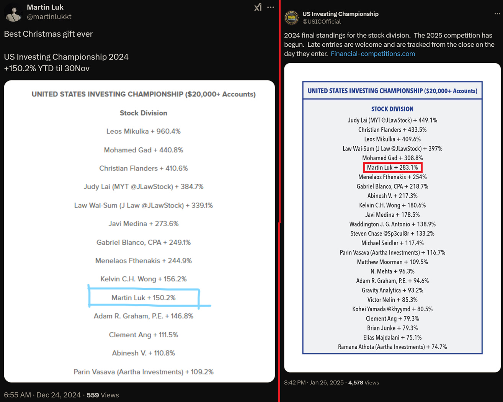

*Sources:[@martinlukkt](https://x.com/martinlukkt/status/1871449484066160646) and [@USICOfficial](https://x.com/USICOfficial/status/1883616540190450172) on 𝕏.*

[Martin](https://tradingresourcehub.substack.com/t/martin-luk) kindly agreed to share the key lessons he learnt in both 2024 and throughout his trading journey to date in this [guest post](https://tradingresourcehub.substack.com/t/guest-posts).

*Note: All views expressed are Martin’s; I just provided full writing and editing support. This included encouraging him to add more detail (context to his stories) to his first draft, because it contains many enlightening and hard-hitting moments I believe will resonate.*

**I strongly encourage you to take the time to read through his entire journey.**

## Martin’s trading journey

In late 2020, the Hong Kong government announced a HK$10,000 (US$1,280) cash payout scheme — which precisely met the minimum capital requirement for opening a brokerage account in Hong Kong.

I deposited the money, and that marked the start of my trading journey.

In the euphoric market, I tripled my account in three months. Sitting in front of my laptop at 21:30 every day, watching my account balance go up and up, was thrilling.

#### Things started going south after January 2021.

Market breadth began to decline and the money was flowing into large caps.

Most of my 2020 gains were from trading small caps and SPACs. I failed to switch my focus to large caps, and suffered a 50% drawdown in 2021 — death by a thousand cuts, making all the typical trader mistakes:

- FOMO
- Revenge trading
- Not respecting stops

My $501 entry in $GME — which was actually *higher* than the high of the daily candle, because I bought it pre-market — perfectly illustrated my inexperience:

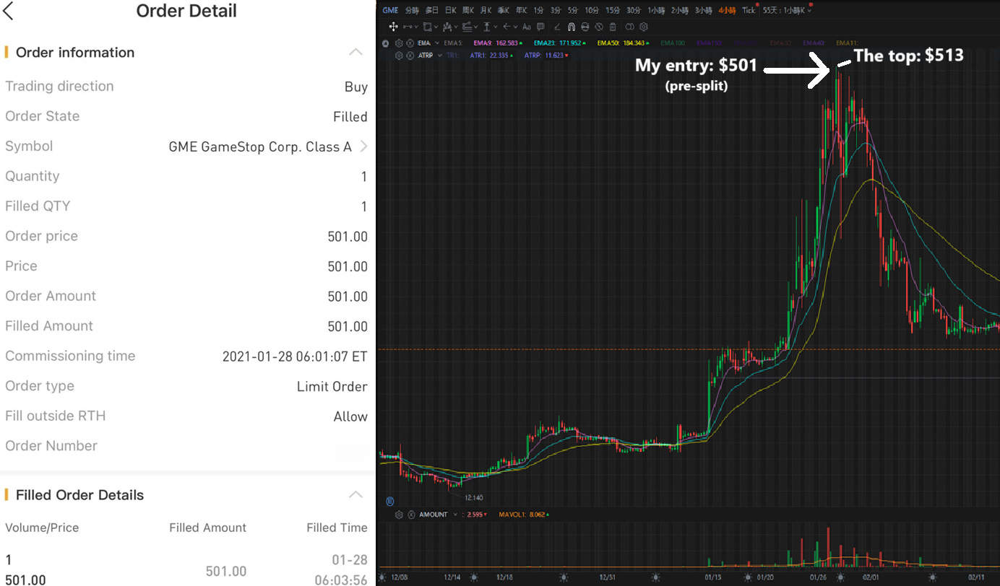

#### Slashing my account in half shattered all my fantasies about trading.

Fortunately, I didn’t quit.

I dedicated myself to studying and honing my trading skills, spending *hours*:

- Watching YouTube videos
- Listening to podcasts
- Studying charts
- Reading books

In late 2021, I discovered [Qullamaggie](https://open.substack.com/pub/tradingresourcehub/p/qullamaggie-stream-notes?r=2gmgdb&utm_campaign=post&utm_medium=web&showWelcomeOnShare=false), and was instantly intrigued by his trading style. Today, 80% of my trading comes from him.

*(Kristjan, thank you for your wholehearted contribution to the trading community. I’m now writing this stack to give back and hopefully learn together. I’ve also been sharing my trade analyses in [his Discord](https://discord.com/channels/748556589333741568/1326853304621465633).)*

Rewinding a little, 2022 was an interesting year, with the arrival of the bear market and market sentiment turned upside down.

Although I made some good trades, especially with $BOIL, revenge trading kicked in again, and random trades had me lose my January–May profits in June, and July–November profits in December.

#### Two bad months ruined my whole year.

**But my results would actually have been quite good if I hadn’t overtraded.**

2023 became a life-changing year in trading for me.

For the first three months, I couldn’t make any significant progress. Fortunately, I was on a semester exchange in Germany and travelling around Europe, which kept boredom and disappointment in trading at bay.

In late May, I realised +80% on a trade in $CVNA, setting a new all-time high in my P&L.

#### This was my ‘aha’ moment in trading.

**I realised my trading can actually make progress.**

This gave me confidence and I slowly developed sit-out power. I added $5,000 to my account, and didn’t make any big trades from August–October to control the drawdown.

In November, I spotted the strength in crypto, and bought $COIN and $MARA. In December, I suffered a big loss with $CLSK because I forgot to submit my stop loss order, but still finished 2023 with a +91% return (with a 23% win rate).

Last year, I joined USIC because I wanted to challenge myself and see if I could remain profitable under high pressure.

#### Two keys led to my USIC 2024 outperformance:

1. Minimise stops to elevate the risk–reward
2. Focus on high ADR stocks in the hot sector/theme

## 1. Minimise stops to elevate the risk–reward

When I started trading, I set my stops between 3–7%, simply copying the many traders using that range.

As I become more experienced, I tightened my stops to 1–5% (mostly), and avoided exceeding half of the stock’s average daily range (ADR) — so, no more than a 2.5% stop for a 5% ADR stock, etc. And I keep account risk at 0.5–1% per trade.

Over 80% of my trades in 2024 used stops of \<3.5%.

**Setting tighter stops has two big benefits:**

#### I. Limited psychological barrier to taking and accepting losses.

This means I can disregard losses and seek re-entry right after getting stopped out. Some of my big winners over the years, like $QUBT, were caught by re-entries.

However, frequent re-entries also caused many consecutive losing streaks, and combined with tight stops, hugely contributed to my overtrading problem. Last year’s win rate was 25%, and I suffered several losing streaks of 10 trades or more.

So, is seeking re-entry a net positive? Yes, **provided that [market conditions](https://tradingresourcehub.substack.com/t/situational-awareness) are right**.

#### II. A tighter stop can exponentially improve risk–reward.

This graph shows the parabolic relationship of the **tightness of a stop** and **risk–reward**:

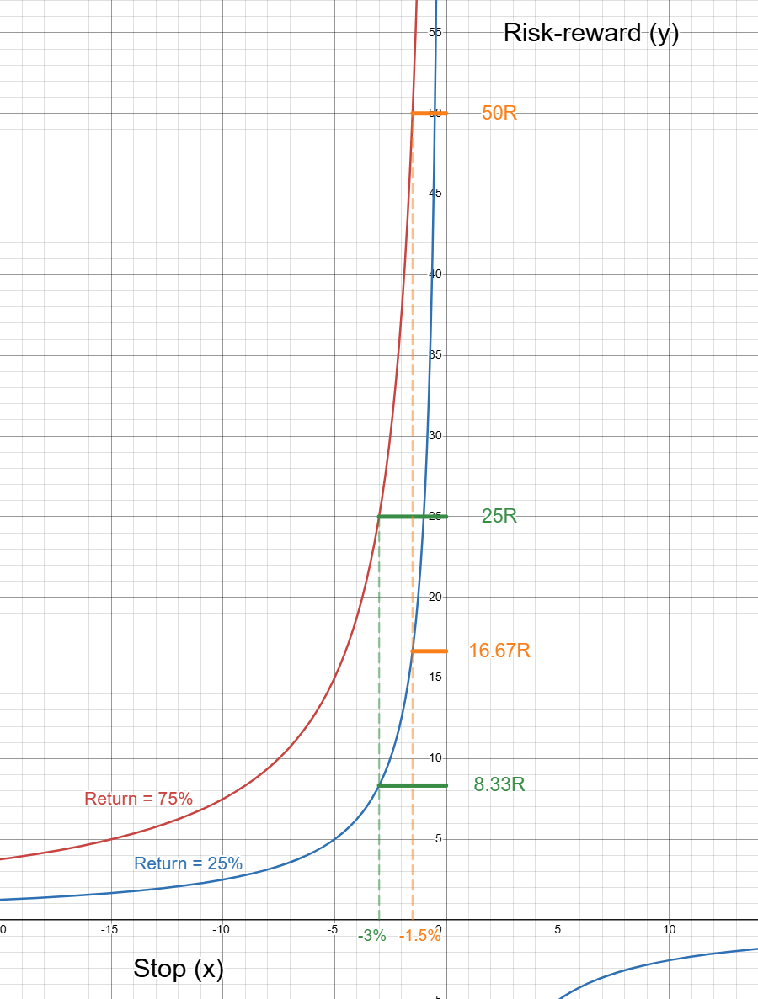

**The higher the return, the larger the absolute increase in R.** For example, when you tighten your stop by 50%, your R doubles.

And by tightening your stop from 3% to 1.5%, you can gain:

- An 8.34R advantage on a trade with a 25% return; and
- A 25R advantage on a trade with a 75% return.

I believe the best way to secure a high R is by tightening my stop\*, which also suits my personality. **We can’t predict the return before we enter a trade, but we can control and define the risk.**

*\*Kyna asked me how I avoid slippage. I currently don’t face problems with that, except when trading stocks below $5, for which I reduce my position size.*

#### Examples of my high R trades in 2024

##### $COIN: 12R (-2.87% stop)

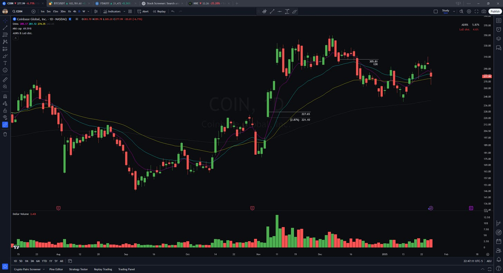

##### $GME: 54R (-3.23% stop)

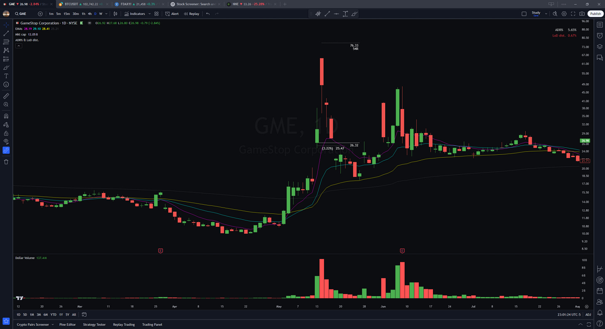

##### $LMND: 12R (-2.38% stop)

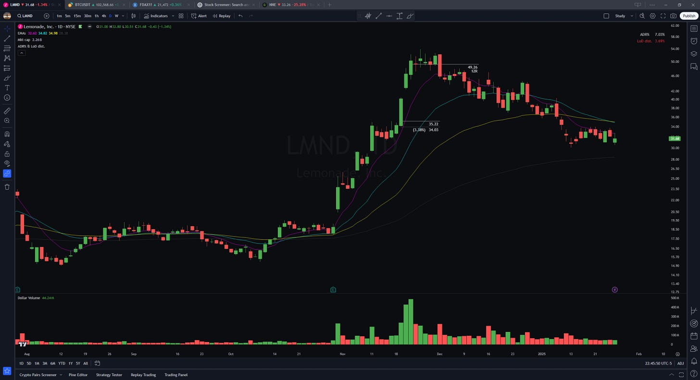

##### $SMCI: 22R (-2.75% stop)

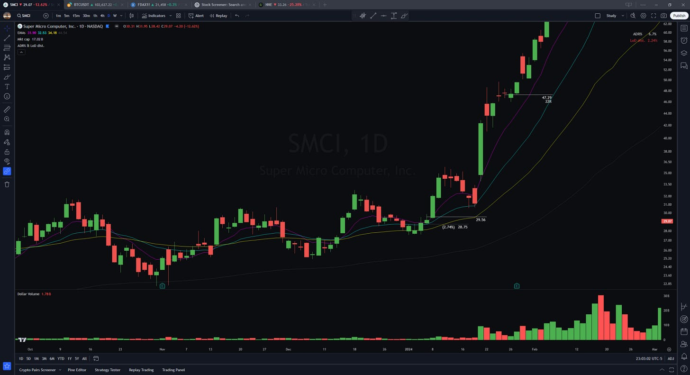

*(I exited $SMCI because I wanted to switch brokers. The switch cost me maybe 50R.)*

##### $SOFI: 19R (-1.97% stop)

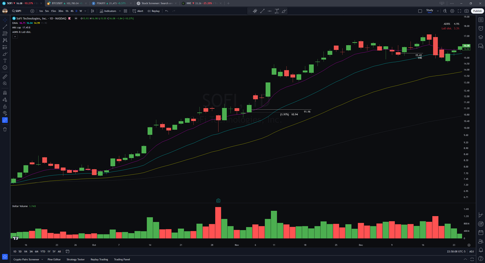

##### $SOUN: 23R (-4.21% stop)

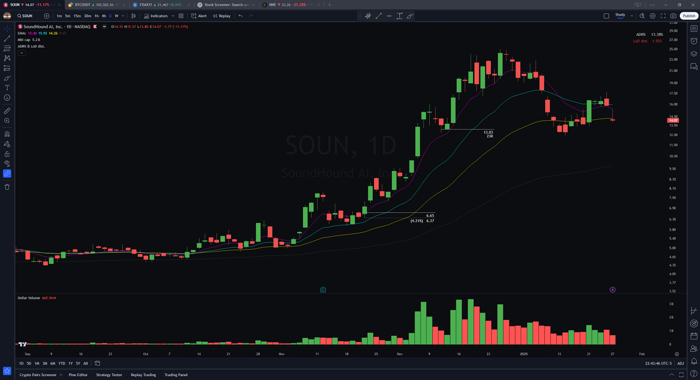

*(I didn’t follow my 9 EMA trailing stop sell rule and got punished for it.)*

## 2. Focus on high ADR stocks in the hot sector/theme

You maximise your odds of achieving **high risk–reward trades** if you combine:

- Setting tight stops, with…
- **Trading high ADR stocks**, because these tend to make the biggest moves in a short period.

I mainly trade stocks with **>5% ADR** for this reason (as illustrated by most trades above), but this isn’t a hard rule. I sometimes trade slower stocks with a tighter stop, depending on what’s working lately and the quality of the setup.

But there’s a more significant key to catching the big winners:

#### Recognising the hot themes early and following the trend.

2024 was a favourable year for speculators, given the many hot sectors that generated enormous moves in various [themes](https://base.report/blog/build-themed-watchlists?aff=e1BDR), including semiconductors, AI, nuclear, fintech and aerospace.

My approach for identifying hot themes early involves **tracking scanners** and **my own watchlists**:

- I spend around 30 minutes a day **scanning** for the previous day’s high performers (‘potent scan’) and pre-market gap-ups (‘pre-market scan’). On weekends, I also scan for the biggest movers of the past 30 days (‘leader scan’).
- I have five primary **watchlists**, including:
  - One main watchlist for the day;
  - One for small caps (\<$5B market cap); and
  - Three watchlists categorised by the stock’s strength based on its EMAs: 
    - Lead: 9 EMA > 21 EMA > 50 EMA.
    - Mediocre: 9 EMA > 21 EMA \< 50 EMA *or* 9 EMA \< 21 EMA > 50 EMA.
    - Lag: 9 EMA \< 21 EMA \< 50 EMA.

#### When *several* stocks within the same sector newly appear on my scans (so ***not*** existing leading themes), or ‘upgrade’ to a stronger watchlist, I pay more attention to them.

I monitor those stocks closely during the next pullback to look for entries.

For example, I’ll be paying more attention to the financial sector, since several financial stocks appeared in my potent scan on 28 January 2025:

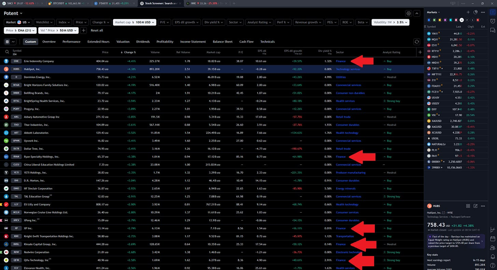

*Red arrows pointing at $ERIE, $RYAN, $XP, $KNSL and $QFIN.*

#### Of course, my journey as a trader started long before I joined USIC.

Here are four more key lessons I learnt along the way:

## 3. Treat trading as a lifelong business

Every trader makes mistakes, from overtrading to taking poor setups, not honouring stops, revenge trading, overleveraging… You name it.

**We all have moments when we make incorrect decisions and fail to follow our rules.**

Personally, I tended to overtrade when I was in a drawdown, trying to make back my losses as quickly as possible. These trades often led to further losses, making it more difficult for me to recover from the drawdown.

I frequently forced trades, trying to make progress on my equity curve without considering the market environment and maintaining discipline — even though I fully understand the importance of both.

#### I focused too much on the instant impact and failed to think about long-term growth.

One day, I was daydreaming, trying to imagine how my trading would look after 10 or 20 years.

I suddenly realised that if I truly want to:

- Become consistently profitable;
- Trade for the rest of my life; and
- Manage a much larger account…

**…I cannot make those simple mistakes and ruin my account again.**

I *cannot* make random trades and suffer a 20% drawdown. I *have* to follow the rules and make disciplined decisions.

#### If I keep overtrading now, I will still overtrade in the future, no matter how experienced I become or how big my account grows.

In that moment, I shifted my focus from short-term to long-term, and the urge to overtrade went away.

**Prioritise long-term thinking.** Focus on being disciplined and trust the [process](https://open.substack.com/pub/tradingresourcehub/p/mark-ritchie-ii-on-process?r=2gmgdb&utm_campaign=post&utm_medium=web&showWelcomeOnShare=false).

## 4. Journal your trades

In the early stages of my trading journey, I didn’t recognise the importance of creating a [trading journal](https://tradingresourcehub.substack.com/t/journaling) and evaluating my past trades.

Fortunately, I documented all my entries and exits in 2020–2023, which allowed me to review and learn from those trades last year.

Then, in June–August 2024, I suffered a 30% drawdown.

#### I also experienced the longest losing streak of my trading career: 18 consecutive losers.

This drained both my financial and mental capital.

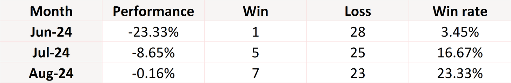

In late August, I began to reflect on my past trades.

I realised I’d also suffered from a significant drawdown due to overtrading in 2021, losing 50% of my account because I failed to adapt to changing market conditions and engaged in revenge trading.

#### It ultimately took 18 *months* to climb out of that trough and make back all the losses.

Knowing how hard it’d be to recover from a huge drawdown again, and seeing the many random trades in my journal I could’ve easily avoided, I told myself I couldn’t afford to trip over the same stone twice.

**So, I reduced my position sizes and started small ([progressive exposure](https://tradingresourcehub.substack.com/i/154300502/the-importance-of-progressive-exposure)).**

The result was consecutive best-performing months that significantly contributed to my outperformance last year.

## 5. Risk management first

Without risk management, traders are doomed to fail.

**It takes hundreds or thousands of trades to get rich, and only one trade to go bust.**

No matter what type of trader you are, what setups you take, or what view you have on the market, controlling risk should always be rule #1 in your trading system.

#### I never argue with the market.

When the market moves against me, I cut my losses while they’re small.

I define my stop before entering a trade, and place a hard stop as soon as I’m filled to ensure I adhere to my plan and avoid significant losses.

When the market tells me I’m wrong, I’m wrong. No second-guessing, no ego. Just exit now and evaluate later.

**Keep losses small and wait for the big gains to come.**

## 6. Be accountable for all actions

The market is always right — and when you’re wrong, you have no one to blame but yourself.

**Treat every failure as an opportunity to grow and improve.**

Finding reasons and excuses may improve your feelings, but not your P&L.

## What a difference four years make!

Besides the lessons above, **continuously evaluating past trades** and **having a growth mindset** are the keys that transformed me.

I went from:

- Buying the exact top of a parabolic move…
- …to becoming a top performer in USIC 2024.

**However, I don’t consider myself a consistently profitable trader — yet.** I still make amateur mistakes such as overtrading and revenge trading, which have led to drawdowns of >15% in a month.

But I’m determined to improve.

I *will* prevent these mistakes from happening again, and am striving to elevate my trading to the next level.

**I’ve already come a long way, but have much further to go.**
