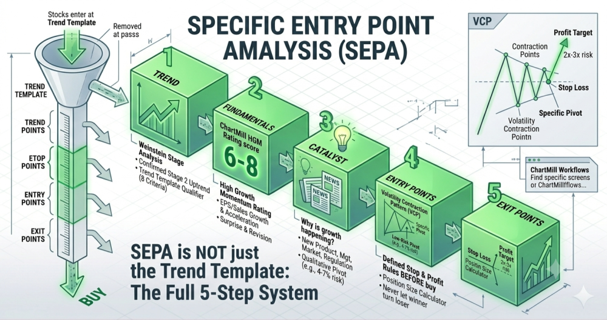
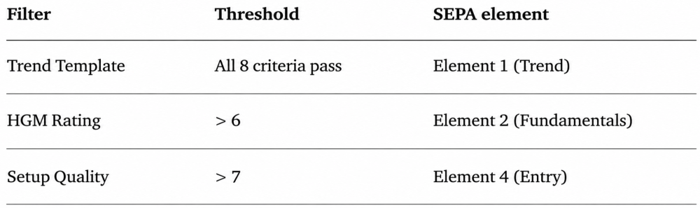

# SEPA Explained | Mark Minervini's Specific Entry Point Analysis System

**Autor:** Kristoff De Turck (recenzja: Aldwin Keppens)  
**Zaktualizowano:** 2026-07-06  
**Źródło:** https://www.chartmill.com/documentation/trading-and-investing/methodologies/523-SEPA-Explained-Mark-Minervinis-Specific-Entry-Point-Analysis-System  
**Pobrano:** 2026-10-22

---

Most Minervini readers come away with the Trend Template and assume that's the system. It isn't.

The Trend Template is one of five elements inside a broader framework Minervini calls **SEPA** - Specific Entry Point Analysis. The full system has trend, fundamentals, catalyst, entry, and exit.

Skip any of the five and the win rate Minervini describes in his books isn't the win rate you'll see in your account.

This article maps SEPA element by element to the ratings and screens on ChartMill, with the actual numbers Minervini uses for each step. The goal isn't to replace [*'Trade Like a Stock Market Wizard'* or *'Think and Trade Like a Champion'*](https://minerviniprivateaccess.com/books), those books are worth reading in full and re-reading every year.

The goal is to give you a working ChartMill workflow that respects all five elements at once, so the Trend Template stops being a standalone screen and starts being what Minervini designed it to be: one filter inside a much stricter funnel.

## What SEPA actually is

SEPA stands for **'Specific Entry Point Analysis'**.

It's the methodology Minervini codified after roughly thirty years of trading US growth stocks, with a publicly verified track record that includes the 1997 US Investing Championship. The name is precise on purpose. Minervini isn't interested in whether a stock is worth owning at some point. He's interested in when, exactly, the chart and the fundamentals line up to offer a low-risk entry into a high-probability move. Everything else in his framework is downstream of that question.

**The five elements of SEPA, in the order Minervini applies them:**

1. **Trend**: the stock must be in a confirmed Stage 2 uptrend
2. **Fundamentals**: the underlying business must show genuine, accelerating growth
3. **Catalyst**: something must explain why the growth is happening and why it can continue
4. **Entry Points**: the chart must offer a specific, low-risk pivot to act on
5. **Exit Points**: both the stop and the profit-taking discipline must be defined before you buy

The order is deliberate. Trend filters out 80% of the market in one step. Fundamentals knock out most of what's left. Catalyst forces you to articulate the thesis. Entry tells you the day and price. Exit tells you when to walk away or take profits.

Each element earns its place by removing a different failure mode, which is why running four out of five doesn't work, the one you skip is exactly the trap that finds you.

The **four pillars framework** on ChartMill ([The Four Pillars of Growth Investing on ChartMill](https://www.chartmill.com/documentation/trading-and-investing/methodologies/517-The-Four-Pillars-of-Growth-Investing-on-ChartMill)) maps cleanly to SEPA.

- Pillar 2 ([Relative Strength](https://www.chartmill.com/documentation/technical-analysis/indicators/33-Relative-Strength)) and the [Trend Template](https://www.chartmill.com/documentation/stock-screener/technical-analysis-trading-strategies/496-Mark-Minervini-Trend-Template-A-Step-by-Step-Guide-for-Beginners) both serve element 1.
- Pillar 1 ([High Growth Momentum](https://www.chartmill.com/documentation/fundamental-analysis/indicators-and-ratios/482-the-chartmill-high-growth-momentum-rating)) covers element 2.
- Pillar 3 ([Sector](https://www.chartmill.com/documentation/trading-and-investing/methodologies/393-Analyzing-sectors-and-industries-in-the-stock-market-sector-rotation)) isn't an explicit SEPA element but Minervini uses it constantly in interviews and Master Trader Program sessions.
- Pillar 4 ([Setup Quality](https://www.chartmill.com/documentation/technical-analysis/indicators/87-Chartmill-Technical-Rating-and-Setup-Quality-scores)) covers element 4. The link between the two frameworks is direct enough that if you already run the four pillars screen, you're already running most of SEPA. This article fills in the rest.

### Element 1 - Trend (the Trend Template)

The [Trend Template](https://www.chartmill.com/documentation/stock-screener/technical-analysis-trading-strategies/496-Mark-Minervini-Trend-Template-A-Step-by-Step-Guide-for-Beginners) is the most-quoted part of SEPA, and the part most readers stop at. It's a set of eight technical criteria that together define a healthy Stage 2 uptrend, Minervini's adaptation of [Stan Weinstein's stage analysis](https://www.chartmill.com/documentation/technical-analysis/indicators/92-Weinstein-Stage-Analysis-Indicators). A stock either passes all eight or it doesn't qualify. There is no partial credit.

**The eight criteria, as Minervini writes them in Trade Like a Stock Market Wizard:**

- The current price is above the 150-day and 200-day moving averages
- The 150-day moving average is above the 200-day moving average
- The 200-day moving average is in an uptrend (rising for at least one month, preferably four to five months)
- The 50-day moving average is above both the 150-day and 200-day moving averages
- The current price is above the 50-day moving average
- The current price is at least 30% above its 52-week low (preferably 100% or more)
- The current price is within 25% of its 52-week high (the closer the better)
- Relative strength ranking is no less than 70, with 80 or 90 preferred

On ChartMill, every one of those criteria is a single filter in the screener. The dedicated ['Mark Minervini Trend Template trading idea'](https://www.chartmill.com/trading-ideas/697-Mark-Minervini-Trend-Template) wires the whole template together so you don't have to assemble it by hand.

**Two practical notes that the book mentions but that get lost in most retellings.**

Criterion 8 uses Minervini's *"RS ranking"*, which is a relative strength score, not RSI. On ChartMill, that's CRS (ChartMill Relative Strength). Minervini's threshold of 70 is the minimum; he prefers 80 or 90, and so should you. CRS ≥ 80 lines the Trend Template up with Pillar 2 of the four pillars framework, and that's the threshold to default to.

Criterion 7 - *"within 25% of the 52-week high"* - is easy to misread. Minervini doesn't mean a stock that just hit a fresh high is automatically a buy. He means a stock that's holding near its high after building a healthy base. A name that just blew through the 25% threshold for the first time in months may still be too extended to enter. The Trend Template is a qualifier, not a trigger. The trigger is in element 4, the pivot.

That distinction is the most common mistake new Minervini readers make.

A passing Trend Template tells you the stock is in good enough shape to deserve further work. It does not tell you to buy today. If you treat the Trend Template as a buy signal, you'll consistently enter too late and get stopped out on the first normal pullback. The full ['Mark Minervini Strategy Part 1 - Technical and Fundamental Filters'](https://www.chartmill.com/documentation/stock-screener/fundamental-analysis-investing-strategies/464-Mark-Minervini-Strategy-Think-and-Trade-Like-a-Champion-Part-1) page goes into more detail on what each criterion actually means and how Minervini uses it in practice.

→ **Related deep dives:** ['How to Use Relative Strength Correctly for Growth Screening'](https://www.chartmill.com/documentation/trading-and-investing/methodologies/519-How-to-Use-Relative-Strength-Correctly), ['How to Spot True Market Leaders'](https://www.chartmill.com/documentation/trading-and-investing/methodologies/521-How-to-Spot-True-Market-Leaders-A-Checklist-for-Growth-Investors)

### Element 2 - Fundamentals

Minervini is often described as a technical trader, and that description is half right. He buys breakouts and trades patterns, but he refuses to buy a chart if the underlying business isn't growing. The Trend Template gets you a stock that's moving; the fundamental screen confirms that the move is supported by the business behind it.

**The fundamental criteria Minervini lays out in Trade Like a Stock Market Wizard:**

- Earnings growth of 25% or more in the most recent quarter (year-over-year)
- Sales growth of 20% or more, ideally accelerating
- Improving margins and expanding ROE (Minervini cites 17% as a working ROE floor, the same number William O'Neil uses)
- Positive earnings surprises and upward analyst revisions in recent quarters

Acceleration matters more than the absolute level, Minervini wants growth that's getting better, not growth that's plateauing. On ChartMill, the HGM Rating is built to capture exactly this combination.

The rating combines three categories (EPS and Sales Growth, Acceleration, and Surprise and Revision) into a single 0 to 10 score. A name passing the Trend Template with an HGM of 6 or higher has both the technical and fundamental sides of SEPA confirmed in one step. That's not a coincidence; the rating was designed to match the way [O'Neil](https://www.chartmill.com/documentation/stock-screener/fundamental-analysis-investing-strategies/418-a-CANSLIM-stock-screener--finding-high-growth-market-leaders) and Minervini frame quality growth.

The full breakdown of how the rating works, where the sweet spot sits, and what the underlying table tells you about the score lives in ChartMill's ['HGM Rating Explained — Score Reading, Workflow, and Real Winners'](https://www.chartmill.com/documentation/trading-and-investing/methodologies/518-ChartMills-HIgh-Growth-Momentum-Rating-Explained-Score-Reading-Workflow-and-Real-Winners).

One detail worth pulling forward here: the sweet spot is HGM 6 to 8, not HGM 10. A 10 is almost always a name everyone already knows and the market has already priced in. A 6 with strong CRS, a clean Trend Template, and a sub-industry that's rotating into leadership is usually a better SEPA setup than a 10 with a tired chart.

A working SEPA filter on the fundamental side: HGM ≥ 6. That's strict enough to remove the bottom 90% of the market and lenient enough to keep names that are early in their move. If you want a stricter filter for a smaller working list, raise it to 7. Above 8 you're looking at confirmation rather than discovery.

### Element 3 - Catalyst

This is the element nobody screens for and most readers skip. It's also the one Minervini talks about most in interviews when he's asked what separates his biggest winners from the average breakout.

A catalyst is the reason the growth is happening and the reason it can continue.

- New product.
- New management.
- New regulatory environment.
- New addressable market opening up.
- ...

A genuine catalyst is what gives the growth a runway long enough to support a multi-month or multi-year move. Without one, you're trading a stock that's growing because of a temporary tailwind, and the move will end with the tailwind.

You can't screen for a catalyst directly. What you can do is verify one is present before you buy. The work is qualitative: read the earnings call transcript for the most recent quarter, scan the news headlines on the ChartMill stock page, check whether analyst commentary has shifted recently.

The question to answer is simple: if a friend asked you in one sentence why this company is growing, could you answer it? If the answer is *"the chart looks good"* or *"it's been beating earnings"*, that's not a catalyst. That's an observation about the past.

**On ChartMill, three places hold most of what you need:**

- [The news tab](https://www.chartmill.com/stock/quote/AAPL/news) on the stock page surfaces recent material announcements and earnings reports
- [The forecast page](https://www.chartmill.com/stock/quote/NVDA/analyst-ratings) for the latest analyst price targets, stock forecast, EPS estimates, revenue projections, revisions, full estimates, rating distribution and upgrades/downgrades
- [The earnings page](https://www.chartmill.com/stock/quote/NFLX/earnings) for past quarterly earnings results, including EPS and revenue actuals, analyst estimates, and surprise percentages. This page focuses on historical performance

The point isn't to find a catalyst nobody else has noticed. The point is to confirm one exists before you act on the chart.

A Trend Template with HGM 7 and no identifiable catalyst is a setup waiting to fail. A Trend Template with HGM 7 and a clear product cycle, market expansion, or regulatory shift is the kind of setup Minervini talks about as a *"leading stock"*. The difference is whether the underlying story has staying power.

A practical filter: before you add a name to your watchlist, write down the catalyst in one sentence. If you can't, skip it. The discipline alone removes most of the marginal entries that erode a SEPA-style book.

### Element 4 - Entry Points (the pivot)

SEPA earns its name at this step. Specific Entry Point Analysis means the entry is not a range, not a *"buy when the chart looks ready"*, but a specific price level identified before you enter, with a specific stop calculated from it.

Minervini's preferred entry structure is the **Volatility Contraction Pattern**, almost always abbreviated as VCP. The full mechanics get their own deep dive in ['Mark Minervini Strategy | Think and Trade Like a Champion Part 2 | Trading Strategy'](https://www.chartmill.com/documentation/stock-screener/fundamental-analysis-investing-strategies/465-Mark-Minervini-Strategy-Think-and-Trade-Like-a-Champion-Trading-Strategy), but the short version: a VCP is a base where the stock pulls back, contracts, pulls back less, contracts again, and repeats two to six times. Each contraction is smaller in percentage terms than the previous one. Volume dries up through the contractions. The pivot is the high of the last contraction.

The mechanics aren't arbitrary. A series of progressively tighter contractions with declining volume means weak hands are getting flushed out and supply is being absorbed. When the stock breaks above the pivot on expanding volume, the supply that was overhead has thinned out, and the move can run with less resistance. That's the moment Minervini wants to be filling the position, not before and not after.

On ChartMill, the Setup Quality rating captures the structural side of this. Setup Quality scores chart structure from 0 to 10 based on consolidation pattern, base depth, volume behavior, and how the price sits relative to its key moving averages. A name passing the Trend Template with Setup Quality ≥ 6 (at least) or 7 (better) is in a base tight enough to be tradable. Setup Quality of 9 or 10 usually means the breakout has already happened, you're either chasing or waiting for the next base, depending on the structure.

**For SEPA specifically, the workflow is:**

- Trend Template + HGM ≥ 6 surfaces the universe
- Setup Quality 6 to 9 narrows it to names in a workable base
- Open the chart and verify the contractions and volume signature visually

**Important! The visual verification matters.**

Setup Quality is a quantitative composite; it can't tell you whether the base is the right shape in the Minervini sense. A VCP has a specific look. [Check the existing VCP examples](https://www.chartmill.com/documentation/stock-screener/fundamental-analysis-investing-strategies/465-Mark-Minervini-Strategy-Think-and-Trade-Like-a-Champion-Trading-Strategy) to calibrate your eye. After a few dozen charts, the pattern becomes obvious.

The pivot itself (the specific entry price) is the high of the most recent tight contraction. The stop sits just below the low of that same contraction, which keeps the initial risk to roughly the height of the final pullback. In a clean VCP, that risk is usually 4% to 7% from the pivot. That number matters, because it feeds directly into element 5.

### Element 5 - Exit Points (stops and profit rules)

SEPA's exit framework is what most retail traders skip when they paper-trade the strategy, and it's the reason their account doesn't perform like the book promised. Minervini is openly more conservative on the exit than almost any other public growth trader.

**The hard rules:**

- Maximum initial stop loss: 7% to 8%. Never wider. If the structure forces you to take more than that, the trade isn't a SEPA trade - skip it.
- Average loss across all losing trades: significantly tighter than the maximum. Minervini targets an average loss of 3% to 4%, which means most stops trigger well before the 7-8% maximum. This is only possible if you enter on a tight pivot, not a range.
- Minimum reward-to-risk ratio of 2:1, ideally 3:1. If the stock's realistic upside isn't at least twice the distance to your stop, the trade isn't worth taking even if everything else lines up.
- Profit-taking rule: lock in partial profits when the trade is up roughly 2x to 3x the initial risk. Minervini commonly takes a third to half off the table at that point, then trails the rest using a structural stop.
- Never let a winner turn into a loser. Once a trade has moved meaningfully into profit, the stop moves up to at least break-even. The rule isn't about technique; it's about the psychological cost of giving back a winner, which is what causes most growth traders to stop trusting their system.

The full risk and trade-management framework is in ['Mark Minervini Strategy Part 2 - Trading Strategy'](https://www.chartmill.com/documentation/stock-screener/fundamental-analysis-investing-strategies/465-Mark-Minervini-Strategy-Think-and-Trade-Like-a-Champion-Trading-Strategy), which is the existing ChartMill page covering Part 2 of his book *'Think and Trade Like a Champion'*. It walks through the average cost basis discipline, the 50% rule, the role of the initial stop versus the trailing stop, and the position-sizing logic that ties it all together. Read it. The exit framework is half the strategy.

**On ChartMill, the practical tooling for exits sits in three places:**

1. [The Position Size Calculator](https://www.chartmill.com/documentation/howto/tools/436-Position-size-calculator) takes your account size, your risk per trade, and the stop distance from the pivot, and returns the position size that puts the right amount at risk
2. [Price alerts](https://www.chartmill.com/documentation/video/72-How-to-use-ChartMill-part-11-Setting-up-alert-in-the-ChartMill-stock-screener) on the stock page handle the structural exit triggers (break of the 50-day moving average, break of a key swing low)
3. The CRS (ChartMill Relative Strength) reading and the Trend Template criteria can themselves act as exit signals, a stock that drops out of the Trend Template or whose CRS deteriorates from 90 to 60 over a few weeks is telling you something even if the price hasn't taken out your stop

The point isn't to mechanize every exit. The point is that every entry has an exit defined before you click buy. If you can't articulate the stop, the position size, and the conditions under which you'd take profits, you don't have a SEPA trade. You have a hope.

## The full SEPA screen on ChartMill

[Here's the working screen.](https://www.chartmill.com/trading-ideas/771-Mark-Minervini-Basic-Screen-Trend-Template-High-Growth-Momentum-Setup-Quality) Save it.

Run it daily. SEPA is an entry-driven strategy, and a clean pivot can form, fire, and be gone inside one or two sessions. Setup Quality can move from 7 to 9 in a single day when a base tightens into its final contraction; the volume signature on a VCP breakout is by definition a one-day event.

Weekly scanning works for the Four Pillars quality filter, where the goal is to surface durable growth names. SEPA is a different job. The whole point of Specific Entry Point Analysis is the specific entry, and you can't take a specific entry on a chart you only check on Sundays.

The output will typically be five to twenty names in a normal market, fewer in a correction, and occasionally close to zero in a deep bear regime. Empty lists are signal, not failure. When the market isn't offering SEPA setups, Minervini's advice is consistent across thirty years of interviews: hold cash, wait, don't force the next trade.

A working daily rhythm: scan after the close. By then the day's price action is locked in, the Trend Template and Setup Quality scores have updated, and you have the overnight session to do the catalyst check and write the exit plan before the next open. Names that pass the screen typically stay on the list for several days to a few weeks; the daily scan keeps you from missing the day the pivot actually triggers.

**Important!** What the screen doesn't do is automate elements 3 and 5. The catalyst question and the exit discipline are still your job. The screen surfaces candidates. You confirm the catalyst and write the exit plan before you act. Skip either step and the screen produces noise instead of signal.

## Six pre-built Trend Template + FA variants

The screen above pairs the Trend Template with HGM because HGM already rolls EPS growth, sales growth, acceleration, and surprises into one composite score, the fastest way to confirm elements 1 and 2 of SEPA in a single pass. It stays the default for the full SEPA workflow.

For readers who want to isolate one fundamental angle at a time instead of the composite, ChartMill also publishes six ready-made Trend Template + FA screens, splitting earnings vs. revenue and quarterly vs. yearly out separately:

- [Screen 1 — Yearly EPS](https://www.chartmill.com/trading-ideas/698-Mark-Minervini-Trend-Template-FA-Screen-1)
- [Screen 2 — Quarterly EPS](https://www.chartmill.com/trading-ideas/699-Mark-Minervini-Trend-Template-FA-Screen-2)
- [Screen 3 — Yearly Revenue](https://www.chartmill.com/trading-ideas/700-Mark-Minervini-Trend-Template-FA-Screen-3)
- [Screen 4 — Quarterly Revenue](https://www.chartmill.com/trading-ideas/701-Mark-Minervini-Trend-Template-FA-Screen-4)
- [Screen 5 — combines 1 and 3](https://www.chartmill.com/trading-ideas/702-Mark-Minervini-Trend-Template-FA-Screen-5)
- [Screen 6 — combines 2 and 4](https://www.chartmill.com/trading-ideas/703-Mark-Minervini-Trend-Template-FA-Screen-6)

The exact filter values behind each one, plus the optional revision, surprise, and margin add-ons, are already broken down in ['Mark Minervini Strategy Part 1'](https://www.chartmill.com/documentation/stock-screener/fundamental-analysis-investing-strategies/464-Mark-Minervini-Strategy-Think-and-Trade-Like-a-Champion-Part-1), this is just the pointer to the ready-made screens themselves.

## How SEPA fits inside the broader workflow

If you're already running the four pillars framework, SEPA isn't a replacement. It's a tighter version of pillars 1, 2, and 4, with a specific entry structure (VCP) and an explicit catalyst step layered on top.

The sector element - pillar 3 in the ChartMill framework - isn't an explicit SEPA bullet, but Minervini talks about it constantly in his Master Trader Program and his Twitter feed. He defaults to looking for leading stocks in leading groups, which is the same logic as the ['Sector First or Stock First top-down workflow'](https://www.chartmill.com/documentation/trading-and-investing/methodologies/522-Sector-First-or-Stock-First-Two-Workflows-for-Growth-Investors). If you want SEPA with a sector overlay, add Industry Strength ≥ 70 to the screen above. It will further narrow the list, and the names that survive will usually be the cleanest setups of the week.

One way to think about the relationship between the two frameworks: the four pillars are a generic growth screen that works across multiple US growth methodologies (CANSLIM, SEPA, GARP momentum, high-quality compounders). SEPA is a specific application of that screen, with Minervini's preferred entry structure and his stricter exit rules. If you already trust the four pillars, SEPA is the deeper layer underneath.

## Five common mistakes when applying SEPA

**A few traps that show up repeatedly in the inbox:**

- The first is treating the Trend Template as the whole system. The Trend Template is a qualifier. It tells you the stock is in good enough shape to deserve more work. It does not tell you to buy today. Most retail Minervini readers stop after the Trend Template and skip elements 2 through 5. Their results reflect that.
- The second is buying immediately when the Trend Template passes. The eight criteria can flip green during the middle of an extended run, well past any reasonable entry. The Trend Template confirms the trend; the pivot confirms the entry. They are two different decisions, taken on two different days.
- The third is ignoring the catalyst question. A passing Trend Template with HGM 7 and no identifiable catalyst is a trade waiting to disappoint. Force yourself to write the catalyst in one sentence before you put the name on the watchlist. The discipline removes most of the marginal entries.
- The fourth is widening the stop because the structure looks *"almost right"*. If the pivot doesn't allow a stop of 7-8% or less, skip the trade. Minervini is explicit: there will be another setup. Forcing a trade with a wider stop is how a 4% average loss turns into a 12% average loss, and that's the difference between a winning and a losing strategy.
- The fifth is paper-trading SEPA without the exit discipline. The full strategy includes partial profit-taking and the *"never let a winner turn into a loser"* rule. Skipping either one - especially the second - is how growth traders give back six months of work in two bad weeks. The exit framework is half the strategy. [Read Part 2 until it's automatic.](https://www.chartmill.com/documentation/stock-screener/fundamental-analysis-investing-strategies/465-Mark-Minervini-Strategy-Think-and-Trade-Like-a-Champion-Trading-Strategy)

## FAQ

### Is SEPA the same as the Trend Template?

No. The Trend Template is one of the five elements inside SEPA. The other four (fundamentals, catalyst, entry, exit) are equally important and are what separates a complete SEPA trade from a trade that just happens to pass eight technical criteria.

### Do I need to read Minervini's books before applying this?

Yes! The article gives you a working screen and the core mechanics. The books themselves, especially Trade Like a Stock Market Wizard and Think and Trade Like a Champion, go far deeper into the psychology and the trade-management side. They're worth the time. The ChartMill pages are a starting point, not a replacement.

### Does SEPA work outside the US market?

The mechanics work anywhere there's enough liquidity to support orderly base structures and visible volume. In practice, Minervini focuses almost entirely on US-listed names, and so does the ChartMill Trend Template screener. For other markets, the same logic applies but you may want to relax the CRS threshold slightly to account for thinner universes.

### What's the difference between CRS and RS in Minervini's book?

CRS (ChartMill Relative Strength) is ChartMill's proprietary relative strength rating, calculated against the broader US universe across multiple timeframes. Minervini's "RS rank" in Trade Like a Stock Market Wizard refers to the same concept, relative strength against the market, scored as a percentile. The two are functionally the same metric calculated on different underlying datasets. Both run 1 to 99. Minervini's minimum of 70 maps directly to CRS ≥ 70.

### Can I use SEPA without the catalyst step?

You can run the screen, but the win rate degrades. The catalyst question forces you to articulate why the growth is real and why it can continue. Without it, you're trusting the rating and the chart to tell you a story that you haven't independently verified. Some trades will work anyway. Many won't. The discipline of writing the catalyst in one sentence is the cheapest filter you can apply.

### How long should I hold a SEPA winner?

Until the structural exit triggers. Break of the 50-day moving average on volume, break of a key swing low, deterioration in CRS, or breakdown of the Trend Template criteria are all exit signals. Some winners run for a few weeks; others run for a year. Minervini's exit framework is structural, not time-based, which is why the average winning trade is several times larger than the average losing trade in his publicly reported results.

---

**Bottom line:** SEPA isn't a screen, it's a sequence. Trend, fundamentals, catalyst, entry, exit, in that order, with no skipped steps. Most retail Minervini readers run two of the five and wonder why the results don't match the book. Run all five with the ChartMill screen above, write the catalyst in one sentence before each entry, and define the exit before you click buy.

The framework does the rest.

Trade Safe!
