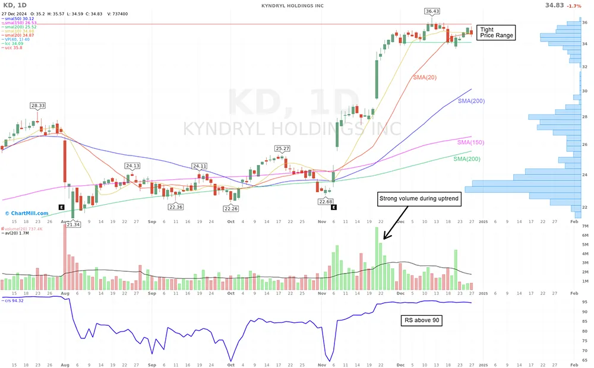

# Mark Minervini’s Trend Template: A Step-by-Step Guide for Beginners

**Autor:** Kristoff De Turck (recenzja: Aldwin Keppens)  
**Zaktualizowano:** 2025-01-10  
**Źródło:** https://www.chartmill.com/documentation/stock-screener/technical-analysis-trading-strategies/496-Mark-Minervini-Trend-Template-A-Step-by-Step-Guide-for-Beginners  
**Pobrano:** 2026-10-22

---

Mark Minervini is a legendary trader and author renowned for his ability to identify high-potential stocks with explosive growth potential. One of his most popular tools for stock selection is the Trend Template, a systematic approach that helps traders screen for strong stocks during trending markets.

This guide will break down Minervini’s Trend Template into simple, actionable steps, making it accessible to beginners.

## What is the Mark Minervini Trend Template?

The Trend Template is a set of technical criteria designed to identify stocks in strong uptrends. It focuses on price action, moving averages, and relative strength to ensure that the stocks meet a high standard of performance.

By adhering to these criteria, traders ensure that all selected stocks exhibit a strong upward trend (stage 2) in the short and long term.

## The 8 Criteria of Minervini’s Trend Template

To apply the Trend Template effectively, ensure that the stock meets these criteria:

### Current Price Above the 150-Day Moving Average (MA)

- The stock’s price must trade above its 150-day MA to indicate a positive long-term trend.

### Current Price Above the 200-Day Moving Average (MA)

- The 200-day MA is a widely used benchmark for long-term trends. A stock above this level is generally considered to be in a bull market phase.

### 150-Day Moving Average Trending Upwards

- The slope of the 150-day MA must be rising, signifying sustained upward momentum.

### 200-Day Moving Average Trending Upwards

- Similarly, the 200-day MA should also be trending upwards, confirming long-term strength.

### 50-Day Moving Average Above the 150-Day Moving Average

- The 50-day MA crossing above the 150-day MA is a bullish signal that indicates accelerating momentum.

### 50-Day Moving Average Above the 200-Day Moving Average

- This further reinforces the stock’s strength and confirms alignment across multiple timeframes.

### Current Price At Least 30% Above Its 52-Week Low

- Stocks that have risen significantly from their lows often exhibit strong recovery trends and growth potential.

### Current Price Within 25% of Its 52-Week High

- Stocks near their yearly highs tend to have stronger momentum and are often leaders in their industry or market.

### Relative Strength above 70

- The [relative strength ranking](https://www.chartmill.com/documentation/technical-analysis/indicators/33-Relative-Strength) is no less than 70, and preferable in the 80s or 90s, which will generally be the case with the better selections.

## How to Spot Ideal Stocks Using the Trend Template

### Use the ChartMill Stock Screener

Use a tool such as the ChartMill stock screener to filter stocks based on Minervini's criteria. All the filters listed above are available in the screener, moving average parameters, price thresholds and relative strength criteria. Moreover, all these filters can be fine-tuned to your own liking.

Better yet, we have created our own specific ChartMill 'Minervini Trend Template' Trading Idea that allows you to apply the filter with just one click!

- [Direct link to the Minervini Trend Template Trading Idea in ChartMill](https://www.chartmill.com/trading-ideas/697-Mark-Minervini-Trend-Template)

### Focus on Strong Sectors

Market leaders often belong to strong-performing sectors. Use sector performance tools to identify where the money is flowing, and prioritize stocks in those areas.

- Both our [sector](https://www.chartmill.com/stock/sector) and [Market Monitor](https://www.chartmill.com/stock/market-monitor) page are an ideal starting point to this end.

### Analyze Price Charts

Examine the price action of potential candidates:

Look for tight price consolidations or bullish chart patterns such as the Minervini's Volatility Contraction Pattern. Be sure to avoid stocks with erratic price movements or excessive volatility.

- More about the VCP pattern can be found in our article [“Mark Minervini Strategy | Think and Trade Like a Champion Part 2 | Trading Strategy.”](https://www.chartmill.com/documentation/stock-screener/fundamental-analysis-investing-strategies/465-Mark-Minervini-Strategy-Think-and-Trade-Like-a-Champion-Trading-Strategy)

### Check Volume Trends

Volume should confirm price action. Rising prices on increasing volume indicate institutional buying, a positive sign of strength.

- Gain a better understanding of why volume is important. To find out, read our article [“The Importance of Volume in Trading and Investing".](https://www.chartmill.com/documentation/trading-and-investing/methodologies/391-the-importance-of-volume-in-trading-and-investing)

### Combine with Relative Strength (RS)

Minervini often emphasizes the importance of relative strength:

Look for stocks with an RS score of 85 or higher, indicating they outperform 85% of the market and don't forget to compare RS scores within the same sector to identify leaders.

- For more detailed information on relative strength, consult this article: [“Relative Strength Performance Filter.”](https://www.chartmill.com/documentation/technical-analysis/indicators/33-Relative-Strength)

## Practical Example of the Trend Template

Let's have a look at the daily chart of [KYNDRYL HOLDINGS INC](https://www.chartmill.com/stock/quote/KD)

- Current price: $34.83
- 150-day MA: $26.53 (trending upward, above 200-day MA)
- 200-day MA: $25.52 (trending upward)
- 50-day MA: $30.12 (above 150-day and 200-day MAs)
- 52-week low: $19.23 (current price is 78% above this level)
- 52-week high: $36.43 (current price is 4.5% of this level
- Relative Strength is very high, above 94

As such, KD stock meets all the criteria of the Trend Template, making it a strong candidate for further analysis.

## Some helpful tips before you start using the trend template.

- Start small: Focus on a manageable list of stocks to avoid becoming overwhelmed.
- Use alerts: Set alerts on your screener for stocks that meet the criteria of the Trend Template filter. In ChartMill, it is possible to set alerts based on this trading idea. To do so, you must first check the Mark Minervini Trend Template on this page as a favorite Trading Idea.
- Alerts can be set for one specific stock but also for stock lists. More information on how to set alerts [can be found here](https://www.chartmill.com/documentation/howto/tools/165-Creating-Stock-Alerts) and in [this video](https://www.chartmill.com/documentation/video/72-How-to-use-ChartMill-part-11-Setting-up-alert-in-the-ChartMill-stock-screener).
- Discipline: Don't go after stocks that meet even one of the criteria; stick to the process.

## Conclusion

Mark Minervini's Trend Template is a powerful tool for identifying promising stocks in strong uptrends. By following the criteria and combining them with sector analysis, chart patterns and volume trends, you can significantly improve your stock selection process.

Use a stock screener like ChartMill to simplify your search and quickly find the most suitable candidates that meet your personal selection criteria.
