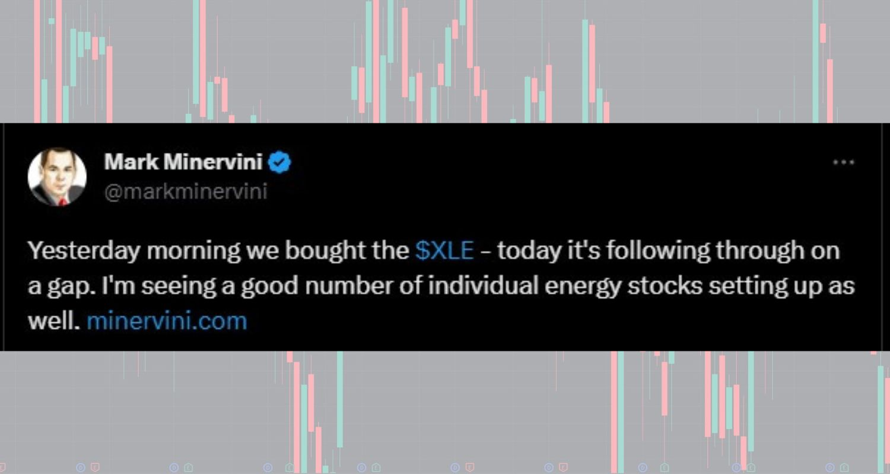
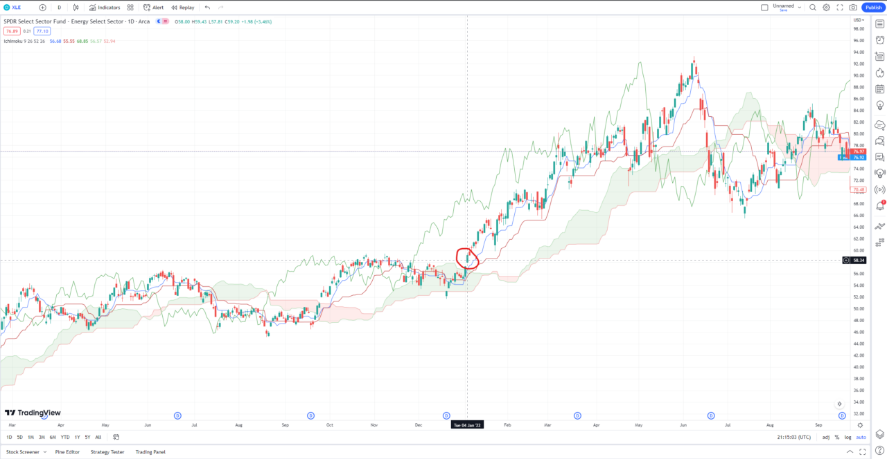

# Mark Minervini Trading Strategy: SEPA, VCP, and Trend Template

**Autor:** Financial Tech Wiz  
**Opublikowano:** 2022-08-24  
**Zaktualizowano:** 2026-08-29  
**Źródło:** https://www.financialtechwiz.com/post/mark-minervini-trading-strategy/  
**Pobrano:** 2026-10-22

---

Stock market wizard Mark Minervini has won two U.S. Investing Championships using a growth-stock momentum methodology called SEPA, built around a strict 8-point Trend Template and the Volatility Contraction Pattern (VCP) breakout. This guide breaks down every part of the system: the SEPA framework, the Trend Template criteria, the VCP setup, the risk rules, and a real Minervini trade.

## Key Takeaways

- SEPA (Specific Entry Point Analysis) is Minervini’s complete framework: Specific Entry Point, Earnings, Price Action, and Announcement/Catalyst all have to line up before a trade passes the filter.
- The 8-point Trend Template is the first screen. If a stock fails any single criterion (moving-average stack, distance from 52-week high and low, RS rating of 70 or higher), it is not a buy candidate.
- Risk is pre-written before entry: a 7 to 8 percent maximum stop, 1.25 to 2.5 percent of account equity at risk per trade, and progressive pyramiding into confirmed winners.

## Mark Minervini’s Trading Strategy

Mark Minervini is known for trading fast-moving growth stocks with a concrete entry and exit plan. His approach combines technical analysis, fundamental analysis, and strict risk management, and he is adamant that timing the entry is as important as picking the right stock.

Minervini is most famous for trading the Volatility Contraction Pattern (VCP), a base pattern that traces back to Jesse Livermore, William J. O’Neil, and Richard D. Wyckoff. He was profiled in Jack Schwager’s book [*Stock Market Wizards*](https://amzn.to/3CvSx5Q), which is where most traders first hear his name.

Minervini’s track record is audited and documented. In 1997 he won the U.S. Investing Championship with a 255% annual return on $250,000 of his own money. He won again in 2021 in the $1,000,000 category with an audited 334.8% annual return. Those two numbers are what put his methodology on the map.

## What Is SEPA? Mark Minervini’s Trading Methodology

SEPA stands for Specific Entry Point Analysis. It is Minervini’s complete stock-selection framework, and the letters spell out the four components a trade has to satisfy.

**S: Specific Entry Point.** The exact price and timing of the entry. In practice this is the pivot point where a stock breaks out of its VCP on expanding volume. Minervini does not chase price extended from the pivot; he either gets in on the breakout or waits for the next setup.

**E: Earnings.** Fundamentals have to confirm the technical setup. Minervini looks for accelerating quarterly earnings growth, ideally 20% or better year over year, with sales accelerating alongside earnings and profit margins expanding. Earnings surprises and upward guidance revisions are bigger green lights.

**P: Price Action.** The technical setup has to be clean. That means a Volatility Contraction Pattern inside a Stage 2 uptrend, with the moving-average stack in the right order (50-day above 150-day, 150-day above 200-day, 200-day rising). The Trend Template covered below is the checklist for this step.

**A: Announcement/Catalyst.** There has to be a reason a large institution would want to buy this stock now. New products, a guidance raise, a contract win, a management change, a regulatory approval, or a clear industry tailwind. Breakouts without a catalyst tend to fail.

What makes SEPA different from a purely technical or purely fundamental system is the insistence on confluence. A perfect VCP without earnings growth fails the test. Strong earnings without the right price action gets rejected. All four letters have to be lit up at the same time.

## Stage Analysis: Why Minervini Only Buys Stage 2

Before Minervini runs the Trend Template, he decides what stage a stock is in. He borrowed the four-stage framework from Stan Weinstein’s *Secrets for Profiting in Bull and Bear Markets*, and it is the filter that decides whether a name is even worth screening.

**Stage 1: Consolidation.** The stock is flat. Price is ranging sideways after a prior downtrend, moving averages are flattening, and volume is dull. These are not buys. They can become buys, but not yet.

**Stage 2: Advancing.** The stock has broken out of its Stage 1 base on volume, the 50-day moving average is rising, and the 200-day has turned up. Price is making higher highs and higher lows, institutions are accumulating, and the Trend Template will start to pass. This is the only stage Minervini buys in.

**Stage 3: Topping.** The advance stalls. Pullbacks get deeper, rallies fail to make new highs, and the 200-day flattens. Minervini is exiting here, not entering.

**Stage 4: Declining.** The stock rolls over. Moving averages stack in reverse (50-day below 150-day below 200-day), and price makes lower highs and lower lows. No longs here, ever. Minervini does not bottom-fish.

Every SEPA buy candidate has to be in Stage 2, full stop. The Trend Template is the mechanical test that proves it.

## The Trend Template: 8 Criteria for a Stage 2 Stock

Before a stock gets past the Price Action filter, it has to satisfy the Trend Template, an 8-point checklist Minervini published in *Trade Like a Stock Market Wizard*. A name that fails any one item is out.

1. Current price is above both the 150-day (30-week) and the 200-day (40-week) moving averages.
2. The 150-day moving average is above the 200-day moving average.
3. The 200-day moving average is trending up and is higher than it was 30 days ago (ideally rising for four to five months or longer).
4. The 50-day moving average is above both the 150-day and the 200-day moving averages.
5. Current price is above the 50-day moving average.
6. Current price is at least 30% above its 52-week low.
7. Current price is within 25% of its 52-week high (the closer to a new high the better).
8. Relative Strength (RS) rating of at least 70, preferably in the 80s or 90s relative to the broader market.

The point of the template is to filter for stocks that are already in Stage 2. Minervini borrows Stan Weinstein’s stage analysis: Stage 1 is basing, Stage 2 is advancing, Stage 3 is topping, Stage 4 is declining. Minervini only buys Stage 2 names. A stock that fails the template is not a short candidate; it is simply not a candidate for this system at all.

Most traders run the Trend Template inside a screener. [TrendSpider](https://www.financialtechwiz.com/post/trendspider-free-trial/) and TC2000 both have preset Minervini-style filters, and some traders run it manually on TradingView.

## What is the Volatility Contraction Pattern (VCP)?

The VCP is the price base Minervini waits for inside a Stage 2 uptrend. It appears when a stock in a strong advance pauses, and a series of pullbacks gets progressively smaller while volume dries up. Selling pressure is being absorbed by institutional buyers, and the stock is coiling up for its next leg.

Three features define a clean VCP: a strong prior uptrend (Stage 2), a base with two to six pullbacks where each contraction is smaller than the one before (for example 25%, then 12%, then 6%), and declining volume into the final contraction. The entry is the breakout above the pivot point on expanding volume. The stop goes just below the low of the final contraction.

For the full pattern-identification walkthrough with chart examples, see the dedicated guide to the [Volatility Contraction Pattern (VCP)](https://www.financialtechwiz.com/post/volatility-contraction-pattern-vcp/). This section sticks to how the VCP fits inside SEPA; the VCP guide covers the pattern mechanics in depth.

The VCP is one setup within a broader library of base patterns. For a complete reference on [chart patterns](https://www.financialtechwiz.com/post/chart-patterns/) used in breakout trading, including flags, ascending triangles, and cup-and-handle formations, see the full pattern guide.

## Risk Management and Position Sizing in SEPA

Minervini’s written rule is to never lose more than 1.25% to 2.5% of total account equity on a single trade. The percentage is a function of two decisions: how far below the entry the stop sits, and how large the position is.

A typical example: if the stop on a breakout is 7% below the entry, the largest position that keeps total account risk at 1.25% is roughly 18% of the account. If the stop can be tightened to 5% because the setup is low-volatility, the position can be larger. Position size is the output of the risk budget, not a fixed dollar amount.

Minervini also uses progressive exposure. He does not start at full size. He buys a starter position, watches how the stock reacts, and pyramids up on confirmation. A stock that turns red on the entry day is cut fast. A stock that works gets added to on the way up.

The math only works if winners are materially larger than losers. Minervini keeps his average gain to average loss ratio above 2 to 1 and often above 3 to 1. Cutting losses at 7 to 8 percent while letting winners run to 20 to 25 percent and beyond is the engine behind the audited championship returns.

This is where a journal matters. Logging every Minervini-style setup in the [Financial Tech Wiz Trading Journal](https://journal.financialtechwiz.com/) lets you see your real hit rate on VCP breakouts, your actual average R multiple, and which stage of the trend you genuinely trade best in. If you are not ready for a paid app, the [free trading journal template](https://www.financialtechwiz.com/free-trading-journal-template/) for Google Sheets tracks entries, stops, partials, and performance against the S&P 500.

## Common Mistakes Traders Make With SEPA and VCP Setups

The methodology looks simple on paper and is unforgiving in practice. A handful of mistakes account for most of the bad trades that come out of traders trying to run this system.

**Buying extended from the pivot.** The entry is the pivot, not several percent above it. If a stock has already run 10% off the pivot by the time you see it, the risk-to-reward math is broken and the stop is too far away. Skip it and wait for the next setup.

**Weak prior uptrend.** A VCP only works inside Stage 2. A base that forms before the stock has actually made progress off a Stage 1 breakout is usually a trap. If the moving averages are still tangled or the 200-day is flat, the pattern is cosmetic.

**Ignoring earnings.** A clean technical VCP without accelerating earnings growth is a technical mirage. Minervini has written about this repeatedly: the SEPA “E” exists because technically perfect charts without fundamental support tend to break down inside a few weeks.

**Widening the stop.** The single fastest way to blow up an account running this strategy is to “give the stock room” after it violates the stop. The stop is a pre-committed number. Moving it down once the trade is open is not risk management, it is a new trade at a worse price with worse odds.

**Averaging down.** Minervini has been explicit that adding to losers is not in the playbook. Pyramiding is for confirmed winners only.

## A Real Trade Mark Minervini Took

On January 4, 2022, [Minervini tweeted](https://twitter.com/markminervini/status/1478377983245230080) that he had bought the ticker symbol $XLE the day before. After he entered, the ETF rallied over 70% to its peak. Minervini based the trade on both technical and fundamental reasons, so it is worth breaking down what he saw.

### $XLE’s technical setup

On the weekly chart below, the entry sits inside a textbook VCP. $XLE was trending up, making higher lows, and breaking out of a tight consolidation. The Ichimoku green cloud on the chart confirmed the Stage 2 uptrend. Minervini could have waited for a full, clean breakout, but if the trend had reversed he would have stopped out anyway, which is the whole point of having pre-written exit rules.

If you want to start charting setups like this, new users can usually [grab a TradingView free trial](https://www.tradingview.com/?aff_id=109144&source=minervinistrat) to get access to one of the best charting tools available.

### $XLE’s fundamental setup

At the time of the trade, energy was the top-performing sector with accelerating relative strength. Oil prices were recovering sharply from the 2020 collapse, OPEC supply discipline was holding, and the major oil companies were seeing accelerating earnings revisions. That is the announcement/catalyst layer of SEPA: a macro tailwind any large institution would want exposure to, with a technical VCP giving the specific entry.

## Mark Minervini’s Books

If you want the full methodology straight from Minervini, his books cover SEPA, the Trend Template, the VCP, and the risk framework in depth. For the complete reading order and which book to start with, see the guide to [Mark Minervini’s books in order](https://www.financialtechwiz.com/post/mark-minervini-books-in-order/).

- [*Trade Like a Stock Market Wizard: How to Achieve Super Performance in Stocks in Any Market*](https://amzn.to/3wrBA8w)
- [*Think & Trade Like a Champion: The Secrets, Rules & Blunt Truths of a Stock Market Wizard*](https://amzn.to/3ALmrla)
- [*Momentum Masters: A Roundtable Interview with Super Traders with Minervini, Ryan, Zanger & Ritchie II*](https://amzn.to/3ckOyhM)
- [*Mindset Secrets for Winning: How to Bring Personal Power to Everything You Do*](https://amzn.to/3AKfJfa)

## Mark Minervini’s Net Worth

As of 2026, Mark Minervini’s net worth is estimated at around $30 million, built from his own trading capital and his training and education business. Public estimates peg his annual income at roughly $3 million, though Minervini does not publish his full account balance and has said the real number fluctuates with his positions.

For a sense of what the other end of the day trading spectrum looks like, here is the breakdown of [Ross Cameron’s net worth and verified trading results](https://www.financialtechwiz.com/post/ross-cameron-net-worth/).

## FAQs

### What is Mark Minervini’s trading strategy?

Mark Minervini’s strategy is a growth-stock momentum system he calls SEPA (Specific Entry Point Analysis). It filters candidates with an 8-point Trend Template, confirms accelerating fundamentals, waits for a Volatility Contraction Pattern (VCP) breakout on expanding volume, and sets a pre-written exit plan before the entry. Only Stage 2 uptrending stocks qualify.

### What is SEPA trading?

SEPA stands for Specific Entry Point Analysis. It is Minervini’s four-part framework: Specific Entry Point, Earnings, Price Action, and Announcement/Catalyst. Every trade he takes has to pass all four filters before position size is calculated and the stop is placed.

### Is Mark Minervini a swing trader or a day trader?

Minervini is a swing trader with a position-trader lean. His typical holding period runs from a few weeks to several months, depending on how the stock acts after a VCP breakout. He is not a day trader and does not scalp. Positions are held as long as the Stage 2 uptrend remains intact and cut the moment the trailing stop is breached.

### What are Mark Minervini’s sell rules?

The maximum hard stop is 7 to 8 percent below the entry, and often tighter on low-volatility setups. Minervini takes partial profits into strength, typically at a 2 to 3 R multiple, moves the stop to breakeven once a reasonable gain is established, and trails the remaining position using either a moving average or a swing-low structure. Exits are rules, not reactions.

### What is Mark Minervini’s track record?

Minervini won the U.S. Investing Championship in 1997 with a 255% audited annual return on $250,000 of his own money. He won again in 2021 in the $1,000,000 category with an audited 334.8% annual return. He was profiled in Jack Schwager’s *Stock Market Wizards*, which is where most traders first encounter his work.
