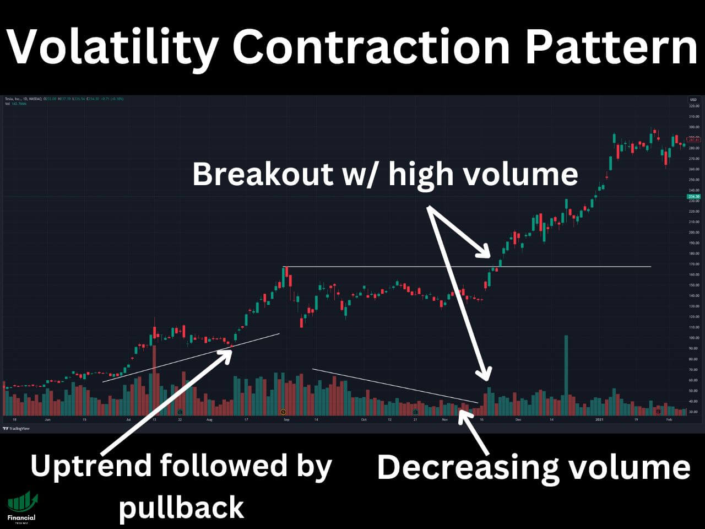

# Volatility Contraction Pattern (VCP): How to Identify, Scan, and Trade It

**Autor:** Financial Tech Wiz  
**Opublikowano:** 2023-04-13  
**Zaktualizowano:** 2026-09-24  
**Źródło:** https://www.financialtechwiz.com/post/volatility-contraction-pattern-vcp/  
**Pobrano:** 2026-10-22

---

The volatility contraction pattern, or VCP, is a base a stock forms inside an existing uptrend: each pullback gets smaller than the one before it, on shrinking volume, right up until the stock breaks out on a surge of buying. If you have ever searched “what is VCP in trading” and landed on a vague answer, this guide covers the full mechanics: how to spot the contractions, how to screen for live setups before the breakout, and how to manage the trade once it triggers.

## Key Takeaways

- A VCP is 2 to 6 progressively smaller pullbacks on falling volume inside a strong uptrend; the entry trigger is a breakout above the pivot on rising volume, with the stop just below the final contraction’s low.
- Mark Minervini popularized the VCP as the core setup inside his SEPA trading method, but the pattern itself can be identified, screened, and traded on its own, independent of his full system.
- Manual scanning does not scale to thousands of tickers; automated screening tools like TrendSpider can flag tightening-range, falling-volume candidates in a strong uptrend so you only chart the shortlist by hand.

## What Is the Volatility Contraction Pattern?

The roots of the VCP trace back to Richard Wyckoff’s original “wave” observations on how institutional buyers absorb supply before a markup phase, and the pattern shares DNA with a simple bull flag. It was Mark Minervini who isolated it, named it, and built a full trading method around it, detailed in his books and interviews. For the complete strategy built around this pattern, including Stage Analysis and the 8-point Trend Template, see [Minervini’s full SEPA trading strategy](https://www.financialtechwiz.com/post/mark-minervini-trading-strategy/); this guide focuses specifically on the VCP pattern itself: how to identify it, screen for it, and trade it.

*Image from TradingView*

## How to Identify a VCP: The Four Stages

A textbook VCP forms in four stages:

1. **Strong underlying demand**: a stock in a confirmed uptrend, ideally a Stage 2 advance, sets up the conditions for a VCP.
2. **An initial pullback**: after a sharp run, the stock pulls back on rising or steady volume as short-term profit-taking kicks in.
3. **Progressively tighter contractions**: each subsequent pullback is smaller than the last, both in percentage terms (a common sequence looks like 25 percent, then 12 percent, then 6 percent) and in duration, while volume dries up on every leg down. Most clean VCPs show 2 to 6 of these contractions.
4. **The breakout**: buyers overwhelm the shrinking supply and the stock breaks out above the pivot point on a clear surge in volume, ideally 40 to 50 percent above the stock’s average daily volume.

## VCP vs Other Chart Patterns

The VCP is easy to confuse with two other setups, and the differences matter for how you trade each one. A [triangle pattern](https://www.financialtechwiz.com/post/triangle-chart-pattern/) shares the same volume-contraction logic (price coils while volume dries up before a breakout) but does not require the progressively smaller pullback structure the VCP demands; a triangle can resolve after a single, symmetric contraction. A bull flag is a single short pullback, usually just days, right after a sharp move up. A VCP is several of those pullbacks stacked in sequence, often over multiple weeks, each one tighter and quieter than the last, which is why traders sometimes describe a VCP as “several flags compressing into one.” In Wyckoff terms, the coiling stage is a [Wyckoff re-accumulation](https://www.financialtechwiz.com/post/wyckoff-method/) range, and in Elliott Wave terms that same sideways, drying-volume stage most often labels as a wave 4, a pause before a final push rather than the end of the trend, per [Elliott Wave Theory](https://www.financialtechwiz.com/post/elliott-wave-theory/). For every base pattern side by side with its trigger and stop, the [chart patterns cheat sheet](https://www.financialtechwiz.com/post/chart-patterns-cheat-sheet/) lays them out in one table, and the [full chart patterns guide](https://www.financialtechwiz.com/post/chart-patterns/) covers the rest of the library, including the [cup and handle](https://www.financialtechwiz.com/post/cup-and-handle-pattern/).

## How to Scan for VCP Setups

Finding a VCP by scrolling through charts one ticker at a time does not scale. The workflow that does: start from a liquid universe of stocks already in a confirmed uptrend, then filter for tightening price ranges and declining volume over the trailing several weeks, and only pull up the charts that survive the filter for a manual read on contraction count and tightness.

TrendSpider’s pattern-recognition and volatility-contraction scans automate exactly that filter: instead of eyeballing thousands of charts, you get a shortlist of tickers already showing the tightening-range, falling-volume signature a VCP needs, which you can then confirm by eye before it breaks out.

## Trading the VCP: Entry, Stop Loss, and Taking Profit

The entry trigger is the breakout above the pivot point, confirmed by volume meaningfully above average; a breakout on light volume is the single most common false signal. Because the pattern gives you a precise structure, the stop loss placement is equally precise: just below the low of the final, tightest contraction. If price reclaims that level after triggering your stop, you can consider re-entering rather than chasing; a shakeout followed by a reclaim is a normal part of how this pattern plays out. For profit-taking, most VCP traders scale out into strength rather than picking a single exit, trimming into extended moves and letting a trailing stop manage the remainder. Whatever exit rule you use, log every VCP trade you take, win or lose, in a [free trading journal template](https://www.financialtechwiz.com/free-trading-journal-template/) so you can see, with your own data, whether the pattern is actually working for you over a large enough sample.

## Is the VCP Pattern Reliable?

No pattern wins every time, and the VCP is no exception; false breakouts happen, especially in choppy, low-volume markets. What makes the VCP a favorite among momentum and swing traders is not a guaranteed win rate, it is the built-in risk control: because the stop sits just below a clearly defined contraction low, a failed VCP is usually a small, known-in-advance loss rather than an open-ended one. That asymmetry, a defined small risk against an open-ended reward if the breakout runs, is the actual case for the pattern, not a claim that it works every time.

## Mark Minervini’s VCP Strategy

Mark Minervini built his entire trading method around finding and trading the VCP inside a Stage 2 uptrend, layering in disciplined risk management and a strict trend filter (his Trend Template) on top of the pattern itself. Minervini has publicly detailed extraordinary returns using this approach as the centerpiece of his strategy, documented across his books below; the pattern is the trigger, but his full method (Stage Analysis, the Trend Template, and strict position sizing) is what turns a good pattern into a repeatable process. [See the complete Minervini SEPA strategy breakdown](https://www.financialtechwiz.com/post/mark-minervini-trading-strategy/) for the rest of the framework.

### Mark Minervini’s Trading Books

Mark Minervini has written many books about trading that can strengthen your understanding of the VCP:

- [*Trade Like a Stock Market Wizard: How to Achieve Super Performance in Stocks in Any Market*](https://amzn.to/3wrBA8w)
- [*Think & Trade Like a Champion: The Secrets, Rules & Blunt Truths of a Stock Market Wizard*](https://amzn.to/3ALmrla)
- [*Momentum Masters: A Roundtable Interview with Super Traders with Minervini, Ryan, Zanger & Ritchie II*](https://amzn.to/3ckOyhM)
- [*Mindset Secrets for Winning: How to Bring Personal Power to Everything You Do*](https://amzn.to/3AKfJfa)

## Charting the VCP with TradingView

TradingView’s charting tools make it straightforward to spot a VCP forming: overlay volume beneath price and watch for the pullbacks to visibly shrink in both size and volume as the base matures. [Chart your VCP watchlist on TradingView](https://www.tradingview.com/?aff_id=109144&source=vcp) to track the contractions in real time as they tighten.

## FAQs

### What is VCP in trading?

VCP stands for volatility contraction pattern. It is a base a stock forms inside an existing uptrend, where each pullback gets smaller than the one before it on shrinking volume, right before the stock breaks out to new highs on rising volume.

### Is the VCP pattern reliable?

No pattern works every time, and the VCP is no exception; false breakouts happen. What makes it a favorite among momentum traders is the built-in risk control: the stop sits just below the final contraction, so a failed setup is usually a small, defined loss rather than an open-ended one.

### How many contractions does a VCP need?

Most VCP bases show two to six pullbacks, with each one shrinking relative to the last, for example 25 percent, then 12 percent, then 6 percent. Two or three tight contractions on falling volume is often enough to qualify.

### Can you scan for VCP setups automatically?

Yes. Screening tools like TrendSpider can flag stocks in a strong uptrend with tightening price ranges and declining volume, which narrows a universe of thousands of tickers down to a shortlist worth charting by hand.

### What is the difference between a VCP and a bull flag?

A bull flag is a single short pullback after a sharp move up. A VCP is a series of progressively smaller pullbacks, often over several weeks, with each contraction tighter and quieter than the last: several small flags compressing into one before the real breakout.

## Final Thoughts on the VCP Pattern

The volatility contraction pattern rewards patience: waiting for the contractions to actually tighten, waiting for volume to actually confirm the breakout, and defining your risk before you place the trade rather than after. Track every VCP setup you take in the [Financial Tech Wiz Trading Journal](https://journal.financialtechwiz.com) so you can measure, with real data, how this pattern performs in your own trading over time.
