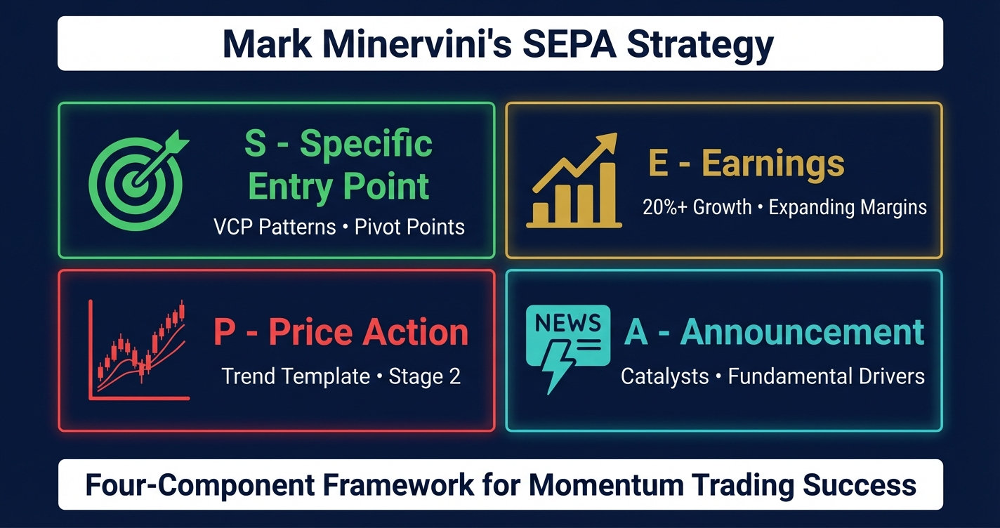

# What is Mark Minervini's Trading Strategy? The Complete SEPA & VCP Guide

**Autor:** Christopher Hall  
**Opublikowano:** 2026-01-12  
**Zaktualizowano:** 2026-04-05  
**Źródło:** https://www.finermarketpoints.com/post/what-is-mark-minervini-s-trading-strategy-the-complete-sepa-vcp-guide  
**Pobrano:** 2026-10-22

---

Mark Minervini's trading strategy centres on [SEPA methodology](https://www.finermarketpoints.com/post/mark-minervini-s-sepa-methodology-complete-framework-explained)—a systematic framework combining Specific Entry Point Analysis, Earnings evaluation, Price Action patterns, and Announcement catalysts. This integrated approach identifies high-probability momentum opportunities by aligning technical timing with fundamental strength, producing 220% average annual returns over five years and multiple U.S. Investing Championship wins.

Unlike value investing strategies that buy undervalued companies and wait, or day trading approaches that seek small intraday gains, Minervini's method focuses on buying institutional-quality growth stocks at precise technical entry points during Stage 2 uptrends. The strategy requires active management, systematic analysis, and strict risk control through 7-8% stop-losses.

The methodology evolved from William O'Neil's CAN SLIM approach, refined through decades of Minervini's experience to emphasise volatility contraction patterns and specific entry point precision. Australian traders applying Minervini's methodology to the ASX find the core principles transfer directly — the same institutional accumulation dynamics, Stage 2 uptrend requirements, and VCP pattern mechanics operate across all liquid markets, with adaptations for ASX liquidity and sector concentration. [***Minervini vs. Buffet***](https://www.finermarketpoints.com/post/mark-minervini-vs-william-o-neil-vs-warren-buffett-trading-style-comparison) ***article*** provides detailed comparison between Minervini, O'Neil, and other trading methodologies.

Remember that past performance is no guarantee of future results, and all trading involves risk. Minervini's achievements represent exceptional performance developed through decades of dedicated study and rigorous application.

## Mark Minervini's Track Record: By the Numbers

Mark Minervini is one of the most decorated traders in US market history. He won the US Investing Championship in 1997 with a 155% return while being invested only 50% of the time. Over a five-year period from 1994 to 2000 he averaged 220% annual returns without a single losing year. He has competed in and won the US Investing Championship multiple times and was profiled by Jack Schwager in *Stock Market Wizards* alongside the most accomplished traders of the modern era. These results were achieved using the same SEPA methodology and [complete VCP criteria](https://www.finermarketpoints.com/post/vcp-criteria-complete-checklist) framework documented in his books and taught through Finer Market Points for ASX application.

## The SEPA Framework: Four-Component Integration

### Understanding SEPA Methodology

[SEPA (Specific Entry Point Analysis)](https://www.finermarketpoints.com/post/mark-minervini-s-sepa-methodology-complete-framework-explained) represents Minervini's complete stock selection and timing framework. Rather than focusing solely on technical patterns or fundamental metrics, SEPA requires confluence across four distinct dimensions before establishing positions.

The acronym breaks down as:

- **S** - Specific Entry Point
- **E** - Earnings
- **P** - Price Action
- **A** - Announcement/Catalyst

Each component serves a specific purpose within the integrated system. Specific Entry Point determines when to enter. Earnings evaluation determines which stocks warrant consideration. Price Action analysis confirms trend structure and stage. Announcement/Catalyst assessment identifies fundamental drivers supporting sustained moves.

Stocks must satisfy all four SEPA components simultaneously. A perfect technical setup without earnings growth fails the methodology. Strong fundamentals without proper price action structure get eliminated. The system demands alignment across technical, fundamental, and catalyst dimensions.

As Minervini explains his focus: "When dealing with growth stocks, really only three things matter: earnings, sales, and margins. Getting really good at deciphering those three things represents 90% of what's important."

This integration distinguishes SEPA from purely technical approaches that ignore fundamentals, or fundamental approaches that lack precise entry timing. The methodology acknowledges that the best technical patterns occur in stocks with improving business fundamentals, while the best fundamental stories produce recognisable technical setups when institutions accumulate.

## S - Specific Entry Point Analysis

### The VCP Pattern as Primary Setup

The [Specific Entry Point](https://www.finermarketpoints.com/post/mark-minervini-s-sepa-methodology-complete-framework-explained) component centres on Minervini's signature Volatility Contraction Pattern (VCP)—a chart formation displaying progressively tighter consolidations before explosive breakouts. [Detailed VCP pattern explanation](https://www.finermarketpoints.com/post/what-is-a-vcp-pattern-mark-minervini-s-volatility-contraction-pattern-explained) covers the complete structure and identification criteria.

VCP patterns reveal institutional accumulation through observable price behaviour. A stock undergoes multiple consolidation phases—typically three to four distinct contractions—where each successive pullback exhibits smaller percentage decline than the previous one. For example, contractions measuring 18% → 12% → 6% demonstrate proper progressive tightening.

This diminishing volatility indicates supply exhausting as weak holders exit during each consolidation, while institutional buyers systematically accumulate positions. The final contraction often displays just 3-5% volatility before the breakout, representing maximum compression.

Entry occurs at the precise pivot point—the resistance level from the most recent contraction—when the stock breaks out on volume 40-50% above average. This volume surge confirms institutional participation rather than retail enthusiasm alone.

### Pivot Point Precision

The pivot point represents more than a technical resistance level—it marks the exact price where supply-demand dynamics shift decisively. Below the pivot, supply equals or exceeds demand. Above the pivot, demand overwhelms remaining supply.

Minervini emphasises timing precision: "I'm looking at the price, just looking at the price when it gets through the level and then watching very carefully the subsequent action, seeing if it holds up."

Entry at the pivot point—rather than during the consolidation or after significant advance—provides optimal risk-reward positioning. Stop-losses place 7-8% below entry, creating defined risk. [Complete risk management framework](https://www.finermarketpoints.com/post/what-is-mark-minervini-s-trading-strategy-the-complete-sepa-vcp-guide) details the mathematical reasoning behind tight stops.

### Volume Confirmation Requirements

Volume analysis validates whether breakouts represent genuine institutional buying or false signals. Proper breakouts display three volume characteristics:

**Breakout Day Volume**: 40-50% above the stock's average daily volume, confirming heavy participation rather than light technical break.

**Declining Volume During Formation**: Each VCP contraction should show decreasing volume as the pullback progresses, indicating sellers exhausting and supply drying up.

**Follow-Through Volume**: Days following the breakout should maintain elevated volume (30-40% above average) for 2-5 days, confirming sustained demand rather than one-day spike.

Light volume breakouts—those displaying only 10-20% above average volume—often fail within days as the stock reverses back below the pivot point. As Minervini notes: "The difference between a breakout that pops out and comes back versus one that works is the difference between retail buying and institutional buying."

## E - Earnings Analysis

### Fundamental Screening Criteria

The Earnings component examines business fundamentals to identify companies with accelerating growth—the engine driving sustained price advances beyond technical patterns. Three core metrics determine fundamental quality:

**Quarterly Earnings Growth**: Year-over-year EPS growth ideally exceeds 20%, with higher percentages (40-50%+) indicating exceptional opportunities. More importantly, earnings growth should accelerate—this quarter growing faster than last quarter demonstrates strengthening business momentum.

**Revenue Growth**: Sales growth should exceed 15% year-over-year, confirming earnings growth stems from genuine business expansion rather than cost-cutting or accounting adjustments. Accelerating revenue (this quarter > last quarter) provides additional confirmation.

**Profit Margin Expansion**: Margins expanding quarter-over-quarter indicate improving operational efficiency and pricing power. Stable or contracting margins raise concerns even when earnings grow, suggesting growth may not be sustainable.

Minervini focuses specifically on these three: "When it comes down to a business, it's all about revenues, profit margins, and turning it into earnings."

### Catalyst Identification

Beyond baseline fundamental strength, Minervini seeks specific catalysts that drive institutional accumulation and sustain advances beyond typical 20-30% gains. Strong catalysts often extend moves to 50-100%+ over months.

Effective catalysts include:

- New product launches entering large addressable markets
- FDA approvals or regulatory clearances removing uncertainty
- Major contract wins demonstrating competitive advantage
- Market share gains in growing industries
- Geographic expansion into new regions
- Technological breakthroughs providing patent protection
- [Industry tailwinds benefiting entire sectors](https://www.finermarketpoints.com/post/how-to-identify-leading-sectors-for-vcp-pattern-trading-asx-focus)

The catalyst provides the "why" behind the move. Technical patterns reveal "when" to enter, but fundamental catalysts determine "how far" the advance extends. Stocks with strong technical setups but lacking catalysts often advance 15-25% then stall. Stocks with both technical setups and powerful catalysts frequently deliver multi-month, multi-hundred-percent advances.

### Institutional Ownership Considerations

Institutional ownership analysis reveals whether professional money managers are accumulating or distributing shares. Increasing institutional ownership over successive quarters indicates smart money recognising the opportunity. Decreasing ownership suggests institutions exiting, regardless of chart appearance.

Optimal institutional ownership typically ranges from 30-70% of shares outstanding. Below 30%, insufficient institutional support exists to drive sustained advances. Above 80-90%, the stock becomes saturated—few additional institutional buyers remain to push prices higher.

[Minervini's Screener Process](https://www.finermarketpoints.com/post/mark-minervini-s-stock-screener-what-indicators-and-criteria-does-he-use) article provides comprehensive screening criteria for identifying stocks meeting fundamental requirements before technical analysis.

## P - Price Action and Trend Template

### The Eight-Point Trend Template

Price Action analysis ensures stocks trade in confirmed Stage 2 uptrends before consideration. Minervini's Trend Template provides eight objective criteria that filter the market to identify only the strongest technical setups:

**Criterion 1 - Price Above 50-Day MA**: Current price trades above the 50-day moving average, confirming short-term uptrend.

**Criterion 2 - Price Above 150-Day MA**: Current price trades above the 150-day moving average, confirming intermediate-term uptrend.

**Criterion 3 - Price Above 200-Day MA**: Current price trades above the 200-day moving average, confirming long-term uptrend.

**Criterion 4 - 50-Day Above 150-Day MA**: The 50-day moving average is positioned above the 150-day moving average, showing momentum building.

**Criterion 5 - 150-Day Above 200-Day MA**: The 150-day moving average is positioned above the 200-day moving average, confirming sustained uptrend.

**Criterion 6 - 200-Day MA Trending Upward**: The 200-day moving average slopes upward for at least one month, preferably 4-5 months, demonstrating long-term trend direction.

**Criterion 7 - Price Within 25% of 52-Week High**: Current price trades within 25% of the 52-week high, indicating current strength rather than recovery from deep weakness.

**Criterion 8 - Relative Strength Above 70**: The stock's Relative Strength rating exceeds 70 (ideally 90+), showing outperformance versus the overall market.

These criteria eliminate approximately 95% of stocks from consideration, leaving only the market's true leaders. As Minervini states: "I don't really do a whole lot of general market analysis. I look at the price and volume of the market. 90% of my work is all stock work. If there's a lot of stocks then I'm bullish on the market."

### Stage Analysis Framework

Stage analysis divides stock price movements into four distinct phases, with [SEPA methodology](https://www.finermarketpoints.com/post/mark-minervini-s-sepa-methodology-complete-framework-explained) operating exclusively during Stage 2:

**Stage 1 - Accumulation**: Price moves sideways after a decline, with the 200-day moving average flattening. Institutional investors begin quiet accumulation. The stock shows no clear directional trend.

**Stage 2 - Advancement** (SEPA Operates Here): Price establishes clear uptrend with higher highs and higher lows. The stock trades above all moving averages with proper alignment. VCP patterns form during this stage before explosive advances.

**Stage 3 - Distribution**: Price stalls at highs, moving sideways with increased volatility. The 200-day moving average begins flattening. Institutions distribute shares to late-arriving retail buyers.

**Stage 4 - Decline**: Price enters downtrend with lower lows and lower highs. The stock trades below the 200-day moving average. Avoid entirely—no SEPA setups occur during declining stages.

The critical rule: SEPA methodology applies only to Stage 2 stocks. Attempting to trade VCP patterns during Stage 3 distribution or Stage 4 decline produces low success rates regardless of pattern quality. Stage identification precedes all other analysis.

### Relative Strength Requirements

Relative Strength measures how a stock performs compared to the overall market (typically the S&P 500 or relevant index). A Relative Strength rating of 90 means the stock outperforms 90% of all stocks over the past year.

Minervini seeks stocks with RS ratings above 70 minimum, with 90+ preferred for highest-probability setups. This requirement ensures focus on market leaders rather than laggards hoping for turnarounds.

Statistical research validates this requirement. Studies show that 90.77% of successful breakouts occur when major indices trade above their monthly 10-period exponential moving averages—the strongest market leaders succeed during confirmed bullish environments.

As Minervini emphasises regarding strong stocks: "Every time the stock pulls back just a little bit, it's met with buying because the institutions are looking at a much bigger picture and that stock has a very bright future."

## A - Announcement and Catalyst

### Fundamental Drivers for Sustained Moves

The Announcement component identifies specific developments providing fundamental justification for major price advances. While technical patterns determine entry timing, catalysts determine whether moves extend to 30%, 50%, 100%+ gains.

Effective announcements and catalysts demonstrate clear business impact rather than vague potential. A pharmaceutical company receiving FDA approval for a blockbuster drug represents a definitive catalyst. [A mining company](https://www.finermarketpoints.com/post/vcp-patterns-in-mining-stocks-sector-specific-considerations) "exploring new regions" without concrete discoveries provides insufficient catalyst.

Types of high-impact catalysts include:

**Product Launch Announcements**: New products entering markets worth billions of dollars annually, particularly when the company demonstrates competitive advantage or patent protection.

**Regulatory Approvals**: FDA approvals, environmental clearances, or government certifications removing uncertainty and enabling revenue generation.

**Major Contract Wins**: Significant customer agreements demonstrating product-market fit and validating the business model, especially when contracts are multi-year or recurring revenue.

**Market Share Gains**: Evidence of capturing share from competitors in growing markets, often revealed through quarterly earnings reports showing revenue growth exceeding industry averages.

**Strategic Partnerships**: Collaborations with established market leaders providing distribution channels, technology access, or market credibility.

**Industry Tailwinds**: Macro trends benefiting [entire sectors](https://www.finermarketpoints.com/post/how-to-identify-leading-sectors-for-vcp-pattern-trading-asx-focus), such as infrastructure spending, energy transition, or demographic shifts creating sustained demand.

### Timing Considerations

Catalyst timing influences whether to enter positions before or after announcements. Known upcoming catalysts—scheduled FDA decisions, earnings releases, product launches—create anticipation that may drive prices higher before the event.

However, trading ahead of binary events (yes/no decisions) introduces additional risk. Unexpected negative outcomes can trigger sharp declines despite perfect technical setups. Minervini generally prefers entering after catalysts materialise and the stock demonstrates strong technical response through VCP breakout.

Post-catalyst entries provide confirmation that the market values the development positively. The technical pattern (VCP formation following the announcement) reveals institutional buying response. This approach trades slightly worse entry price for significantly reduced event risk.

The catalyst provides context for holding winners longer than typical swing trades. When a stock breaks out from a VCP pattern with a genuine fundamental catalyst, the advance may extend for months rather than weeks. Trailing stops allow capturing these extended moves while protecting profits if the trend breaks.

## Integrated Workflow: Applying SEPA Systematically

### The Complete Selection Process

SEPA methodology operates as an integrated system where components work together rather than sequential filters. The practical workflow proceeds as follows:

**Step 1 - Trend Template Screening**: Begin with the eight-point Trend Template filter to identify stocks in confirmed Stage 2 uptrends. This technical screen narrows the universe from thousands of stocks to dozens of candidates.

**Step 2 - Fundamental Analysis**: Examine earnings growth, revenue acceleration, and profit margins for stocks passing the Trend Template. Eliminate stocks lacking 20%+ earnings growth or showing margin compression.

**Step 3 - Catalyst Assessment**: Research recent announcements, upcoming catalysts, or industry developments for fundamentally strong stocks. Pass on stocks lacking clear drivers for sustained moves.

**Step 4 - VCP Pattern Monitoring**: Monitor qualified stocks daily or weekly to identify those forming VCP patterns. Add stocks displaying two contractions to watchlists, anticipating potential third contraction and breakout.

**Step 5 - Entry Execution**: When a stock completes VCP formation and breaks above the pivot point on volume 40-50% above average, execute entry. Place stop-loss 7-8% below entry price.

**Step 6 - Position Management**: Monitor position daily for stop-loss violation or trailing stop adjustment as profit develops. Hold positions until technical structure breaks or market environment shifts.

This systematic approach removes emotional decision-making and subjective judgment. Each component provides objective criteria—stocks either pass or fail each filter. The methodology doesn't predict which stocks will advance, but identifies setups demonstrating highest probability of success based on historical patterns.

### Market Environment Overlay

SEPA effectiveness varies significantly based on overall market conditions. Even perfect setups—stocks satisfying all SEPA components—fail more frequently during hostile market environments.

**Bullish Market Conditions**: When major indices trade above their 50-day and 200-day moving averages with expanding breadth (percentage of stocks above 200-day MA increasing), SEPA methodology operates optimally. Position sizing increases, multiple concurrent positions are held, and holding periods extend.

**Neutral Market Conditions**: During sideways, choppy conditions with mixed breadth signals, reduce position sizing and focus only on highest-quality setups (A+ rated patterns). Take partial profits more quickly and trail stops more aggressively.

**Bearish Market Conditions**: When indices break below key moving averages and breadth contracts, move to cash entirely. Minervini's approach: "When the market's in a correction, I go to cash. I don't fight it. I wait for the environment to improve."

Statistical research shows 90.77% of successful breakouts occur during bullish market conditions. Fighting bearish environments reduces even perfect SEPA setup success rates to 30-40% or lower. Preserving capital during hostile periods enables aggressive deployment when conditions improve.

### Position Sizing and Risk Control

Risk management integrates with SEPA methodology rather than operating as separate consideration. [Complete risk management principles](https://www.finermarketpoints.com/post/3-key-lessons-from-trade-like-a-stock-market-wizard) detail the mathematics and psychology behind Minervini's 7-8% stop-loss rule.

The key principle: never risk more than 1-2% of total capital on any single trade. Position size calculations work backwards from this risk tolerance:

Position Size = (Account Size × Risk %) ÷ (Entry Price - Stop Price)

For example, with a $100,000 account risking 1% ($1,000) on a stock entering at $50 with a stop at $46 (8% stop): Position Size = $1,000 ÷ ($50 - $46) = $1,000 ÷ $4 = 250 shares

This mathematical approach ensures consistent risk across all trades regardless of entry price or stop distance. Wider stop-loss distances automatically reduce position size, keeping dollar risk constant.

Minervini's pivotal discovery: "I went from having a 15% loss normalised everything to a 10% stop and my account would have been up 72% instead of being down. I calculated it again, came back the same. I calculated a third time, lo and behold it was correct."

This revelation changed his career trajectory. Tight stops protect capital by cutting losses quickly while allowing winners to run to 20-30%+ gains, creating the asymmetric returns necessary for long-term success.

## From Theory to Practice: SEPA Application

### Learning Curve Expectations

Developing proficiency with SEPA methodology requires time investment and deliberate practice. Minervini's own journey involved years of struggle before achieving consistent profitability: "I wasn't profitable for seven years. It took me that long because I didn't have the benefit of the education that exists nowadays."

Modern traders benefit from documented frameworks, detailed books, and educational resources unavailable in earlier decades. However, pattern recognition skills, disciplined execution, and emotional control still require development through experience.

Realistic progression timeline:

- **Months 1-3**: Study theory, paper trade, develop screening processes
- **Months 4-6**: Begin small-size real trades, focus on rule adherence
- **Months 7-12**: Increase position sizing gradually, refine entry timing
- **Year 2**: Consistency developing, larger positions, comfortable execution
- **Years 3-5**: Mastery emerging, intuitive pattern recognition, psychological control

The methodology itself doesn't change—the trader's skill in applying it develops over time. As Minervini notes: "Think in five to ten year increments as opposed to one or two. That's the real key. With me I didn't do well for six years."

### Common Implementation Mistakes

Traders implementing SEPA methodology commonly make specific errors that reduce success rates despite understanding the concepts:

**Entering Before Breakout**: Attempting to "get in early" during VCP formation rather than waiting for volume-confirmed breakout through the pivot point. This increases risk and reduces probability.

**Ignoring Fundamental Requirements**: Focusing exclusively on technical patterns while overlooking earnings growth, margin trends, or catalyst presence. Perfect VCP patterns in fundamentally weak stocks produce lower success rates.

**Trading Against Market Environment**: Continuing to trade SEPA setups during corrections or bear markets when even perfect patterns fail at high rates. Preservation of capital during hostile periods enables aggressive deployment during optimal conditions.

**Widening Stop-Losses**: Moving stops further away when trades move against entry rather than executing the pre-planned 7-8% stop. This single error converts small losses into large losses that damage capital and psychology.

**Insufficient Position Sizing**: Taking positions too small to meaningfully impact account growth when correct, often due to fear or lack of confidence in the methodology. Proper position sizing (risking 1-2% per trade) allows asymmetric returns to compound.

## Test Knowledge of Entry Point Analysis

The Specific Entry Point component represents the technical foundation of SEPA methodology—identifying exact entry timing through VCP pattern recognition and pivot point breakouts.

Pattern recognition skills develop through systematic study and practice. The free VCP pattern quiz reinforces entry signal identification, volume behaviour analysis, and breakout confirmation:

→ Immediate feedback on recognition accuracy→ Reinforcement of key characteristics and volume behaviour→ Cover entry and exit signals

[**Access the Free VCP Pattern Quiz**](https://fmp-trading-tools.thinkific.com/products/courses/master-momentum-trading-mark-minervini-vcp)

This assessment helps identify areas of strength and concepts requiring additional study within the SEPA framework.

Frequently Asked Questions About Mark Minervini's Trading Strategy

##### What is Mark Minervini's strategy called?

Mark Minervini's strategy is called SEPA — Specific Entry Point Analysis. It is a systematic framework that integrates four components: the Specific Entry Point (identifying precise technical entry timing through VCP patterns), Earnings evaluation (screening for accelerating quarterly growth above 20%), Price Action analysis (confirming Stage 2 uptrend structure using the eight-point Trend Template), and Announcement assessment (identifying fundamental catalysts driving sustained advances). All four components must align simultaneously for a setup to qualify.

##### How many times has Mark Minervini won the US Investing Championship?

Mark Minervini has won the US Investing Championship multiple times. His most documented performance was his 1997 victory with a 155% return while being only 50% invested. Over a five-year competitive period from 1994 to 2000 he averaged 220% annual returns without a single losing year — a verified track record that led to his inclusion in Jack Schwager's *Stock Market Wizards*. He subsequently competed in and won the championship again in later years, making him one of the most successful repeat competitors in the event's history.

##### What stocks does Mark Minervini trade?

Minervini trades institutional-quality growth stocks in confirmed Stage 2 uptrends — companies showing accelerating quarterly earnings growth above 20%, revenue growth above 15%, and expanding profit margins. He focuses on market leaders with Relative Strength ratings above 70, ideally 90 or higher, trading near their 52-week highs. He avoids penny stocks, turnaround plays, and beaten-down recovery candidates regardless of how cheap they appear. His universe is the top 5–10% of the market by fundamental momentum and technical strength at any given time.

##### Is Mark Minervini's strategy suitable for ASX traders?

Yes — the core principles of SEPA methodology apply directly to the ASX with targeted adaptations. The Stage 2 uptrend requirements, VCP pattern mechanics, and institutional accumulation dynamics operate the same way on Australian stocks as on US stocks. The primary adaptations required are lower volume thresholds (ASX stocks trade at lower daily volumes than US equivalents), wider contraction allowances for mining and resources stocks due to commodity price sensitivity, and sourcing Australian fundamental data through local platforms such as Commsec or Market Index rather than US-focused tools. Christopher Hall has applied and adapted Minervini's methodology specifically for ASX market conditions at Finer Market Points.

##### What is the difference between SEPA and VCP?

SEPA (Specific Entry Point Analysis) is Minervini's complete trading methodology — the full system covering stock selection, fundamental screening, trend confirmation, catalyst assessment, entry timing, position sizing, and risk management. The VCP (Volatility Contraction Pattern) is a specific chart pattern that forms the entry timing component within SEPA. Think of SEPA as the complete framework and VCP as the technical trigger within it. A stock can form a perfect VCP pattern but still fail the SEPA methodology if it lacks earnings growth, does not have a confirmed Stage 2 uptrend, or trades without a meaningful fundamental catalyst. Both must be present for the highest-probability setups.

## Key Takeaways

**SEPA Integration**: Minervini's strategy requires confluence across four components—Specific Entry Point (VCP patterns at pivot points), Earnings (20%+ growth with accelerating trends), Price Action (Trend Template and Stage 2 confirmation), and Announcement (fundamental catalysts driving sustained moves).

**Specific Entry Point Priority**: VCP patterns provide precise entry timing through progressively tighter consolidations (typically 18% → 12% → 6%) before breakout on 40-50% above average volume at the pivot point resistance level.

**Trend Template Foundation**: The eight-point Trend Template filters to Stage 2 stocks only—those above 50-day, 150-day, and 200-day MAs with proper alignment, upward-sloping 200-day MA, within 25% of 52-week high, and Relative Strength above 70.

**Fundamental Screening**: Earnings analysis focuses on three metrics—quarterly EPS growth above 20%, revenue growth above 15%, and expanding profit margins—identifying genuine business momentum beyond technical patterns.

**Catalyst Requirements**: Announcements and catalysts (product launches, regulatory approvals, major contracts, market share gains) determine whether technical moves extend to 50-100%+ rather than stalling at 20-30%.

**Stage Analysis Context**: SEPA operates exclusively during Stage 2 uptrends. Stage 1 (accumulation), Stage 3 (distribution), and Stage 4 (decline) lack the institutional buying dynamics necessary for VCP pattern success.

**Risk Management Integration**: The 7-8% stop-loss rule integrates with SEPA rather than operating separately. Position sizing calculations ensure consistent 1-2% risk per trade regardless of entry price or volatility.

**Market Environment Override**: Even perfect SEPA setups fail during bearish markets. Statistical research shows 90.77% of successful breakouts occur when indices trade above monthly 10-period EMAs—bullish environment confirmation.

**Systematic Application Workflow**: Screen with Trend Template → Verify fundamentals → Identify catalysts → Monitor for VCP patterns → Enter on volume breakout → Manage with 7-8% stops → Trail winners with moving averages.

**Implementation Timeline**: Developing proficiency requires months to years of deliberate practice. Minervini's own journey involved seven years before consistent profitability, though modern educational resources accelerate learning.

**Relative Strength Emphasis**: Focus on market leaders (RS 90+) rather than lagging stocks. The strongest performers during bull markets typically display superior relative strength before major advances begin.

**Institutional Accumulation Focus**: VCP patterns reveal institutional buying through volume analysis—decreasing volume on contractions (supply exhausting), expanding volume on rallies (demand building), surge on breakout (confirmation).

Mark Minervini's SEPA methodology provides a complete framework for systematic momentum trading. Rather than isolated techniques, the four components work together to identify stocks with aligned technical timing, fundamental strength, and catalytic drivers during optimal market conditions.

The strategy challenges conventional investment wisdom—buying stocks making new highs rather than seeking bargains, cutting losses quickly at 7-8% rather than holding and hoping, concentrating capital in few high-conviction positions rather than broad diversification.

This counterintuitive approach, applied systematically with discipline, produced Minervini's championship-level results. The methodology remains accessible to dedicated students willing to invest time in study, practice, and psychological development necessary for consistent execution.

[***Which Minervini Book to Start with?***](https://www.finermarketpoints.com/post/which-mark-minervini-book-should-you-read-first) provides guidance on which of Minervini's books to read for deeper understanding of SEPA methodology and the psychological dimensions of implementation.

**Ready to Test Your VCP Pattern Recognition Skills?**

Understanding the VCP pattern conceptually is the first step—recognising it on actual charts is where trading success begins. The [Free Master Momentum Trading Quiz](https://fmp-trading-tools.thinkific.com/products/courses/master-momentum-trading-mark-minervini-vcp) tests pattern recognition skills across multiple VCP examples, providing immediate feedback on recognition accuracy, reinforcement of key characteristics and volume behaviour, and coverage of both entry and exit signals. This practical assessment helps identify gaps in understanding before risking capital in live markets.

**Explore the Complete VCP Framework**: This article is part of the [Complete VCP Trading Guide for ASX Markets](https://www.finermarketpoints.com/post/complete-vcp-trading-guide-asx-markets), covering all aspects of Mark Minervini's methodology.

**Educational Disclaimer**: This content is for educational purposes only and does not constitute financial advice. Past performance is no guarantee of future results. Consider personal financial situations and seek professional advice before making investment decisions.

Finer Market Points Pty Ltd, CAR 1304002, AFSL 526688, ABN 87 645 284 680. This general information is educational only and not financial advice, recommendation, forecast or solicitation. Consider objectives, financial situation and needs before acting. Seek appropriate professional advice. We accept no liability for any loss or damages arising from use.
