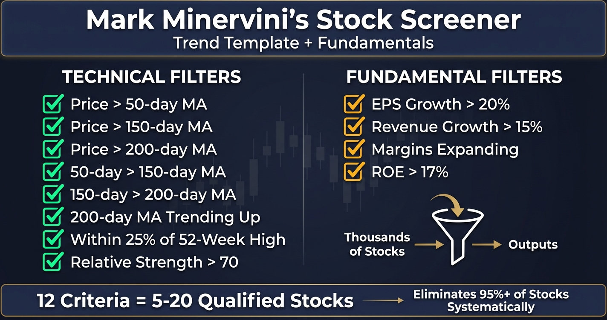

# Mark Minervini's Stock Screener: What Indicators and Criteria Does He Use?

**Autor:** Christopher Hall  
**Opublikowano:** 2026-01-12  
**Zaktualizowano:** 2026-04-05  
**Źródło:** https://www.finermarketpoints.com/post/mark-minervini-s-stock-screener-what-indicators-and-criteria-does-he-use  
**Pobrano:** 2026-10-22

---

Mark Minervini's stock screening methodology combines eight technical criteria (the Trend Template) with fundamental filters to identify stocks in confirmed Stage 2 uptrends with accelerating earnings growth. This systematic approach narrows the investment universe from thousands of stocks to 5-20 high-probability candidates, eliminating 95%+ of stocks before chart analysis begins.

The screening process operates as the foundation of [Minervini's complete SEPA methodology](https://www.finermarketpoints.com/post/what-is-mark-minervini-s-trading-strategy-the-complete-sepa-vcp-guide), determining which stocks warrant detailed technical analysis for VCP pattern identification. Rather than manually reviewing hundreds of charts hoping to spot opportunities, systematic screening filters to only the strongest setups meeting objective criteria.

This quantitative approach removes subjective judgment from initial stock selection. Stocks either pass all screening criteria or they don't—there's no ambiguity. As Minervini states: "I don't really do a whole lot of general market analysis. I look at the price and volume of the market. 90% of my work is all stock work. If there's a lot of stocks then I'm bullish on the market."

Remember that past performance is no guarantee of future results, and all trading involves risk. Screening criteria identify stocks meeting historical success patterns but don't predict future outcomes.

## The Complete Trend Template: Eight Technical Criteria

Mark Minervini's Trend Template requires all eight criteria to pass simultaneously. A stock failing any single criterion is eliminated regardless of how well it meets the others.

1. **Price above the 50-day moving average** — confirms short-term uptrend momentum is intact
2. **Price above the 150-day moving average** — confirms intermediate-term trend direction
3. **Price above the 200-day moving average** — confirms long-term Stage 2 uptrend structure
4. **50-day MA above the 150-day MA** — confirms shorter-term momentum exceeds intermediate trend
5. **150-day MA above the 200-day MA** — confirms intermediate trend exceeds long-term baseline
6. **200-day MA trending upward for at least one month** — confirms long-term trend has established upward direction, not just flattened
7. **Price within 25% of the 52-week high** — confirms current strength rather than recovery from deep weakness
8. **Relative Strength rating above 70, ideally 90+** — confirms the stock outperforms the majority of the market

All eight criteria applied together identify stocks in confirmed Stage 2 uptrends with institutional accumulation already underway. For the complete breakdown of each criterion in detail, see the [complete VCP criteria checklist](https://www.finermarketpoints.com/post/vcp-criteria-complete-checklist) which covers how these technical requirements interact with VCP pattern formation.

### The Screening Foundation

The Trend Template provides eight objective technical requirements that filter for stocks in confirmed Stage 2 uptrends. These criteria ensure focus on market leaders rather than lagging stocks, turnaround candidates, or declining issues.

All eight criteria must be satisfied simultaneously. A stock passing seven but failing one criterion gets eliminated from consideration. This strict filtering prevents compromising on quality to generate more screening results.

**Criterion 1 - Price Above 50-Day Moving Average**

Current price must trade above the 50-day moving average, confirming short-term uptrend momentum. This criterion eliminates stocks in short-term downtrends or sideways consolidation below this key level.

The 50-day MA represents approximately 10 weeks of trading, capturing intermediate-term price behaviour. Stocks below this average lack the momentum structure necessary for VCP pattern formation.

**Criterion 2 - Price Above 150-Day Moving Average**

Current price must trade above the 150-day moving average (approximately 30 weeks), confirming intermediate-term uptrend. This filter removes stocks still recovering from deeper pullbacks or extended declines.

The 150-day MA provides context for whether recent strength represents genuine trend or temporary bounce within larger weakness.

**Criterion 3 - Price Above 200-Day Moving Average**

Current price must trade above the 200-day moving average (approximately 40 weeks), confirming long-term uptrend structure. This represents the most important single moving average for determining overall trend direction.

Stocks below the 200-day MA remain in Stage 1, 3, or 4—never Stage 2 where [VCP patterns form successfully](https://www.finermarketpoints.com/post/what-is-a-vcp-pattern-mark-minervini-s-volatility-contraction-pattern-explained).

**Criterion 4 - 50-Day MA Above 150-Day MA**

The 50-day moving average must be positioned above the 150-day moving average, confirming that shorter-term momentum exceeds intermediate-term trends. This alignment demonstrates acceleration rather than deceleration.

When shorter moving averages cross below longer ones, trend deterioration begins. The Trend Template requires proper upward alignment throughout.

**Criterion 5 - 150-Day MA Above 200-Day MA**

The 150-day moving average must be positioned above the 200-day moving average, confirming intermediate-term momentum exceeds long-term trends. This creates the characteristic ascending moving average structure of Stage 2 uptrends.

This criterion prevents screening stocks where the 200-day MA acts as resistance rather than support.

**Criterion 6 - 200-Day MA Trending Upward**

The 200-day moving average itself must slope upward for at least one month, preferably 4-5 months. A rising 200-day MA confirms the long-term trend has established upward direction.

Flat or declining 200-day moving averages indicate Stage 1 or Stage 4 conditions. Even if price temporarily trades above a flat 200-day MA, the lack of upward slope suggests insufficient trend strength.

**Criterion 7 - Price Within 25% of 52-Week High**

Current price must trade within 25% of the 52-week high, indicating current strength rather than recovery from deep weakness. This criterion focuses screening on stocks at or near leadership positions.

Stocks trading 40-50% below their 52-week highs may eventually recover, but Minervini's methodology focuses on stocks already demonstrating strength. The strongest stocks stay near their highs even during market volatility.

**Criterion 8 - Relative Strength Rating Above 70**

The stock's Relative Strength rating must exceed 70, ideally 90+. Relative Strength measures how a stock performs compared to the overall market over the past 12 months, expressed as a percentile ranking.

An RS rating of 90 means the stock outperforms 90% of all stocks. This criterion ensures focus on market leaders rather than average performers. As Minervini emphasises: "Stock market leaders usually have Relative Strength Rating of 90 or higher at the early stage of their major moves."

### Why These Eight Criteria Work

The Trend Template filters for specific conditions present during institutional accumulation phases. Large institutional buyers leave observable footprints through price and moving average behaviour.

When institutions accumulate positions over weeks and months, their sustained buying pressure pushes prices above moving averages and keeps them there. The proper moving average alignment (50 > 150 > 200) reflects this progressive strength building.

Stocks meeting all eight criteria demonstrate that institutions have been actively buying for sufficient duration to establish confirmed uptrends. These represent the stocks institutions have chosen to support—the market's actual leaders rather than hoped-for turnarounds.

The screening eliminates stocks where institutions are distributing (Stage 3), declining stocks institutions have abandoned (Stage 4), and stocks still in early accumulation without clear trends (Stage 1). Only Stage 2 advancement candidates pass.

## Fundamental Screening Criteria

### Earnings Growth Requirements

Beyond technical criteria, Minervini's screening incorporates fundamental filters ensuring stocks possess genuine business momentum driving price advances. The primary fundamental metric is quarterly earnings per share (EPS) growth.

**Minimum Standard**: Quarterly EPS growth must exceed 20% year-over-year. This represents comparison of current quarter earnings to the same quarter one year prior, accounting for seasonal business variations.

**Preferred Standard**: Quarterly EPS growth exceeding 40-50% identifies exceptional opportunities. Higher earnings growth rates correlate with larger price advances when combined with proper technical setups.

**Acceleration Requirement**: Current quarter growth should exceed previous quarter growth, demonstrating accelerating momentum. A stock growing earnings 25% this quarter and 20% last quarter shows acceleration. A stock growing 20% this quarter and 30% last quarter shows deceleration.

As Minervini explains his fundamental focus: "When dealing with growth stocks, really only three things matter: earnings, sales, and margins. Getting really good at deciphering those three things represents 90% of what's important."

### Revenue Acceleration

Revenue (sales) growth confirms earnings growth stems from genuine business expansion rather than cost-cutting or accounting adjustments. Companies can temporarily boost earnings through expense reduction, but sustained growth requires revenue expansion.

**Minimum Standard**: Quarterly revenue growth must exceed 15% year-over-year. This validates that earnings growth reflects growing business activity.

**Quality Indicator**: Revenue growth exceeding earnings growth suggests margin compression—potentially concerning. Revenue growth below earnings growth but with expanding margins indicates improving efficiency—positive signal.

**Trend Consistency**: Multiple consecutive quarters of accelerating revenue growth provide strongest confirmation of business momentum.

### Profit Margin Analysis

Profit margins reveal operational efficiency and pricing power. Expanding margins indicate the company captures increasing value from each dollar of revenue—a sign of competitive advantage and business quality.

**Key Metrics**:

- **Gross Margin**: Revenue minus cost of goods sold, divided by revenue. Expanding gross margins suggest pricing power or cost efficiencies.
- **Operating Margin**: Operating income divided by revenue. Expanding operating margins indicate improving operational leverage.
- **Net Margin**: Net income divided by revenue. Expanding net margins demonstrate bottom-line efficiency improvements.

**Screening Application**: Quarter-over-quarter margin expansion (current quarter margins > previous quarter margins) indicates improving business quality. Stable margins are acceptable; contracting margins raise concerns even when earnings grow.

### Additional Fundamental Filters

**Return on Equity (ROE)**: ROE above 17% indicates efficient capital deployment. This metric measures net income as percentage of shareholder equity, revealing how effectively management generates returns on invested capital.

**Debt Levels**: Low debt-to-equity ratios (preferably below 30-40%) provide financial flexibility and reduce bankruptcy risk during market downturns. High-growth companies with strong fundamentals typically don't require excessive leverage.

**Institutional Ownership**: Institutional ownership between 30-70% of shares outstanding indicates professional money manager interest without oversaturation. Below 30% suggests insufficient institutional support; above 80% leaves fewer additional buyers to drive prices higher.

**Institutional Ownership Trend**: Increasing institutional ownership over successive quarters confirms smart money accumulation. Decreasing institutional ownership signals distribution regardless of chart appearance.

## Technical Indicators Minervini Prioritises

### Moving Average Relationships

Beyond the Trend Template requirements, moving average relationships provide context for entry timing and holding decisions. The most critical moving averages for ongoing analysis are the 10-day, 21-day, 50-day, and 200-day.

**10-Day Moving Average**: Used as initial trailing stop level once positions establish profits. Stocks advancing strongly often remain above the 10-day MA for extended periods. Closes below the 10-day MA on heavy volume signal potential trend changes.

**21-Day Moving Average**: Approximates one month of trading. Strong stocks in early-stage advances frequently bounce off the 21-day MA during shallow pullbacks, providing lower-risk entry opportunities.

**50-Day Moving Average**: Critical support level during intermediate-term advances. [As covered in risk management principles](https://www.finermarketpoints.com/post/3-key-lessons-from-trade-like-a-stock-market-wizard), many strong stocks advance 100-300%+ without closing below the 50-day MA once properly established.

**200-Day Moving Average**: The ultimate trend determinant. Stocks trading above rising 200-day MAs remain in Stage 2. Breaks below the 200-day MA signal transition to Stage 3 or 4.

### Relative Strength Analysis

Relative Strength rating deserves expanded discussion beyond the screening criterion. This metric identifies stocks outperforming the market—the actual leaders institutional buyers favour.

**Calculation Methodology**: RS rating compares a stock's 12-month price performance to all other stocks in the market, producing a percentile ranking from 1-99. An RS of 85 means the stock outperformed 85% of all stocks over the past year.

**Screening Threshold**: Minimum RS of 70 required, with 90+ strongly preferred for highest-probability setups. During bull markets, focusing exclusively on RS 90+ stocks improves success rates significantly.

**RS Trend**: Rising RS (moving from 75 to 85 to 92 over recent months) indicates accelerating relative performance—a strong leadership signal. Declining RS (moving from 95 to 88 to 82) suggests weakening relative performance even if absolute price remains strong.

### Volume Pattern Recognition

Volume analysis reveals institutional participation versus retail activity. Minervini's screening criteria include minimum average volume requirements and specific volume pattern characteristics.

**Minimum Average Volume**: 400,000 shares per day minimum ensures adequate liquidity for position entry and exit without excessive slippage. Preferably 1,000,000+ shares daily for larger positions.

**Volume During Screening**: Current average volume should exceed historical averages from 6-12 months prior, indicating increasing interest and participation—typically a bullish sign for emerging leaders.

**Volume on Up Days vs Down Days**: Up days should display volume 10-20% higher than down days on average over recent weeks. This reveals whether buying pressure (demand) exceeds selling pressure (supply).

### Price Proximity to 52-Week High

The 25% criterion represents minimum standard, but additional context from price proximity analysis improves screening quality:

**10% from High**: Stocks within 10% of 52-week highs demonstrate exceptional strength. These often break out to new highs shortly, providing ideal entry opportunities.

**10-20% from High**: Still strong, though may require additional base formation before breakout attempts. Monitoring for VCP pattern development becomes priority.

**20-25% from High**: Meets screening criteria but represents borderline cases. These require exceptional fundamental strength or catalyst presence to warrant focus.

**Below 25% from High**: Eliminated from screening regardless of other criteria. Recovery plays don't fit the methodology—focus remains on current strength, not hoped-for strength.

## The Step-by-Step Screening Process

### Stage 1: Technical Filter (Trend Template)

The screening process begins with applying all eight Trend Template criteria simultaneously. This technical filter narrows the universe from thousands of stocks to dozens of candidates—typically 20-50 stocks depending on market conditions.

**Implementation**: Input the eight technical criteria into screening software, requiring all criteria pass (AND logic, not OR logic). Run the screen daily or weekly to identify current stocks meeting requirements.

**Expected Results**: During strong bull markets, 30-50 stocks may pass all eight criteria. During neutral markets, 10-20 stocks typically qualify. During corrections or bear markets, sometimes zero stocks pass—a signal to avoid trading and preserve capital.

The number of stocks passing Trend Template screening serves as market health indicator. Expanding qualifying stocks suggests improving market breadth and conditions. Contracting qualifying stocks warns of deteriorating conditions.

### Stage 2: Fundamental Filter

Stocks passing the Trend Template advance to fundamental analysis. This stage examines earnings growth, revenue acceleration, profit margins, and other fundamental metrics.

**Implementation**: Review quarterly earnings reports, focusing on most recent quarter compared to year-ago quarter. Calculate year-over-year EPS growth, revenue growth, and margin changes. Verify institutional ownership trends.

**Quality Grading**: Rate stocks as A+, A, B, or C based on fundamental strength:

- **A+**: EPS growth >40%, revenue growth >25%, expanding margins, accelerating trends
- **A**: EPS growth >25%, revenue growth >15%, expanding margins
- **B**: EPS growth >20%, revenue growth >10%, stable margins
- **C**: EPS growth 15-20%, minimal revenue growth, or contracting margins

**Filtering Decision**: Focus exclusively on A+ and A rated stocks. B-rated stocks might qualify during exceptional market conditions. C-rated stocks get eliminated despite passing technical criteria.

### Stage 3: Manual Chart Review

Stocks passing both technical and fundamental filters advance to detailed chart analysis. This stage examines price action characteristics, volume patterns, and base formation quality.

**Chart Analysis Focus**:

- Base count (first base strongly preferred over third or fourth base)
- Prior advance magnitude before current consolidation
- Consolidation structure and quality
- Volume behaviour during formation
- Proximity to potential pivot points

**VCP Pattern Identification**: [Identify whether stocks are forming VCP patterns](https://www.finermarketpoints.com/post/what-is-a-vcp-pattern-mark-minervini-s-volatility-contraction-pattern-explained)—multiple contractions with progressively diminishing volatility. Stocks displaying two contractions get added to watchlists for monitoring of potential third contraction and breakout.

**Stage Assessment**: Confirm Stage 2 uptrend structure through weekly and monthly chart review. Eliminate stocks showing Stage 3 topping characteristics or Stage 4 distribution despite passing daily chart screening.

### Stage 4: Watchlist Management

The final screening stage involves organising qualified stocks into [prioritised watchlists for ongoing monitoring](https://www.finermarketpoints.com/post/building-a-vcp-watchlist-criteria-and-monitoring-process). Not all screened stocks warrant immediate action—many require additional base formation before entry opportunities materialise.

**Watchlist Categories**:

- **Near Breakout**: Stocks in final VCP contraction, likely to trigger entry signals within 1-2 weeks
- **Formation Watch**: Stocks in mid-VCP formation (second contraction), monitor for third contraction development
- **Early Stage**: Stocks recently clearing initial bases, watch for first consolidation/VCP formation
- **Research Queue**: Stocks passing all criteria but requiring additional fundamental research or catalyst identification

**Daily Monitoring**: Review Near Breakout watchlist daily for volume breakouts above pivot points. Review other watchlists weekly for progression through formation stages.

## Screening Tools and Platforms

### Available Software Options

Multiple commercial platforms enable technical and fundamental screening based on Minervini's criteria. These tools allow filtering thousands of stocks to identify candidates meeting specific requirements.

**Screening Software Capabilities**:

**Technical Filtering**: These platforms enable setting criteria for moving average relationships (price above MAs, MA alignment), relative strength ratings, volume requirements, and price proximity to 52-week highs. The software scans all stocks meeting these technical parameters.

**Fundamental Filtering**: Screening tools provide access to earnings growth data, revenue trends, profit margins, institutional ownership, and other fundamental metrics. Filters identify stocks exceeding growth thresholds.

**Relative Strength Rankings**: Premium platforms calculate proprietary relative strength ratings or provide access to Investor's Business Daily RS ratings. This enables identifying top-performing stocks ranked by percentile.

**Custom Screen Building**: Most platforms allow saving custom screens combining technical and fundamental criteria, enabling one-click screening updates daily or weekly.

**Platform Examples**:

Major screening platforms include Finviz, MarketSmith (Investor's Business Daily), TradingView, and TC2000. Each offers different features, data quality, and pricing structures ranging from free basic versions to premium subscriptions costing $100-300+ monthly.

### Australian Market Screening Challenges

Standard [US-focused screening](https://www.finermarketpoints.com/post/how-to-identify-leading-sectors-for-vcp-pattern-trading-asx-focus) platforms present significant limitations for Australian market participants. The ASX operates differently from US exchanges in terms of data availability, liquidity profiles, and sector composition.

**ASX-Specific Challenges**:

**Data Availability**: Many US screening platforms lack comprehensive ASX fundamental data or provide delayed/incomplete earnings information for Australian stocks. Relative strength calculations often compare ASX stocks to US indices rather than appropriate Australian benchmarks.

**Liquidity Thresholds**: US-based minimum volume requirements (400,000+ shares daily) eliminate most ASX stocks despite being adequately liquid for Australian trading. ASX liquidity standards differ significantly from US markets.

**Sector Concentration**: The ASX's heavy concentration in financials, resources, and mining requires sector-specific screening adjustments not built into US-focused platforms. Mining company fundamentals differ from typical growth stock metrics.

**Market Hours**: Time zone differences and ASX trading hours (10:00-16:00 AEST/AEDT) create challenges with real-time data availability on platforms optimised for US market hours.

### Educational Screening Resources

Recognising these Australian market challenges, comprehensive educational materials covering systematic screening approaches specifically adapted for ASX conditions provide valuable learning resources for local traders.

Detailed screening frameworks, criteria checklists, and pattern identification training help develop the systematic stock selection skills Minervini's methodology requires. These educational resources bridge the gap between generic US-focused screening concepts and practical Australian market application.

## How to Build a Minervini VCP Scanner on TradingView

TradingView is the most accessible platform for building a Minervini-style screener and is the primary charting platform used at Finer Market Points (profile: chall886). The screener function allows you to filter the entire ASX or US market using the Trend Template criteria in minutes, reducing thousands of stocks to a manageable watchlist of Stage 2 candidates.

Here is the step-by-step process:

**Step 1: Open the TradingView Screener** Go to TradingView and click the "Screener" tab at the bottom of the screen. Select "Stock Screener." Set your market to Australia (ASX) for local stocks, or United States for US markets. You can run both separately.

**Step 2: Apply the moving average filters** Under "Filters," add the following conditions — all must be set to AND logic, not OR:

- Price greater than MA 50
- Price greater than MA 150
- Price greater than MA 200
- MA 50 greater than MA 150
- MA 150 greater than MA 200

This applies the first five Trend Template criteria simultaneously and will typically reduce your universe by 80–90% immediately.

**Step 3: Apply the 52-week high proximity filter** Add a filter for "Price Performance (1 Year)" and set it to greater than -25%. This captures stocks trading within 25% of their 52-week high — Criterion 7 of the Trend Template.

**Step 4: Set the minimum volume filter** Add an "Average Volume" filter set to greater than 200,000 for ASX stocks. This eliminates illiquid stocks where entering and exiting positions would move the price against you. However, Christopher Hall prefers $400,000 threshold for ASX shares / trading as the US filters of 200,000 shares is often too low for low share price ASX shares.

**Step 5: Sort by Relative Strength** TradingView does not natively calculate Investor's Business Daily RS ratings. As a proxy, sort your results by "Performance (1 Year)" descending — this ranks stocks by their 12-month price performance relative to peers, approximating RS behaviour. Focus on the top third of results.

**Step 6: Export or review the filtered list** You now have a filtered list of Stage 2 candidates. Save this as a custom screener in TradingView so you can re-run it daily with one click.

**Step 7: Open each chart individually** For each remaining stock, open the daily chart and look for VCP formation — progressively tighter pullbacks with declining volume. This step cannot be automated and requires chart-by-chart review. This is where pattern recognition skill determines the quality of your final watchlist.

**Step 8: Set pivot point alerts** For any stock showing a valid two or three-contraction VCP, mark the high of the most recent consolidation as your pivot point and set a price alert at that level. TradingView will notify you when price approaches the breakout zone.

Christopher Hall demonstrates this full scanning process live on the Finer Market Points YouTube channel — search [@finermarketpoints](https://youtube.com/@finermarketpoints) or visit TradingView profile chall886 to see the screener applied to live ASX setups each week.

**ASX-specific note:** Standard TradingView volume thresholds used in US markets (400,000+ shares daily) eliminate most ASX stocks. Christopher Hall prefers $400,000 threshold for ASX shares / trading as the US filters of 200,000 shares is often too low for low share price ASX shares. For mining and resources stocks, be aware that volume can spike dramatically on news and dry up in between — weekly average volume is more reliable than daily for these sectors.

## How Many Stocks Pass the Screen?

### Expected Screening Results

Properly configured screening using all Trend Template criteria and fundamental filters typically produces 5-20 qualified stocks. This narrow universe reflects the methodology's emphasis on quality over quantity.

As Minervini notes: "You've got to concentrate and bring it down to at least 10 stocks or even less than that." The screening process performs exactly this concentration—eliminating 95%+ of stocks to focus on genuine leaders.

**Result Variations by Market Condition**:

**Strong Bull Market**: 20-50 stocks may pass all criteria during robust uptrends with expanding market breadth. Multiple sectors show strength, providing opportunities across different industries.

**Neutral Market**: 10-20 stocks typically qualify during sideways, choppy conditions. Leadership narrows to specific sectors while others lag, reducing overall qualifying candidates.

**Weak Market**: 0-5 stocks pass during corrections or bear markets. Declining market environments break even the strongest stocks below moving averages, violating Trend Template criteria. This serves as objective signal to preserve capital.

**Correction/Bear Market**: Zero stocks passing all criteria indicates hostile trading environment. This objective signal supersedes subjective market opinions—when no stocks qualify, move to cash.

### Quality Over Quantity Philosophy

Traders sometimes loosen screening criteria attempting to generate more results, compromising the methodology's effectiveness. The temptation to reduce thresholds (accept RS 60 instead of 70, allow price 30% below highs instead of 25%) reflects misunderstanding of the strategic intent.

The methodology doesn't require numerous opportunities—it requires highest-quality opportunities. Trading three exceptional A+ setups produces superior results to trading twenty mediocre B/C setups.

As Minervini emphasises: "I'd rather have 3 great positions than 10 mediocre ones." The screening process embodies this philosophy by filtering rigorously rather than generating volume.

**Psychological Challenge**: New traders often feel uncomfortable with small watchlists containing just 5-10 stocks. This discomfort leads to loosening criteria—exactly the wrong response. The proper response is accepting that high-quality setups are rare, and patience waiting for them exceeds forcing marginal setups.

## What Happens After Screening?

### From Screen Results to Entry Execution

Screening identifies candidates meeting technical and fundamental requirements—not immediate buy signals. Stocks passing screening require ongoing monitoring for specific entry triggers before position establishment.

**Watchlist Organisation**: Transfer screening results to categorised watchlists based on pattern development stage. Near-breakout stocks receive daily attention; early-stage formations get [weekly review](https://www.finermarketpoints.com/post/how-to-scan-the-asx-for-vcp-patterns-every-week-step-by-step).

**Price Alert Configuration**: Set price alerts at key technical levels (pivot points, moving averages) for watchlist stocks. These alerts notify when stocks approach entry triggers without requiring constant chart monitoring.

**Fundamental Update Monitoring**: Track earnings announcement dates for watchlist stocks. Quarterly reports can provide catalysts accelerating pattern completion or invalidate setups through disappointing results.

### Daily Monitoring Process

Effective screening requires regular updates rather than one-time execution. Market conditions change, stocks advance or decline, new opportunities emerge while others deteriorate.

**Morning Routine**: Run screening criteria before market open, comparing results to previous day's watchlist. Note new additions (stocks recently qualifying) and deletions (stocks falling below criteria).

**Intraday Alerts**: Monitor price alerts for watchlist stocks approaching breakout levels. Focus attention on stocks showing volume expansion and upward price movement.

**End-of-Day Review**: Update watchlists with current pattern status. Remove stocks violating screening criteria (breaking below 200-day MA, RS declining below 70). Add newly qualifying stocks from daily screening run.

**Weekly Deep Analysis**: Each weekend, review watchlist stocks' weekly charts, assess pattern progression, research fundamental developments, verify continued qualification under all screening criteria.

### Pattern Development Tracking

Stocks passing screening criteria but not yet displaying entry signals require monitoring for VCP pattern development. This anticipatory approach enables preparation before breakouts occur rather than reacting after they've already happened.

**Two-Contraction Stage**: Stocks showing initial base formation followed by first consolidation (first contraction) merit watchlist addition. Monitor for second consolidation development.

**Three-Contraction Stage**: Stocks displaying two contractions with proper volatility diminishment earn priority watchlist status. These approach potential third contraction and breakout—highest probability stage.

**Breakout Preparation**: As stocks enter final tightening phase (third contraction), prepare entry orders, calculate position sizing based on 7-8% stop-loss, plan stop-loss placement. Execute immediately upon volume breakout confirmation.

This systematic progression from screening â†' watchlist monitoring â†' pattern recognition â†' entry preparation â†' execution removes emotional decision-making and ensures disciplined implementation.

## Common Screening Mistakes

### Loosening Criteria for More Results

The most frequent screening error involves reducing threshold strictness to generate more candidates. Traders uncomfortable with small watchlists (5-10 stocks) lower requirements—accepting RS 60 instead of 70, allowing price 35% below highs instead of 25%, or overlooking earnings growth shortfalls.

This approach defeats the methodology's purpose. The screening criteria aren't arbitrary—they reflect specific characteristics present during institutional accumulation phases. Compromising criteria introduces lower-quality setups with reduced success probability.

Quality concentration produces superior results to diversified mediocrity. Three exceptional A+ setups outperform twenty marginal B/C setups over time.

### Ignoring Market Environment

Running screens and establishing positions regardless of overall market conditions produces poor results even with perfect individual stock setups. Research shows 90.77% of successful breakouts occur during bullish market conditions when major indices trade above monthly 10-period EMAs.

The number of stocks passing Trend Template screening serves as objective market health indicator:

- **30+ stocks qualifying**: Bullish environment, trade actively
- **10-20 stocks qualifying**: Neutral environment, trade selectively
- **0-5 stocks qualifying**: Bearish environment, preserve capital

Attempting to trade when few or no stocks meet criteria ignores the methodology's market environment component. As Minervini states: "When the market's in a correction, I go to cash. I don't fight it."

### Focusing on Penny Stocks

Low-priced stocks (under $10-15) occasionally pass technical screening criteria, creating temptation to include them despite quality concerns. Penny stocks typically lack institutional sponsorship, suffer from wider bid-ask spreads, and demonstrate higher manipulation risk.

Minervini's methodology focuses on institutional-quality stocks—companies large enough to attract professional money manager attention. These typically trade above $20-30 and demonstrate sufficient liquidity for institutional position building.

The volume criterion (400,000+ shares daily) partially addresses this by eliminating thinly traded issues, but absolute price consideration matters. Low-priced stocks passing screening often represent deteriorating former leaders rather than emerging new leaders.

### Insufficient Re-Screening Frequency

Static watchlists become outdated quickly as market conditions evolve. Stocks meeting all criteria today may violate multiple criteria within days or weeks as their technical pictures deteriorate.

Daily or weekly re-screening ensures watchlists contain only currently qualified candidates. Stocks dropping below moving averages, showing RS deterioration, or breaking technical support levels require immediate removal from consideration regardless of prior status.

Effective screening operates as dynamic filter, not one-time selection. Regular updates prevent holding outdated views about stocks that no longer meet methodology requirements.

### Skipping Fundamental Verification

Some traders focus exclusively on technical screening criteria (Trend Template) while ignoring fundamental requirements. Perfect technical setups in fundamentally weak stocks produce lower success rates and shorter advances.

The integration of technical and fundamental screening separates Minervini's approach from purely technical methodologies. Technical patterns provide timing; fundamentals provide fuel for sustained advances.

Stocks passing Trend Template requirements but showing earnings deceleration, revenue weakness, or margin compression warrant elimination despite chart quality. The methodology requires confluence—both technical and fundamental strength must align.

## Develop Systematic Screening Skills

Understanding Minervini's screening criteria intellectually differs from applying them systematically to identify high-probability opportunities. The methodology requires integrating technical indicators, fundamental metrics, and pattern recognition into cohesive analysis framework.

Comprehensive educational materials covering screening methodology, pattern identification, and entry signal recognition provide structured learning path for developing these systematic skills.

[**Access Educational Materials on Systematic Momentum Trading**](https://fmp-trading-tools.thinkific.com/products/courses/master-momentum-trading-mark-minervini-vcp)

These resources cover: → Complete screening criteria application→ Pattern recognition development→ Entry and exit signal identification

##### What is Mark Minervini's trend template?

The Trend Template is an eight-point technical filter Minervini uses to identify stocks in confirmed Stage 2 uptrends. All eight criteria must pass simultaneously: price above the 50-day, 150-day, and 200-day moving averages; the 50-day MA above the 150-day MA; the 150-day MA above the 200-day MA; the 200-day MA trending upward for at least one month; price within 25% of the 52-week high; and Relative Strength rating above 70. Together these criteria eliminate 95% of stocks and focus analysis exclusively on institutional leaders.

##### How do I screen for Minervini stocks on TradingView?

Open the TradingView Stock Screener and apply moving average filters requiring price above the 50-day, 150-day, and 200-day MAs with proper alignment (50 > 150 > 200). Add a 52-week performance filter greater than -25% to capture stocks near their highs. Set a minimum average volume threshold — Christopher Hall uses $400,000 as his preferred floor for ASX stocks, as lower thresholds can include stocks where the low share price makes even moderate volume inadequate for clean position entry and exit. Save the filter as a custom screener for daily re-runs. Then review each remaining chart individually for VCP pattern formation — this manual step cannot be automated. The Finer Market Points TradingView profile (chall886) demonstrates this process applied to live ASX setups.

##### What are the 8 criteria in Minervini's trend template?

The eight criteria are: (1) price above the 50-day moving average, (2) price above the 150-day moving average, (3) price above the 200-day moving average, (4) 50-day MA above the 150-day MA, (5) 150-day MA above the 200-day MA, (6) 200-day MA trending upward for at least one month, (7) price within 25% of the 52-week high, and (8) Relative Strength rating above 70 — ideally 90 or higher. All eight must pass simultaneously. A stock failing even one criterion is eliminated regardless of its other characteristics. Note these are simple moving averages, not exponential moving averages — the two produce different results and Minervini's criteria are based on MAs.

##### Is there a free Minervini stock screener?

There is no official free screener published by Minervini, but TradingView's free tier allows you to build a functional approximation of the Trend Template using moving average and price performance filters at no cost. The free version has limitations on the number of simultaneous filters and does not provide native Relative Strength ratings — these require a TradingView paid plan or access to Investor's Business Daily's MarketSmith platform. For ASX traders, the TradingView free tier is sufficient to apply the core five moving average criteria and begin filtering candidates, with the volume threshold set manually based on your position size requirements.

##### Can I use the Minervini screener on ASX stocks?

Yes — the Trend Template criteria apply to any liquid market including the ASX. Two adjustments are necessary for Australian markets. First, the volume threshold requires careful consideration — Christopher Hall uses $400,000 as his preferred ASX floor rather than simply applying a share count minimum, because low share price stocks can show high volume numbers that are misleading in dollar terms. For mining and resources stocks specifically, weekly average volume is more reliable than daily volume, as volume can spike dramatically on news and dry up between announcements. Second, standard US-focused screening platforms may lack comprehensive ASX fundamental data for earnings and revenue filters — source Australian earnings data separately through platforms such as Commsec, Market Index, or direct ASX announcements.

## Key Takeaways

**Eight-Point Trend Template**: All eight criteria must pass simultaneously—price above 50/150/200-day MAs, proper MA alignment (50>150>200), 200-day MA trending up, price within 25% of 52-week high, and Relative Strength above 70 (ideally 90+).

**Fundamental Requirements**: Quarterly EPS growth exceeding 20% year-over-year, revenue growth above 15%, expanding profit margins quarter-over-quarter, and ROE above 17% identify stocks with genuine business momentum beyond technical patterns.

**Relative Strength Priority**: RS rating above 70 minimum (90+ preferred) ensures focus on market leaders outperforming the overall market. The strongest setups display rising RS trends indicating accelerating relative performance.

**Volume Standards**: Minimum average volume of 400,000 shares daily (preferably 1,000,000+) ensures adequate liquidity. Volume patterns showing expansion on up days and contraction on down days reveal institutional accumulation.

**Screening Results as Market Indicator**: The number of stocks passing all criteria indicates market health—30+ stocks suggests bullish conditions, 10-20 indicates neutral environment, 0-5 signals correction/bear market requiring capital preservation.

**Quality Over Quantity Philosophy**: Properly configured screening produces 5-20 qualified stocks, not hundreds. This concentration reflects the methodology's emphasis on highest-probability setups rather than opportunity volume.

**Sequential Filtering Process**: Stage 1 applies Trend Template technical criteria → Stage 2 applies fundamental filters → Stage 3 conducts manual chart review → Stage 4 identifies VCP pattern formation and entry timing.

**Moving Average Relationships**: Beyond screening requirements, moving averages provide ongoing position management signals—10-day MA for trailing stops, 50-day MA for intermediate support, 200-day MA for ultimate trend determination.

**Common Mistakes**: Loosening criteria to generate more results, ignoring market environment context, focusing on low-priced stocks despite quality concerns, insufficient re-screening frequency, and skipping fundamental verification all reduce methodology effectiveness.

**Stage 2 Exclusivity**: [SEPA methodology](https://www.finermarketpoints.com/post/what-is-mark-minervini-s-trading-strategy-the-complete-sepa-vcp-guide) operates exclusively during Stage 2 uptrends. Screening criteria ensure focus only on stocks in confirmed advancement phases, eliminating Stage 1/3/4 candidates.

**Watchlist Management**: Screening identifies candidates; watchlist monitoring tracks pattern development. Categorise stocks by formation stage (near breakout, mid-formation, early stage) for appropriate monitoring frequency.

**Australian Market Adaptations**: ASX screening requires adjustments for liquidity thresholds, sector concentration, and data availability differences from US markets. Standard US-focused platforms present limitations for Australian market application.

Mark Minervini's screening methodology provides systematic approach to identifying the market's actual leaders—stocks institutions are actively accumulating during Stage 2 uptrends with accelerating fundamental momentum. This quantitative filtering narrows focus to highest-probability opportunities before detailed pattern analysis begins.

The screening criteria aren't optional preferences but essential requirements reflecting characteristics present during successful institutional accumulation phases. All criteria must pass simultaneously—compromising standards to generate more results defeats the methodology's quality-focused philosophy.

Effective screening operates as dynamic process requiring regular updates rather than one-time execution. Daily or weekly re-screening ensures watchlists contain only currently qualified stocks, removing those falling below standards as quickly as adding newly qualifying candidates.

The integration of technical Trend Template criteria with fundamental growth requirements distinguishes this approach from purely technical or purely fundamental methodologies. Both dimensions must align—technical patterns without fundamental support produce shorter advances; fundamental strength without technical timing creates suboptimal entry points.

**Ready to Test Your VCP Pattern Recognition Skills?**

Understanding the VCP pattern conceptually is the first step—recognising it on actual charts is where trading success begins. The [Free Master Momentum Trading Quiz](https://fmp-trading-tools.thinkific.com/products/courses/master-momentum-trading-mark-minervini-vcp) tests pattern recognition skills across multiple VCP examples, providing immediate feedback on recognition accuracy, reinforcement of key characteristics and volume behaviour, and coverage of both entry and exit signals. This practical assessment helps identify gaps in understanding before risking capital in live markets.

***Which Minervini Book to Read?*** [***This article***](https://www.finermarketpoints.com/post/which-mark-minervini-book-should-you-read-first) provides guidance on Minervini's books covering screening methodology, pattern recognition, and complete trading framework in greater detail.

**Explore the Complete VCP Framework**: This article is part of the [Complete VCP Trading Guide for ASX Markets](https://www.finermarketpoints.com/post/complete-vcp-trading-guide-for-asx-markets), covering all aspects of Mark Minervini's methodology.

**Educational Disclaimer**: This content is for educational purposes only and does not constitute financial advice. Past performance is no guarantee of future results. Consider personal financial situations and seek professional advice before making investment decisions.

Finer Market Points Pty Ltd, CAR 1304002, AFSL 526688, ABN 87 645 284 680. This general information is educational only and not financial advice, recommendation, forecast or solicitation. Consider objectives, financial situation and needs before acting. Seek appropriate professional advice. We accept no liability for any loss or damages arising from use.
