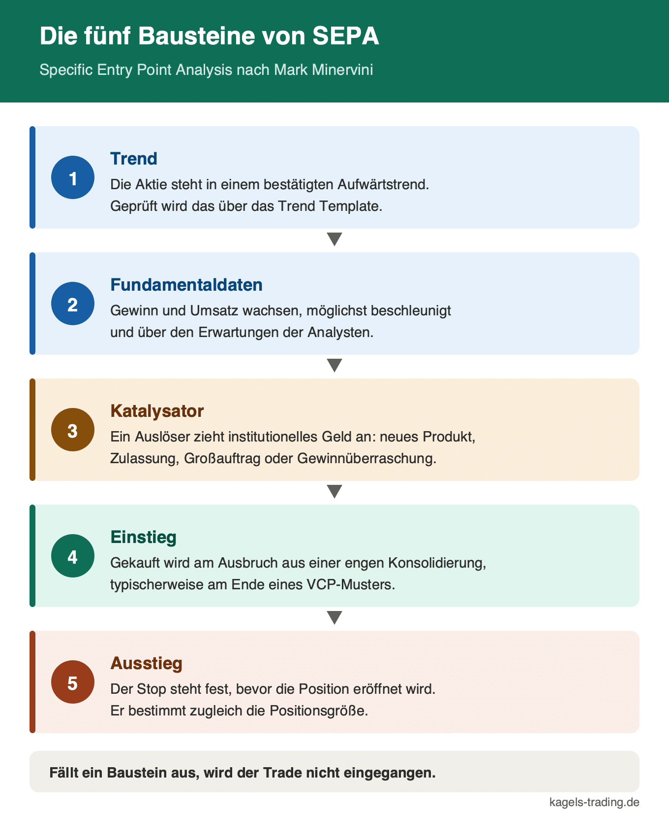
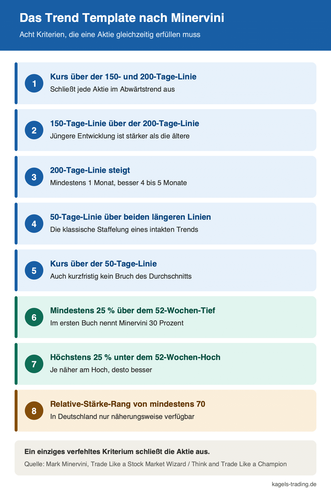
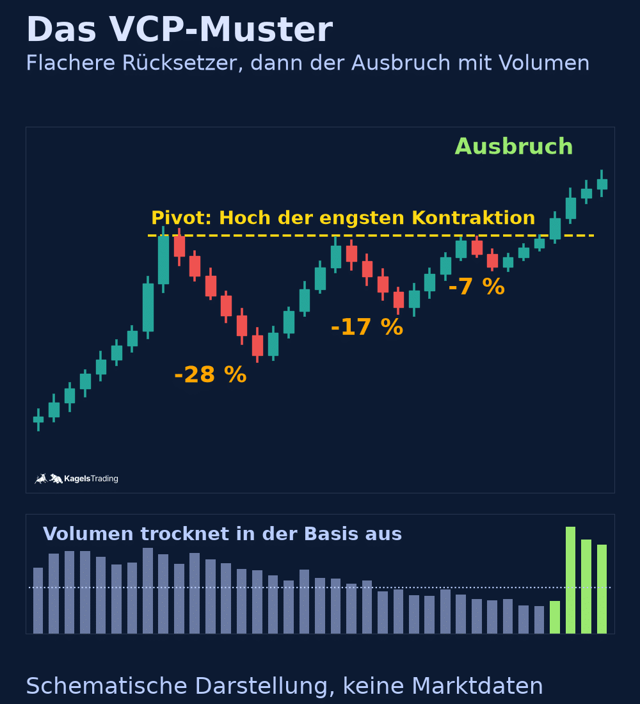
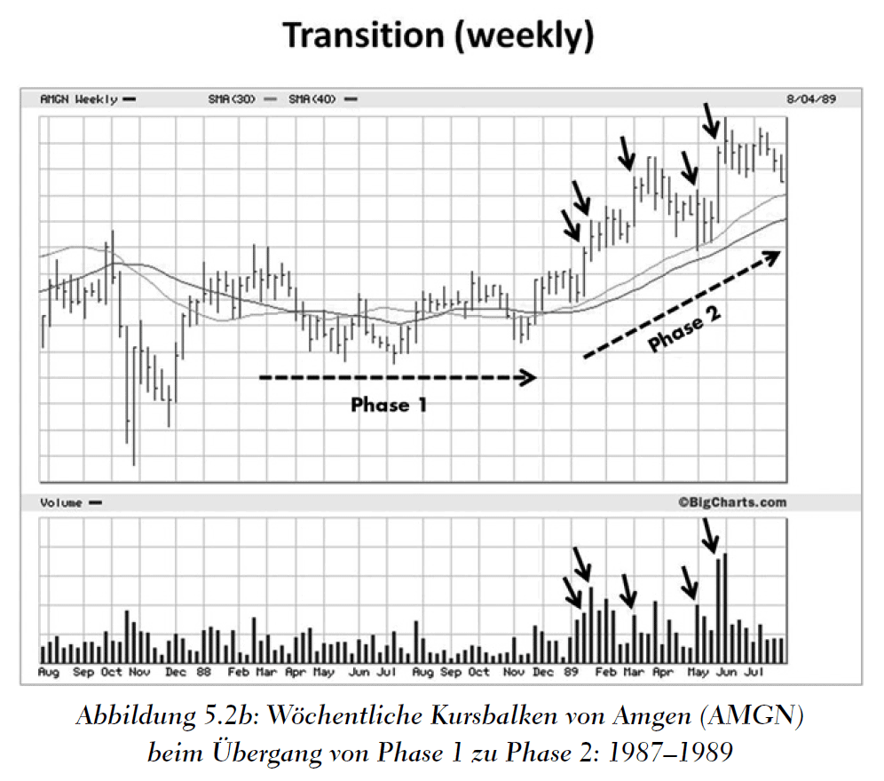
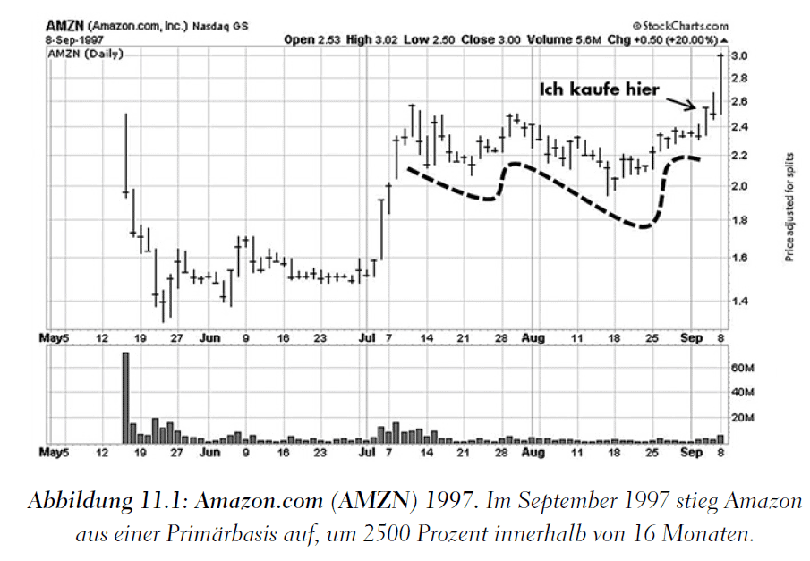

# Mark Minervini: die SEPA-Strategie hinter „Handeln wie ein Market Wizard“

**Autor:** Christian Möhrer  
**Opublikowano:** 2024-04-17  
**Zaktualizowano:** 2026-10-21  
**Źródło:** https://www.kagels-trading.de/mark-minervini/  
**Pobrano:** 2026-10-22

---

Die meisten Trader kennen **Mark Minervini** über sein Buch. Deutlich spannender als die Buchvorstellung ist aber die Frage, was er dort eigentlich beschreibt: ein festes Regelwerk, das jede Aktie durch dieselben acht Prüfpunkte schickt, bevor sie überhaupt auf die Watchlist darf. Genau dieses Regelwerk hat ihm 2021 einen ***Rekord in der US Investing Championship*** eingebracht. Gebrochen hat ihn erst 2024 J Law, ein Schüler Minervinis.

Dieser Artikel erklärt die **SEPA-Methode**, das **Trend Template** und das **VCP-Muster** so, dass du sie an einem eigenen Chart nachvollziehen kannst. Dazu kommt eine ehrliche Einordnung, welche Teile seines Ansatzes sich für ***deutsche Trader überhaupt umsetzen lassen*** und welche an fehlenden Datenquellen scheitern. Am Ende steht die Rezension seines Buchs „Handeln wie ein Market Wizard“. Dieser Artikel entspricht unseren [redaktionellen Richtlinien](https://www.kagels-trading.de/redaktionelle-richtlinien/).

## Mark Minervini: das Wichtigste in 30 Sekunden

- ***Zweifacher US Investing Champion:*** Minervini gewann den Wettbewerb **1997**, nach eigener Angabe mit 155 Prozent, und **2021 mit 334,8 Prozent**. Der zweite Sieg brach den bisherigen Rekord von 119,1 Prozent deutlich, 2024 übertraf **J Law** ihn mit 353,9 Prozent.
- ***SEPA steht für Specific Entry Point Analysis*** und ist sein Auswahlsystem. Es kombiniert **fundamentale Filter** mit **charttechnischem Timing** und lässt nur Aktien in einem bestätigten Aufwärtstrend zu.
- ***Das Trend Template prüft acht Bedingungen*** an den **gleitenden Durchschnitten**, am **52-Wochen-Hoch** und an der **relativen Stärke**. Alle acht müssen gleichzeitig erfüllt sein.
- ***Das VCP-Muster zeigt schrumpfende Rücksetzer*** vor dem Ausbruch. Meist sind es zwei bis vier Konsolidierungen, deren Tiefe von Welle zu Welle abnimmt, während das Volumen austrocknet.
- ***Sein Risikomanagement ist strenger als die Aktienauswahl.*** Verluste werden früh geschnitten, die Positionsgröße richtet sich am maximal akzeptierten Verlust aus, nicht an der Überzeugung.

## Wer ist Mark Minervini?

**Mark Minervini ist ein US-amerikanischer Aktienhändler, Autor und zweifacher Gewinner der US Investing Championship, der mit seiner selbst entwickelten SEPA-Methode auf Wachstumsaktien in bestätigten Aufwärtstrends setzt.**

***Minervini nennt in Interviews immer wieder seine Vorbilder.*** Neben **William O’Neil** taucht dort regelmäßig [der Spekulant Jesse Livermore](https://www.kagels-trading.de/jesse-livermore/) auf. Nach unserer Lesart greift das **Trend Template** dessen Grundsatz auf, nur mit dem übergeordneten Trend zu handeln, und macht ihn messbar.

Seine erste Aktie kaufte Minervini nach eigener Darstellung ***1983***, und er hat keinen klassischen Ausbildungsweg hinter sich. Er brach die **Schule** früh ab und brachte sich das Handwerk über Jahre selbst bei. Bekannt wurde er durch Jack Schwagers Buch **Stock Market Wizards** (2001), den dritten Band der Market-Wizards-Reihe.

Heute betreibt er die Plattform ***Minervini Markets 360***, über die Mitglieder unter dem Namen **Minervini Private Access** Zugang zu seinen Handelsentscheidungen bekommen. Dazu kommen **Workshops** und das **Master Trader Program**, in denen er seine Methodik unterrichtet. Wer sich ein Bild machen will, findet die Angebote auf seiner [offiziellen Website](https://www.minervini.com/).

Wichtig für die Einordnung: Minervini ist ***kein Daytrader***. Seine Haltedauer liegt typischerweise bei **Wochen bis Monaten**, er handelt **Einzelaktien** am US-Markt und arbeitet fast nur auf der **Long-Seite**. Haltedauer und Long-Fokus sind unsere Einordnung seines Ansatzes, keine Regel, die er so festgeschrieben hätte. Wer Intraday auf Indizes oder Devisen unterwegs ist, wird aus seinem System die Auswahlkriterien mitnehmen können, nicht aber den Handelsrhythmus.

## Minervinis Rendite: was die Zahlen zeigen und was nicht

**Die US Investing Championship ist ein Wettbewerb für Trader mit echtem Kapital, bei dem die Depotentwicklung über ein Kalenderjahr verglichen wird und die erzielten Renditen von den Veranstaltern geprüft werden.**

Minervini gewann diesen Wettbewerb zweimal, beide Siege bestätigt der Veranstalter. ***1997 trat er nach eigener Darstellung mit 250.000 Dollar eigenem Kapital an*** und beendete das Jahr mit **155 Prozent**, diese Zahlen stammen von Minervinis Seite. Der zweite Sieg kam 2021 in der Millionen-Dollar-Kategorie: **334,8 Prozent** in einem Jahr, [geprüft und offiziell veröffentlicht](https://www.businesswire.com/news/home/20220124005241/en/2021-United-States-Investing-Championship-Winners-%E2%80%94-Minervini-Smashes-Record). Der bis dahin gültige **Rekord** lag bei 119,1 Prozent aus dem Jahr 2020. Gebrochen wurde Minervinis Rekord 2024: J Law, nach Angaben des Veranstalters ein Schüler Minervinis, kam auf 353,9 Prozent.

Deutlich häufiger zitiert wird eine andere Zahl, und die verdient eine Einordnung. Minervini nennt eine ***Gesamtrendite von 33.500 Prozent*** über fünf aufeinanderfolgende Jahre, so steht es auch im Verlagstext zu seinem ersten Buch, was rechnerisch etwa **220 Prozent im Jahresschnitt** entspricht. Diese Angabe stammt aus **eigener Darstellung** und ist nicht in derselben Weise durch einen Wettbewerb geprüft wie das Championship-Ergebnis von 2021. Sie ist deshalb kein Beleg, sondern eine Behauptung des Autors.

Für die Bewertung seiner Methode ist das trotzdem kein Ausschlusskriterium. Die beiden ***Championship-Siege sind vom Veranstalter bestätigt***, und sie zeigen zwei Dinge: Der Ansatz funktioniert in **starken Marktphasen** außergewöhnlich gut, und er funktioniert in unterschiedlichen **Jahrzehnten**. Was die Zahlen nicht zeigen, sind die Jahre dazwischen. Ein Wettbewerbsjahr ist eine Momentaufnahme, kein Track Record über 30 Jahre.

## Was ist die SEPA-Strategie?

**SEPA steht für Specific Entry Point Analysis und bezeichnet Minervinis Auswahlsystem, das Aktien zuerst nach fundamentalen und charttechnischen Kriterien filtert und den Einstieg erst an einem eng definierten Punkt zulässt.**

Der Name ist Programm: ***Specific Entry Point Analysis*** heißt die Analyse eines ganz bestimmten **Einstiegspunkts**. Nicht die Aktie allein entscheidet, sondern die Kombination aus **Aktie** und **Zeitpunkt**.

SEPA stützt sich auf ***fünf Bausteine***, die alle zusammenpassen müssen. Ein einzelner **starker Baustein** reicht nicht aus, solange ein anderer **fehlt**:

- ***Trend:*** Die Aktie muss sich in einem bestätigten Aufwärtstrend befinden. Das ist der Filter, den das Trend Template prüft, und der erste Ausschlussgrund für die große Mehrheit aller Kandidaten.
- ***Fundamentaldaten:*** Gewinn und Umsatz sollen wachsen, idealerweise beschleunigt und über den Erwartungen. Minervini sucht Unternehmen, bei denen die Zahlen **vor** dem großen Kursanstieg bereits gedreht haben.
- ***Katalysator:*** Es braucht einen Auslöser, der institutionelles Geld anzieht. Das kann ein neues Produkt sein, eine Zulassung, ein Vertragsabschluss oder eine deutliche Gewinnüberraschung.
- ***Einstieg:*** Der Kauf erfolgt an einem definierten Punkt, meist am Ausbruch aus einer engen Konsolidierung. Wer zu früh kauft, sitzt in einer Basis fest, die noch nicht fertig ist.
- ***Ausstieg:*** Vor dem Kauf steht fest, wo die Position aufgelöst wird. Diesen Punkt behandelt Minervini als Teil der Auswahl, nicht als nachgelagerte Entscheidung.

Der Kern des Ansatzes ist ein ***Blick zurück auf die größten Gewinner***. Statt zu fragen, welche Aktie gerade günstig aussieht, hat Minervini historische **Gewinneraktien** untersucht und nach deren **Gemeinsamkeiten** in der Zeit vor dem Anstieg gesucht. Aus diesen Gemeinsamkeiten wurden die Filterkriterien. Für die Trendlogik stützt er sich auf [Stan Weinsteins Stage Analysis](https://www.kagels-trading.de/aktienstrategie-stage-analysis/), die den Kursverlauf einer Aktie in vier Phasen einteilt.

*Die fünf SEPA-Bausteine wirken als Kette: Fällt ein Glied aus, wird der Trade nicht eingegangen.*

## Das Trend Template: acht Kriterien für einen bestätigten Aufwärtstrend

**Das Trend Template ist Minervinis Filter aus acht technischen Bedingungen, die eine Aktie gleichzeitig erfüllen muss, damit er sie als Kandidat in einem bestätigten Aufwärtstrend akzeptiert.**

Dieser Filter ist der praktisch nützlichste Teil seiner Arbeit, weil er sich ***vollständig in Zahlen ausdrücken lässt***. Jede Bedingung ist objektiv prüfbar, es gibt keinen Interpretationsspielraum. Die Kriterien stützen sich auf drei **gleitende Durchschnitte** sowie auf die Lage des Kurses im **52-Wochen-Bereich**.

- ***Kurs über der 150- und der 200-Tage-Linie:*** Der aktuelle Kurs notiert über beiden langfristigen Durchschnitten. Damit fallen alle Aktien heraus, die sich in einer Abwärtsbewegung befinden.
- ***150-Tage-Linie über der 200-Tage-Linie:*** Die mittlere Linie liegt oberhalb der langen. Das zeigt, dass die jüngere Kursentwicklung stärker ist als die ältere.
- ***200-Tage-Linie steigt:*** Sie muss seit mindestens einem Monat aufwärts zeigen, besser seit vier bis fünf Monaten. Eine flache Linie reicht nicht.
- ***50-Tage-Linie über beiden längeren Linien:*** Der kurze Durchschnitt liegt über dem mittleren und dem langen. Diese Staffelung ist das klassische Bild eines intakten Trends.
- ***Kurs über der 50-Tage-Linie:*** Auch kurzfristig darf die Aktie nicht unter ihren Durchschnitt gefallen sein.
- ***Mindestens 30 Prozent über dem 52-Wochen-Tief:*** Die Aktie hat sich bereits deutlich vom Boden gelöst. So steht es in „Handeln wie ein Market Wizard“, in vielen späteren Fassungen des Trend Templates kursieren 25 Prozent.
- ***Höchstens 25 Prozent unter dem 52-Wochen-Hoch:*** Je näher am Hoch, desto besser. Minervini kauft bewusst Stärke und nicht den Rücksetzer.
- ***Relative-Stärke-Rang von mindestens 70:*** Die Aktie muss zu den stärksten 30 Prozent des Gesamtmarkts gehören. Besser sind Werte in den 80ern oder 90ern.

**Der Relative-Stärke-Rang misst, wie sich der Kurs einer Aktie im Vergleich zu allen anderen Aktien des Marktes entwickelt hat, und drückt das Ergebnis als Rangplatz zwischen 1 und 99 aus.**

Hier liegt die ***größte praktische Hürde für deutsche Trader***. Der von Minervini genannte **Relative-Stärke-Rang** stammt aus dem Datenangebot von **Investor’s Business Daily** und ist im deutschsprachigen Raum nicht ohne Weiteres verfügbar. Er misst die Kursentwicklung einer Aktie im Vergleich zu allen anderen und drückt das Ergebnis als Rangplatz von 1 bis 99 aus.

Verwechsle diesen Wert nicht mit dem **RSI**, dem Relative Strength Index. Der ***RSI ist ein Oszillator***, der Aufwärts- gegen Abwärtsbewegungen derselben Aktie aufrechnet und dabei nur ihre eigene Historie betrachtet. Minervinis Rang vergleicht dagegen **eine Aktie mit dem gesamten Markt**. Beide tragen ein ähnliches Kürzel und messen völlig Verschiedenes. Wer keinen Zugriff auf ein Ranking hat, kann sich behelfen, indem er die prozentuale Kursentwicklung über sechs bis zwölf Monate gegen einen Index wie den S&P 500 stellt.

Die übrigen ***sieben Kriterien lassen sich dagegen problemlos abbilden***. Jeder [Aktienscreener](https://www.kagels-trading.de/aktienscreener/), der Filter auf [gleitende Durchschnitte](https://www.kagels-trading.de/tradinganleitung-gleitenden-durchschnitt/) und den **52-Wochen-Bereich** zulässt, bildet den Rest des **Trend Templates** ab.

*Alle acht Bedingungen gelten gleichzeitig: Ein einziges verfehltes Kriterium schließt die Aktie aus.*

## Das VCP-Muster: wenn die Schwankungen vor dem Ausbruch schrumpfen

**Das Volatility Contraction Pattern, kurz VCP, ist ein Chartmuster, bei dem eine Aktie mehrere Konsolidierungen durchläuft, deren Rücksetzer von Mal zu Mal flacher ausfallen, bevor sie nach oben ausbricht.**

Während das Trend Template die Vorauswahl trifft, liefert das VCP das ***Timing für den Einstieg***. Die Idee dahinter ist eine Aussage über das **Angebot**: Bei jedem Rücksetzer geben ungeduldige Halter ihre Stücke ab. Wird der nächste Rücksetzer flacher, bedeutet das, dass weniger Verkäufer übrig sind. Irgendwann trifft eine geringe **Angebotsmenge** auf normale Nachfrage, und der Kurs löst sich nach oben.

Meist sind es ***zwei bis vier Kontraktionen*** in Folge, manchmal mehr. Wie das aussieht, zeigt die schematische **Grafik** unten: Jeder Rücksetzer fällt flacher aus als der vorige. Die genauen Werte sind nicht in Stein gemeißelt, entscheidend ist die Richtung. Parallel dazu sollte das **Handelsvolumen** in den Konsolidierungen abnehmen.

Den Ausbruch selbst bestätigt Minervini über das Volumen: Am Ausbruchstag soll das ***Volumen deutlich über dem Durchschnitt*** liegen. Unter Anwendern kursiert dafür oft die Faustregel von 40 bis 50 Prozent, aus Minervinis eigenen Texten konnten wir diese Zahl nicht belegen. Ohne diesen Schub fehlt der Hinweis, dass **institutionelle Käufer** hinter der Bewegung stehen, und das Risiko eines **Fehlausbruchs** steigt deutlich.

Wer das Muster in der Praxis sucht, merkt schnell die **Verwandtschaft** zum [Cup-and-Handle-Muster](https://www.kagels-trading.de/cup-and-handle-pattern/). Der ***Henkel ist im Grunde die letzte Kontraktion***: eine kurze, flache Beruhigung direkt unter dem Ausbruchsniveau. Auch die klassische [Breakout-Logik](https://www.kagels-trading.de/breakout-trading/) mit Volumenbestätigung ist dieselbe. Das VCP ist damit kein exotisches Konstrukt, sondern eine präzisere Beschreibung dessen, was viele Trader ohnehin handeln.

*Von Welle zu Welle flachere Rücksetzer bei fallendem Volumen: das Angebot versiegt, bevor der Ausbruch kommt. Schematische Darstellung.*

## Risikomanagement: der Teil, den die meisten überlesen

Minervini widmet dem Umgang mit **Verlusten** in seinem Buch gleich zwei Kapitel, und das ist kein Zufall. Seine Position dazu ist ***kompromissloser als seine Aktienauswahl***. Wer nur die Einstiegskriterien übernimmt und den Rest weglässt, hat die Methode nicht verstanden, sondern halbiert.

**Die Positionsgröße ist im Risikomanagement der Betrag, der sich aus dem maximal akzeptierten Verlust und dem Abstand zwischen Einstiegskurs und Stop-Loss errechnet.**

Der zentrale Gedanke: Die **Positionsgröße** ergibt sich aus dem Abstand zum Stop, nicht aus der Überzeugung. Steht der Stop weit entfernt, wird die Position kleiner. ***Der maximal akzeptierte Verlust je Trade bleibt konstant***, unabhängig davon, wie gut das Setup aussieht. Diese Rechnung ist der Grund, warum eine hohe Trefferquote gar nicht nötig ist.

Dazu kommt eine Haltung, die im deutschsprachigen Raum selten so deutlich formuliert wird: Ein Verlust ist ***kein Beleg für einen Fehler***, sondern normaler Bestandteil des Geschäfts. Fehlerhaft ist erst, den **Stop** zu verschieben oder eine Verlustposition nachzukaufen. Wer die typischen [Trading-Fehler](https://www.kagels-trading.de/trading-fehler/) kennt, findet hier fast alle davon in Minervinis Warnliste wieder, und auch seine Regeln zum [Ausstieg aus einem Trade](https://www.kagels-trading.de/trade-ausstieg/) folgen dieser Logik.

## Die Bücher von Mark Minervini im Überblick

Minervini hat **vier Bücher** veröffentlicht, von denen bislang ***nur eines auf Deutsch vorliegt***. Für **deutschsprachige Leser** ist die Auswahl damit überschaubar:

- ***Trade Like a Stock Market Wizard (2013):*** Das Grundlagenwerk zur SEPA-Methode. Es liegt als **„Handeln wie ein Market Wizard“** auf Deutsch vor und ist die Basis für die Rezension weiter unten.
- ***Think & Trade Like a Champion (2017):*** Die Fortsetzung mit Schwerpunkt auf **Ausführung** und **Disziplin**. Eine deutsche Übersetzung existiert nach aktuellem Stand nicht.
- ***Momentum Masters (2015):*** Ein Gesprächsband mit vier Tradern: Minervini, **David Ryan**, **Dan Zanger** und Mark Ritchie II. Nur auf Englisch verfügbar.
- ***Mindset Secrets for Winning (2019):*** Ein Buch über **mentale Stärke**, das über das Trading hinausgeht. Nur auf Englisch verfügbar.

Wer tiefer einsteigen will, ***kommt an der englischen Ausgabe von „Think & Trade Like a Champion“ kaum vorbei***. Es baut auf dem ersten Buch auf und vertieft **Einstiege**, Ausstiege und das Positionsmanagement. Weitere Empfehlungen findest du in unserer Übersicht der besten [Trading-Bücher](https://www.kagels-trading.de/tradingbuecher/).

## „Handeln wie ein Market Wizard“ im Detail

Das Buch erschien im [FinanzBuch Verlag](https://www.m-vg.de/finanzbuchverlag/shop/article/21928-handeln-wie-ein-market-wizard/) und liegt inzwischen in der **vierten Auflage** vor. Es umfasst ***336 Seiten im Hardcover*** und kostet **28,00 €**, die E-Book-Ausgabe liegt bei **22,99 €**. Enthalten sind mehr als **160 Beispielcharts** sowie zahlreiche Fallstudien. [Hier mehr über das Buch erfahren](https://www.amazon.de/dp/3959725124?tag=kagtragmb-pers-21)

### Der Aufbau: von der Auswahl zum Risiko

Die dreizehn Kapitel folgen einer klaren Linie. Die ersten beiden liefern ***Werdegang und Grundhaltung***, ab **Kapitel 3** kommt mit SEPA der Kern. Die Kapitel 4 bis 8 arbeiten die **fundamentale Seite** ab, die Kapitel 9 bis 11 die **charttechnische**, und die letzten beiden gehören dem **Risikomanagement**. Diese Reihenfolge ist bewusst gewählt: Erst wird gefiltert, dann getimt, dann abgesichert.

### Warum Minervini das KGV ablehnt

In **Kapitel 4** räumt der Autor mit einer verbreiteten Annahme auf. Ein niedriges **Kurs-Gewinn-Verhältnis** ist für ihn ***kein Kaufargument***, ein hohes kein Verkaufsargument. Wachstumsaktien tragen fast immer ein hohes KGV, weil der Markt künftige Gewinne vorwegnimmt. Sein Bild dazu: Der Preis eines Van-Gogh-Gemäldes hat nichts mit den Materialkosten für **Leinwand und Farbe** zu tun.

Ebenso deutlich fällt seine Kritik am günstigen Einstieg nach einem Kursrutsch aus. Ein deutlicher **Trendbruch** deutet für ihn auf eine ***Neubewertung durch die Anleger*** hin, nicht auf ein Schnäppchen. In den meisten Fällen fällt der Kurs weiter oder verharrt jahrelang auf der Stelle.

### Die vier Phasen einer Aktie

**Kapitel 5** führt das Trendmodell ein, das auf ***Stan Weinsteins Stage Analysis*** zurückgeht. Aktien durchlaufen demnach vier Phasen: Bodenbildung, Aufwärtstrend, Topbildung und Abwärtstrend.

**Phase 2 bezeichnet die Aufwärtsphase einer Aktie, in der institutionelle Käufer den Kurs über steigende gleitende Durchschnitte tragen, und ist die einzige Phase, in der Minervini kauft.**

Gekauft wird also ausschließlich in ***Phase 2***, dem bestätigten Aufwärtstrend. Bemerkenswert ist Minervinis Beobachtung, dass der Phasenwechsel meist mit einer Veränderung der **Fundamentaldaten** zusammenfällt.

*Nur Phase 2 ist für Minervini handelbar: Der Aufwärtstrend ist bestätigt, die Fundamentaldaten haben bereits gedreht.*

### Charts, Primärbasis und die Grenzen der Theorie

Die **Kapitel 9 bis 11** widmen sich dem Chartbild. Minervini beginnt mit einer Abrechnung mit der **Hypothese effizienter Märkte** und begründet, warum Charts für ihn unverzichtbar sind. Besondere Aufmerksamkeit bekommt die ***Primärbasis***: die erste größere Konsolidierung eines jungen Unternehmens nach dem Börsengang, die häufig den Startpunkt einer langen Aufwärtsbewegung markiert.

*Die Primärbasis ist die erste große Konsolidierung nach dem Börsengang und oft der Startpunkt einer mehrjährigen Bewegung.*

### Lesbarkeit und Übersetzung

Die deutsche **Übersetzung** ist gelungen und trifft den Ton des Originals, auch bei den bildhaften Vergleichen, für die Minervini bekannt ist. Der Text ist ***verständlich geschrieben*** und setzt keine Vorkenntnisse in **Bilanzanalyse** voraus. Für Leser, die gerade erst anfangen, ist das Buch damit zugänglicher als die meisten Werke zur Aktienauswahl. Wer sich vorher einen Überblick verschaffen will, findet in unserem Leitfaden zum [Traden lernen](https://www.kagels-trading.de/traden-lernen/) die Grundlagen.

## Was du von Minervini übernehmen kannst und was nicht

Nicht jeder Teil des Ansatzes lässt sich ***vom deutschen Schreibtisch aus umsetzen***. Diese Punkte funktionieren in der **Praxis** gut:

- ***Das Trend Template als Vorfilter:*** Sieben der acht Kriterien lassen sich mit jedem brauchbaren Screener abbilden. Schon dieser Filter reduziert eine Kandidatenliste drastisch und verhindert Käufe in Abwärtstrends.
- ***Die Volumenbestätigung beim Ausbruch:*** Der Blick auf das Volumen am Ausbruchstag kostet nichts und filtert einen Teil der Fehlausbrüche heraus.
- ***Die Stop-Logik vor dem Einstieg:*** Position erst dimensionieren, wenn der Ausstiegspunkt feststeht. Das ist unabhängig von Markt und Zeitrahmen anwendbar.

An diesen Stellen wird es dagegen ***schwierig bis unmöglich***:

- ***Der Relative-Stärke-Rang:*** Die Datenquelle aus den USA ist hierzulande nicht ohne Weiteres zugänglich. Eine Eigenberechnung gegen einen Index ist möglich, liefert aber nicht dieselben Werte.
- ***Die Fundamentaldaten in Minervinis Tiefe:*** Quartalsweise Gewinn- und Umsatzbeschleunigung über mehrere Perioden zu verfolgen, kostet Zeit und setzt einen guten Datenanbieter voraus.
- ***Die Übertragung auf deutsche Nebenwerte:*** Das System wurde für den liquiden US-Markt entwickelt. Bei dünn gehandelten Werten sind Volumensignale und Ausbrüche deutlich weniger verlässlich.
- ***Der Zeitaufwand:*** Minervini handelt hauptberuflich. Wer nebenbei tradet, wird die tägliche Marktbeobachtung in dieser Form nicht leisten können.

Ein grundsätzlicher Vorbehalt bleibt. Minervinis Ansatz ist eine ***Schönwettermethode für steigende Märkte***. Er handelt fast nur long und geht in schwachen Phasen in **Cash**. Wer erwartet, dass ihm dieses System in einem **Bärenmarkt** Gewinne liefert, hat es missverstanden. Die Kunst liegt dann darin, nicht zu handeln. Wie unterschiedlich Marktphasen wirken, zeigt auch unser Artikel zum [Momentum Trading](https://www.kagels-trading.de/momentum-trading/), das derselben Grundidee folgt.

## Fazit: ein Regelwerk, das mehr taugt als seine Renditezahlen

Der bleibende Wert von Minervinis Arbeit liegt nicht in den **334,8 Prozent** von 2021 und auch nicht in den vielzitierten 33.500 Prozent. Er liegt darin, dass hier jemand eine ***vollständig ausformulierte Aktienauswahl*** offengelegt hat, die sich Punkt für Punkt nachprüfen lässt. Das Trend Template ist eines der wenigen Regelwerke, bei denen zwei Trader unabhängig voneinander zum selben Ergebnis kommen.

Christian Möhrer hat das Buch zuerst im **englischen Original** gelesen und hält es für eines der wenigen Werke, die ***fundamentale und charttechnische Auswahl sauber verbinden***, ohne eine der beiden Seiten zur Nebensache zu machen. Seine Einschränkung: Die Renditeangaben aus eigener Darstellung sollte man von der Methode trennen. Die **Methode** trägt auch ohne sie.

Das Buch lohnt sich für ***Aktienhändler mit Blick auf den US-Markt*** und einem Zeithorizont von **Wochen bis Monaten**. Es lohnt sich nicht für **Daytrader**, für reine **Indexanleger** und für alle, die eine Methode für **fallende Märkte** suchen. Wer Aktien mit dem Potenzial zur Verzehnfachung sucht, findet die Statistik dazu in unserem Artikel über [Tenbagger](https://www.kagels-trading.de/tenbagger/).

## Häufige Fragen zu Mark Minervini

### Wer ist Mark Minervini?

Mark Minervini ist ein US-amerikanischer Aktienhändler und Autor, der die ***US Investing Championship zweimal gewonnen hat***: **1997**, nach eigener Angabe mit 155 Prozent, und **2021 mit 334,8 Prozent**. Bekannt wurde er durch seine **SEPA-Methode** und durch Jack Schwagers Buch Stock Market Wizards (2001).

### Was ist die SEPA-Strategie von Mark Minervini?

SEPA steht für ***Specific Entry Point Analysis*** und bezeichnet sein Auswahlsystem für Aktien. Es verbindet **fundamentale Filter** mit **charttechnischem Timing** und lässt Käufe nur in bestätigten Aufwärtstrends zu. Die Methode stützt sich auf fünf Bausteine: Trend, Fundamentaldaten, Katalysator, Einstieg und Ausstieg.

### Was ist das Trend Template?

Das Trend Template ist ein Filter aus ***acht technischen Bedingungen***, die eine Aktie gleichzeitig erfüllen muss. Geprüft werden die Lage des Kurses zur **50-, 150- und 200-Tage-Linie**, die Staffelung dieser Linien untereinander, der Abstand zum **52-Wochen-Hoch und -Tief** sowie ein **Relative-Stärke-Rang von mindestens 70**.

### Was bedeutet VCP im Trading?

VCP steht für Volatility Contraction Pattern. Gemeint ist ein Chartmuster, bei dem die ***Rücksetzer von Welle zu Welle flacher*** werden, meist über zwei bis vier Konsolidierungen. Das sinkende **Angebot** kündigt einen Ausbruch an, den Minervini über ein **deutlich erhöhtes Volumen** bestätigt sehen will.

### Welche Bücher hat Mark Minervini geschrieben?

Minervini hat vier Bücher veröffentlicht. Auf Deutsch liegt bislang ***nur „Handeln wie ein Market Wizard“*** vor, die Übersetzung von „Trade Like a Stock Market Wizard“. Die Titel **„Think & Trade Like a Champion“**, **„Momentum Masters“** und **„Mindset Secrets for Winning“** gibt es nach aktuellem Stand nur auf **Englisch**.

### Wie hoch war Minervinis Rendite wirklich?

Vom Veranstalter bestätigt sind die ***beiden Siege in der US Investing Championship***. Die **334,8 Prozent** von 2021 hat der Veranstalter veröffentlicht, die 155 Prozent von 1997 stammen aus Minervinis eigener Darstellung. Auch die häufig zitierte Gesamtrendite von **33.500 Prozent** über fünf aufeinanderfolgende Jahre ist eine Eigenangabe und nicht durch einen Wettbewerb belegt.

### Lässt sich Minervinis Strategie in Deutschland umsetzen?

Weitgehend ja, mit einer Einschränkung. **Sieben der acht** Trend-Template-Kriterien lassen sich mit einem gewöhnlichen **Screener** prüfen. Der ***Relative-Stärke-Rang von Investor’s Business Daily*** ist hierzulande nicht ohne Weiteres verfügbar und muss näherungsweise gegen einen Index selbst berechnet werden.
