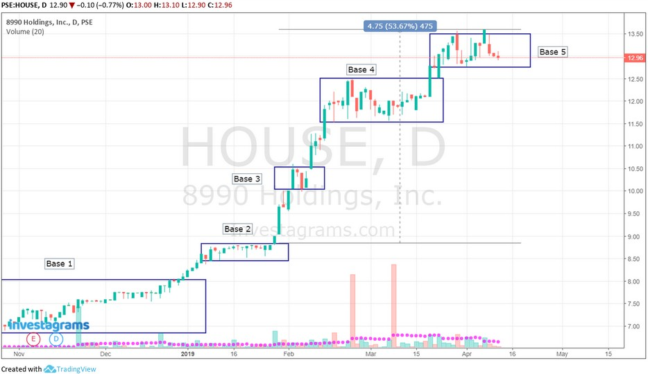

# Mark Minervini – zasady tradingu według gwiazdy portalu X

**Źródło:** https://gospodarka.sos.pl/mark-minervini-zasady-tradingu-wedlug-gwiazdy-portalu-x-32349607.html  
**Pobrano:** 2026-10-22

---

**Czy można nie ukończyć żadnej szkoły, choćby średniej, i dorobić się majątku sięgającego niemal 80 mln USD? Można, jeżeli zajmiesz się inwestowaniem. Udowodnił to Mark Minervini. Wart poznać jego nauczanie i zrozumieć, co ma do przekazania na temat tradingu.**

Z tego artykułu dowiesz się:

- Kim jest Mark Minervini?
- Dzięki jakim zasadom Minervini odniósł sukces w tradingu?
- Dlaczego trader odradza handlowania na kontach demo?
- Jak Minervini inwestuje na rynku akcji?
- Czemu Minervini nie szuka tanich spółek?
- Jakie żelazne zasady inwestowania promuje Minervini?

### Kim jest Mark Minervini?

Dwa razy wygrał US Investing Championship. **Jego majątek to około 72 mln USD** – wedle portalu CoinCodex. Jego [profil na portalu X](https://x.com/markminervini) (dawniej Twitter) obserwuje około 625 tys. miłośników i adeptów inwestowania i tradingu. Co roku szkoli dziesiątki tysięcy osób.

Jego dzieciństwo było naznaczone trudnościami: rodzice rozwiedli się, gdy miał osiem lat, a rodzina zmagała się z ubóstwem. W jednym z wpisów na platformie X wspomina, iż w jego dzieciństwie zdarzały się momenty, gdy w domu brakowało jedzenia. Porzucił szkołę w wieku 15 lat, kończąc edukację na poziomie ósmej klasy. Nie kontynuował formalnego wykształcenia, co czyni jego sukces jeszcze bardziej niezwykłym. Jako samouk, zdobywał wiedzę czytając książki i słuchając setek programów edukacyjnych, co pozwoliło mu rozwinąć umiejętności inwestycyjne.

*„Jeśli mnie się udało, to Tobie też może się udać”* **– powtarza.**

Dziś Mark Minervini jest gwiazdą świata inwestycyjnego. Jedną z wielu, ale na portalu X jest jedną z tych najmocniej błyszczących. Obserwuje go niemal tylu fanów, co dużo starszą od niego legendę rynku inwestycyjnego i tradingu – Petera Brandta (około 802 tys.). I to nie zadziało się przez przypadek. Minervini na swój status zasłużył, i naprawdę warto poznać jego historię oraz porady, jakich udzielał na przestrzeni wielu lat tym, którzy go słuchali.

Warto podkreślić, iż 8 maja jego firma doradczo-inwestycyjna wysłała do klientów rekomendację „kupuj” S&P 500 i weszła za 100% kapitału w amerykański indeks.

*„Obecnie znajdujemy się w optymalnym okresie wzrostu gospodarczego, który sprzyja utrzymaniu hossy. Oczywiście, panuje duża niepewność związana z cłami, ropą naftową i Iranem. jeżeli cena ropy przekroczy 80 USD za baryłkę, może to być punkt zwrotny, który wywrze presję na rynek. Każde 5 lub 10 USD wzrostu ceny ropy powyżej 80 USD może przyczynić się do scenariusza recesji. w tej chwili jesteśmy optymistycznie nastawieni do głównych indeksów, takich jak S&P 500, ale ostrożni w odniesieniu do poszczególnych akcji — zwłaszcza spółek o małej i średniej kapitalizacji”* **– powiedział Minervini w [wywiadzie](https://www.marketwatch.com/story/why-this-stock-market-wizard-is-100-invested-in-the-s-p-500-right-now-even-after-the-u-s-strike-on-iran-7b8d9b3b) dla MarketWatch.**

### Jakie zasady tradingu promuje Mark Minervini

Minervini jak każdy doświadczony trader radzi przede wszystkim, w niemal wszystkich swoich wypowiedziach pisemnych i ustnych – by przede wszystkim unikać tracenia kapitału, czyli w odpowiedni sposób zarządzać ryzykiem. Minervini stosuje zlecenia stop-loss blisko poziomu wejścia, aby ograniczyć potencjalne straty.

*„Nie ponoszenie dużych strat jest najważniejszym czynnikiem pozwalającym osiągnąć duże zyski. Jako spekulant nie masz wyboru co do tego, czy poniesiesz stratę, ale możesz zdecydować, jak duża ona będzie”* **– podkreśla Minervini.**

Klucz do sukcesu w tradingu to również konsekwentne przestrzeganie planu inwestycyjnego – co oczywiście jest powiązane z kontrolą ryzyka. Każda decyzja powinna być zgodna z wcześniej ustalonymi regułami, aby zminimalizować emocjonalne reakcje. Minervini podkreśla, iż nie można handlować perfekcyjnie, ale można perfekcyjnie realizować swój plan.

Minervini radzi również, by nie bać się małych strat. Nie należy żałować sprzedaży akcji, które później odbiły, jeżeli decyzja była zgodna z planem (chodzi np. o osiągnięcie poziomu stop-loss). Ważniejsze jest unikanie dużych strat, które poważnie naruszają kapitał, niż próba unikania małych strat.

The only way to avoid a large loss is to accept a small loss before it snowballs. In 38-years, I haven’t found a better way, because one doesn’t exist. I lose just as often as I win, but I NEVER take a large loss. Here’s one of many trades where my stop saved me a fortune. [pic.twitter.com/lpfPw7cun8](https://t.co/lpfPw7cun8)

— Mark Minervini (@markminervini) [December 15, 2021](https://twitter.com/markminervini/status/1471182574273892352)

Naprawdę warto śledzić profil tradera na X. W swoich postach Minervini wskazuje na momenty, gdy rynek wygląda na „ciężki” (np. przegrzany), co może sugerować możliwość korekty. W takich sytuacjach stosuje hedging, np. otwierając krótkie pozycje na indeksy, aby chronić zyskowne pozycje. I przeważnie się nie myli. Często publikuje na X również sygnały wejścia na pozycje „long”.

Cycle work suggests continued weakness heading into early April before rallying into the Summer. The long-term trend remains intact; our [$SPY](https://twitter.com/search?q=%24SPY) Advisor Model has yet to trigger a sell signal. However, it’s starting to look like a potential bubble could be in the making (although… [pic.twitter.com/eSyOMsY3fe](https://t.co/eSyOMsY3fe)

— Mark Minervini (@markminervini) [March 3, 2025](https://twitter.com/markminervini/status/1896580468729938316)

Just did some late night screening. There are few stocks meeting my buy criteria. The market needs some time to repair. But in time, a new bull market will emerge led by new names. Now is the time to roll up your sleeves and put in the work so you are prepared to act decisively…

— Mark Minervini (@markminervini) [April 8, 2025](https://twitter.com/markminervini/status/1909483275925463474)

Minervini ostrzega inwestorów przed **nadmierną pewnością siebie**. Podkreśla, iż choćby po 43 latach tradingu nigdy nie jest w 100% pewien żadnego ruchu na rynku. Jest pewny tylko jednego, iż zamknie pozycję, gdy osiągnie ona zaplanowany poziom stop-loss.

Minervini [opublikował na swoim profilu na X](https://x.com/markminervini/status/1859625009469112773) kiedyś zasady, na których zbudował karierę i osobistą fortunę. Oto one:

1. **Zawsze stosuj stop-loss.**
2. **Określ stop-loss przed wejściem w transakcję.**
3. **Nigdy nie ryzykuj więcej, niż możesz zyskać.**
4. **Zabezpiecz przyzwoite zyski.**
5. **Nigdy nie pozwól, aby dobry zysk zamienił się w stratę.**
6. **Nigdy nie uśredniaj w dół.**
7. **Nigdy nie bądź zbyt śmiały, gdy masz pecha.**
8. **Stosuj system, który pozwala na największe transakcje, gdy osiągasz najlepsze wyniki, i najmniejsze transakcje, gdy osiągasz najgorsze wyniki.**
9. **Wraz z postępem w tradingu powinieneś coraz wyraźniej widzieć także najgorszy scenariusz.**
10. **Unikaj częstej zmiany stylu tradingu.**

Można jeszcze dodać – i tutaj początkujący powinni szczególnie wyostrzyć uwagę – iż Minervini radzi by unikać kont demo, czyli „paper tradingu”. Uważa, iż tylko prawdziwe pieniądze uczą dyscypliny i rzeczywistych emocji związanych z tradingiem, a inwestowanie „wirtualnych” środków to niepotrzebna zabawa, która tylko oddala od prawdziwego tradingu i uczy złych nawyków.

*„Myślę, iż handel na koncie demo to najgorsza rzecz, jaką można robić. jeżeli jesteś początkującym inwestorem, handluj małymi kwotami, które są na tyle małe, iż możesz sobie pozwolić na ich utratę, ale na tyle duże, iż poczujesz ból, jeżeli do tego dojdzie. W przeciwnym razie oszukujesz sam siebie”* **– radzi Minervini.**

Why I don’t recommend paper trading… <https://t.co/R05YHeRP1D> [pic.twitter.com/83xymF5S5A](https://t.co/83xymF5S5A)

— Mark Minervini (@markminervini) [December 28, 2020](https://twitter.com/markminervini/status/1343663489202712576)

Na zakończenie wywiadu, udzielonego niedawno portalowi MarketWatch, Minervini tak mówił do początkujących traderów:

*„Jeśli dopiero zaczynasz inwestować lub trade’ować, nie wierz tym, którzy twierdzą, iż kiedyś było to łatwiejsze. Handel jest teraz łatwiejszy niż kiedykolwiek. To jeden z najlepszych momentów w historii na trading i inwestowanie w akcje. Bądź cierpliwy i nie poddawaj się. Nie można zostać lekarzem ani graczem ligi baseballowej Major League w ciągu sześciu miesięcy lub roku. Nie oczekuj, iż tak samo będzie w przypadku tradingu. Będziesz musiał poświęcić na to trochę czasu, ale warto.”*

### Jak Minervini inwestuje w akcje

Warto przestudiować także to, co Minervini ma do powiedzenia na temat inwestowania w akcje spółek. Ma on kilka interesujących nawyków, jeżeli chodzi o inwestowanie w akcje. Zaczął lokować środki na giełdzie dość późno, bo w 1993 roku, a zaczął niepozornie – od zakupu walorów producenta traktorów spółki Allis-Chalmers.

Minervini przede wszystkim zaleca obserwowanie całego rynku i granie z trendem. Zaleca kupowanie akcji tylko wtedy, gdy indeksy są w trendzie wzrostowym. Podobnie z poszczególnymi walorami – choćby jeżeli coś sobie upatrzy, wchodzi na pozycję tylko wtedy, gdy notowania wchodzą w trend wzrostowy.

Jedną z kluczowych lekcji, których Mark Minervini udziela w swojej książce *„Trade Like a Stock Market Wizard”* jest koncepcja liczenia baz. Minervini kupuje wyłącznie akcje, które znajdują się w fazie, którą nazywa fazą 2 lub trendem wzrostowym w fazie 2. W tej fazie akcje generują gwałtowne ruchy, które mogą pomóc inwestorowi osiągnąć największy zysk w najkrótszym czasie. Minervini twierdzi, iż najlepszym momentem na zakup akcji znajdujących się w trendzie wzrostowym jest druga baza (base 2 – na poniższym wykresie). W bazie 2 akcje nie są jeszcze w centrum uwagi opinii publicznej, i to jest dorby moment na ich zakup, bo gdy osiągną bazę 3 dla ogółu inwestorów staje się oczywiste, iż te akcje wykazują silny trend wzrostowy. jeżeli akcje osiągnęły bazę 4/5 to są już podatne na głębokie korekty i spadki i nie zaleca się ich nabywania.

*„Nauka koncepcji liczenia baz pozwoliła mi na wejście na rynek podczas pierwszej lub drugiej bazy. Ponadto wiedza o tym, kiedy akcje osiągnęły czwartą lub piątą bazę, może być sygnałem, iż nadszedł czas na sprzedaż. Liczenie baz jest nieco subiektywne, więc nie ma idealnego sposobu, aby to zrobić”* **– pisał we wspomnianej książce Minervini.**

*Bazy w trendzie wzrostowym. Źródło: TradingView*

Jeśli chodzi o selekcję i inwestowanie w spółki, to **nie dotyka on walorów, które są tanie** – nominalnie czy wskaźnikowo (niski C/Z). Uważa bowiem, iż skoro akcje są tanie, to jest jakiś powód, dla którego są tanie, i niekoniecznie ten powód (balast) zniknie. jeżeli coś jest tanie, to nie jest dobre – wychodzi z założenia Minervini. Dlatego ma zasadę, iż nie kupuje akcji które kosztują mniej niż 12 USD.

Poza tym podkreśla, iż wielu inwestorów przepuściło niesamowite okazje na rynku akcji, bo szukało walorów z niskim C/Z, a tymczasem doskonałe spółki growth nie mogą mieć niskiego C/Z, a czasami w ogóle nie mają zysku, więc nie można policzyć tego wskaźnika. Według Minerviniego, wskaźnik C/Z wprowadza w pewnym sensie w błąd – to nie jest wskaźnik za pomocą którego można wyszukać prawdziwie apetyczne okazje.

Minervini podkreśla, iż **należy inwestować w akcje spółek, które są liderami w swoich sektorach**, wykazują silny wzrost zysków i przychodów oraz mają wysoki potencjał wzrostowy. Unikać należy akcji o słabych fundamentach, choćby jeżeli wydają się „tanie”. najważniejsze jest identyfikowanie spółek z silnym momentum wzrostowym na kursie i przewagą konkurencyjną nad rywalami.

Poza tym, inwestor giełdowy – tak jak trader – musi trzymać się planu i zasad, przekonuje Minervini.

*„Długoterminowy sukces na giełdzie nie ma nic wspólnego z nadzieją ani ze szczęściem. Zwycięzcy na giełdzie mają zasady i dobrze przemyślany plan. Natomiast przegrani nie mają zasad lub, jeżeli je mają, nie trzymają się ich zbyt długo. Przegrani robią odstępstwa od planu i to ich gubi”* **– mówi Minervini.**

W niedawnym wywiadzie dla portalu MarketWatch Minervini jeszcze raz podkreślał, iż inwestor giełdowy, tak jak trader operujący na kontraktach czy CFD, musi stawiać stop-loss.

*„Wiele osób spędza cały swój czas na badaniu firmy i zakochuje się w produktach i usługach, takich jak sztuczna inteligencja. Następnie kupują akcje, a następnego dnia ich wartość spada o 3%, 4%, 5% lub 8%. Są zmuszeni podjąć decyzję, czy ograniczyć straty. Nie planowali spadku wartości akcji. Kiedy kupujesz akcje, a ich wartość spada, popełniasz błąd. jeżeli sprzedasz je i poniesiesz stratę, przyznasz się do porażki. Prawdziwym strachem, który powstrzymuje ludzi przed sprzedażą, jest to, iż gdy sprzedadzą akcje, ich cena ponownie wzrośnie. Wtedy popełniają błąd po raz drugi. Psychologicznie rzecz biorąc, popełnienie błędu dwa razy silnie oddziałuje i sprawia, iż trzymamy się pozycji, choćby jeżeli jest jasne, iż należy ją sprzedać”* **– wyjaśnia Minervini.**

### Kim jest Mark Minervini?

Minervini rozpoczął swoją przygodę z tradingiem w 1983 roku, zaczynając od niewielkiego kapitału rzędu kilku tysięcy dolarów. Początkowe lata nie były łatwe. Przez pierwsze sześć lat nie osiągał zysków, a choćby ponosił straty. Jednak dzięki wytrwałości i pasji zaczął osiągać znaczące sukcesy. Przyszedł okres, który pozwolił mu się dorobić, bo jego średnioroczny zwrot z inwestycji przez pięć kolejnych lat wynosił 220%, z tylko jedną stratną kwartą, co przełożyło się na **łączny zwrot na poziomie 33 500%**! To oznacza, iż konto o wartości 100 000 USD wzrosło do ponad 30 mln USD w zaledwie pięć lat! *(To tylko przykład, nie jest znany dokładny nominalny wynik Minerviniego.)*

W 1993 roku Minervini założył Quantech Research Group – firmę zajmującą się badaniem rynków finansowych. Opracował metodę Specific Entry Point Analysis (SEPA), która opiera się na analizie historycznych danych notowań akcji, identyfikując pozycje o korzystnym stosunku zysku do ryzyka. Metoda ta uwzględnia zarówno aspekty techniczne, jak i fundamentalne, a także wpływ dużych graczy instytucjonalnych na rynek.

Minervini zyskał międzynarodową sławę dzięki swoim książkom które stały się bestsellerami: *„Trade Like a Stock Market Wizard: How to Achieve Super Performance in Stocks in Any Market”* oraz *„Think & Trade Like a Champion: The Secrets, Rules & Blunt Truths of a Stock Market Wizard”*. Obie pozycje znalazły się na liście najlepszych książek o rynkach finansowych według BookAuthority. Jest także współautorem publikacji *„Momentum Masters – A Roundtable Interview with Super Traders”* oraz bohaterem książki Jacka Schwagera *„Stock Market Wizards”*, w której Schwager określił jego wyniki jako „zdumiewające”. W 1997 roku Minervini wygrał prestiżowy konkurs inwestycyjny U.S. Investing Championship, osiągając roczny zwrot na poziomie 155%. Wygrał go ponownie w 2021 roku wypracowując niesamowity zysk w wysokości 335%.

Obecnie Minervini prowadzi swoją platformę [Minervini Markets 360](https://www.minervini.com/). Oferuje wiele narzędzi, nie tylko tutoriale i zarządzanie portfelem, ale też m.in. specjalny system do wyszukiwania okazji inwestycyjnych oraz narzędzie TraderGrader które pełni rolę nauczyciela obserwującego ucznia i poprawiającego jego błędy. Mało tego, Minervini oferuje także MAI – Minervini AI – czyli sztuczną inteligencję która „natychmiastowo i bez emocji interpretuje wzorce zachowań, analizuje wykresy i dostarcza komentarze dotyczące zachowania konkretnych akcji w czasie rzeczywistym, zapewniając obiektywny obraz zmian cen w miarę ich pojawiania się” (jak zachwala na stronie Minervini).

Co ciekawe, kilka wiadomo na temat życia prywatnego Marka Minervini. Wiadomo, iż jego dziadek przybył do USA z Włoch i w 1935 roku otworzył pizzerię, którą później przejęli ojciec i brat Minerviniego. Sam Mark w młodości pracował jako muzyk, co pomagało mu się utrzymać, podczas gdy rozwijał swoje umiejętności tradingowe.

My grandfather came to this country from italy and opened a pizza restaurant in 1935, which he later passed down to my father and then to my brother in the 70s. I dropped out of school in the 8th grade and worked as a musician to support myself while I pursued stock trading in… [pic.twitter.com/cN5TFIqHfe](https://t.co/cN5TFIqHfe)

— Mark Minervini (@markminervini) [April 4, 2025](https://twitter.com/markminervini/status/1908225887264297445)

Minervini nie ujawnia szczegółów dotyczących swojego życia rodzinnego, takich jak informacje o żonie czy dzieciach. Świadomie chroni prywatność. Skupia się na karierze i zarabianiu pieniędzy i tylko taki wizerunek upublicznia. Jego filozofia życia opiera się na przekonaniu, iż każdy może osiągnąć sukces, niezależnie od pochodzenia – jeżeli tylko wykaże się wytrwałością i chęcią nauki.
