# 3 TIMELESS setups that have made me TENS OF MILLIONS!

**Author:** Kristjan Kullamägi  
**Published:** January 8, 2021 · **Updated:** April 28, 2021  
**Source:** https://qullamaggie.com/my-3-timeless-setups-that-have-made-me-tens-of-millions/

I have made tens of millions the past few years trading 3 simple, timeless setups. These setups occurred last year, 10 years ago, 50 years ago and 100+ years ago. They occur over and over again. They occur in the Japanese market, they occur in the Swedish market, they occur in the Indian market. The U.S. stock markets are the biggest and baddest of them all and therefore the best hunting grounds if you have a setup with an edge.

These 3 setups are:

- **Breakouts** (if you want to learn this setup, this is a mandatory video: [YouTube](https://www.youtube.com/watch?v=xx8GvtAxilk&feature=youtu.be&t=1) — note: that's one of my moderator YouTube channels, not mine)
- **The Episodic Pivot (EP)**
- **The Parabolic short (or long)**

Before I go into detail about where to buy, lock in profits, position sizing and stopping out of a losing trade, I want to talk a little about position sizing and risk.

I don't believe you should ever have more than 30% of your account overnight in any stock or ETF. Intraday you can do more since you don't have to deal with potential overnight gaps.

Most of my positions are 10–20% of account size.

My risk on most trades is usually 0.25–1%. I rarely risk more than 1% of my account on any trade. When my accounts were small, less than a few million, I risked more, maybe 0.5–1.5%. At the very beginning I risked more still, but honestly I had not a great grasp of the concept of risk and position sizing in the beginning.

Okay, let's get to the setups!

## Breakouts

If you study thousands of the biggest winning stocks over the past 100 years they tend to move in stair steps. Meaning they will make a 20–50%+ move, pull back and go sideways for a while, then make another move. This is how most leading stocks act. This pattern is something we as traders can use to our advantage, to get an edge.

How to find these setups?

Scan for the 1 or 2% of stocks that are up the most over these 3 timeframes:

- 1-month
- 3-month
- 6-month

This is how you find the stocks that are leading right now.

### There are 3 steps to this setup:

1. A big move higher sometime in the past 1–3 months. This move can be anywhere from 30–100%+ and usually lasts a few days to a few weeks.

2. An orderly pullback and consolidation with higher lows and tightening range in the consolidation phase.

3. A range expansion (breakout) out of that consolidation. The consolidation phase is usually 2 weeks to 2 months. During the consolidation the stock price "surfs" the rising 10- and 20-day, and sometimes the 50-day moving average.

### How do you trade this setup?

1. Identify the setups. You need to have a watchlist ready before the market open. You should also probably have alerts set, and know how many shares you want to buy.

2. Enter on the opening range highs. The opening range highs can be the highs of the first 1-minute candle, the 5-minute candle or the 60-minute candle (on the 60-minute timeframe the first candle is always only 30 minutes, 9:30–10 AM). You can use whatever timeframe or a combination of them. You don't even have to use any intraday chart, just look at the daily chart and enter when the stock is starting to break out. This method can also be traded by anticipating the breakout, but I don't find it as effective and more skill and experience is needed.

3. Stop is always lows of the day and the stop should not be wider than the ATR or ADR of the stock, to prevent the risk/reward mechanics getting out of whack. So if the ADR of the stock is 5%, your stop shouldn't be wider than 5%. If the ATR is 50c, then the stop should not be wider than 50c.

4. You should sell 1/3 to 1/2 of the position after 3–5 days, and then move the stop to break even. The rest of the position should be trailed with the 10- or the 20-day moving average. It depends on how fast the stock is. If a beginner, stick to the 10-day. You wait for the first CLOSE below the 10-day.

In a bullish market it is very common to get moves that are 10–20x+ your initial risk if you are good at setup selection.

There are variations of this setup but the premise stays the same. I am a swing trader and use the daily chart to find these setups, but this setup also works on the weekly chart and the intraday (1- and 5-minute) charts. On the intraday timeframe this setup is called Holy Grail by some; on the daily it can be called a high tight flag sometimes. It's pretty much flat channels, symmetrical and descending triangles. I've even drawn the lines to illustrate this on 2 of the examples below.

I am providing 3 examples of breakout setups with 5–10 years between them.

#### $TSLA from 2020 before and after:

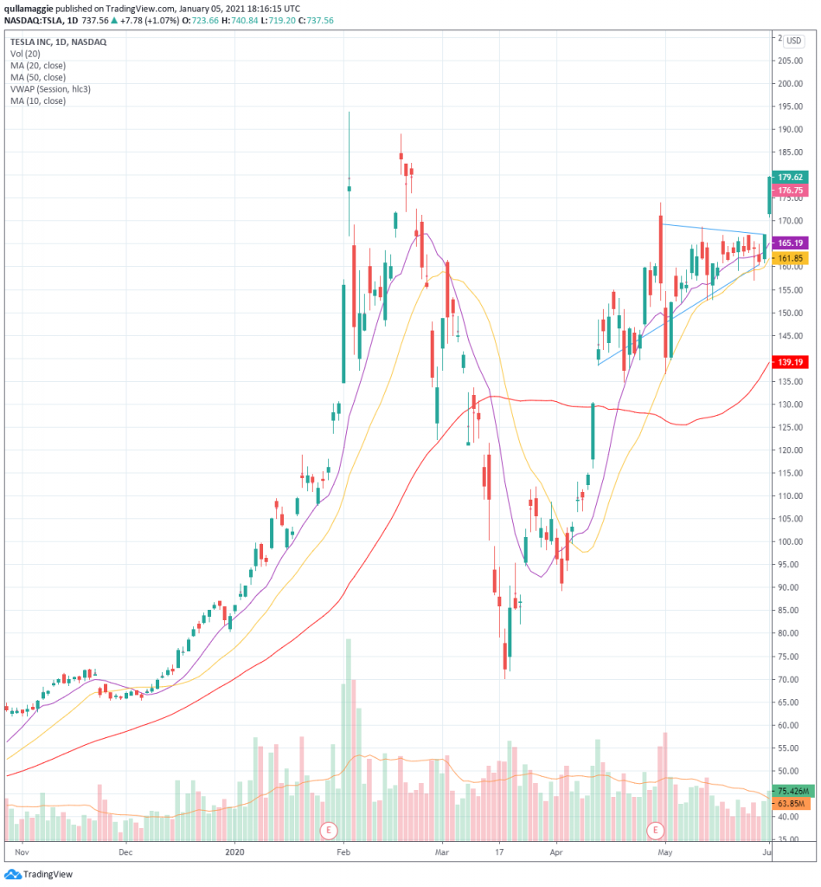

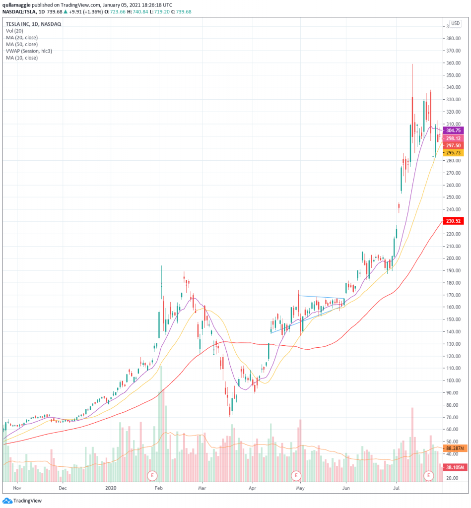

#### $MNKD from 2013, before and after:

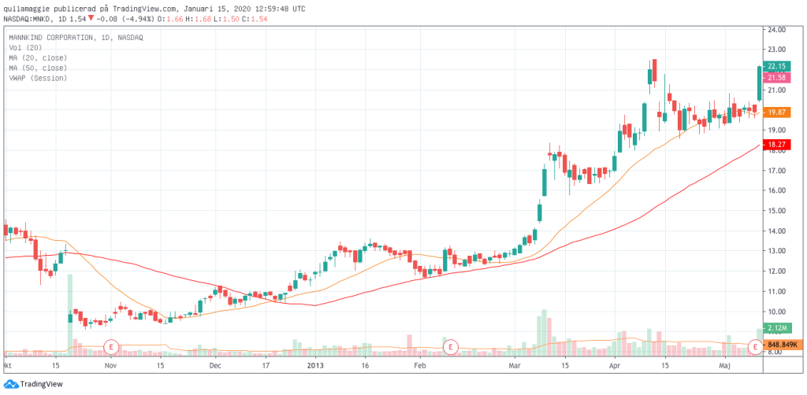

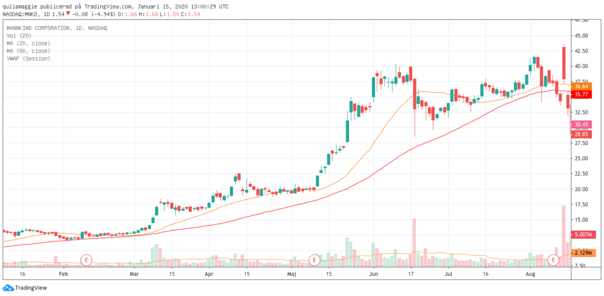

#### $AAXN ($TASR) from 2004, before and after:

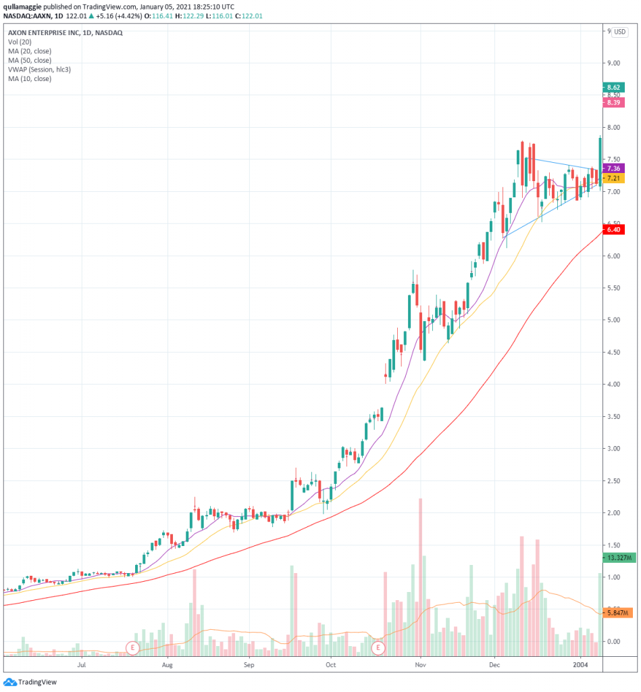

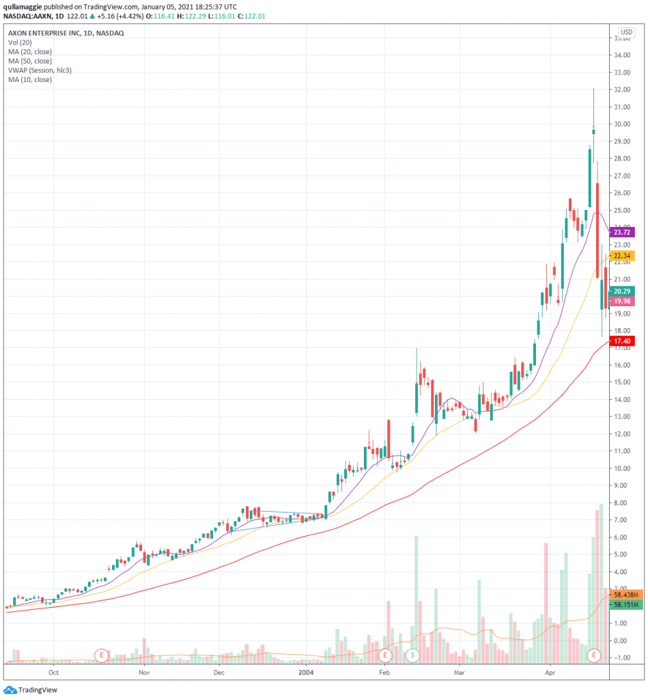

If you look closely, there are additional setups on these stocks.

## Episodic Pivot (EP)

When unexpected good news hits a stock, especially if that stock is neglected, that can trigger multi-month, and multi-year moves.

There are many types of EPs:

- Earnings and earnings guidance
- Government regulations, political stuff
- Biotech related, like drug trial results or FDA decisions
- Macro and political related
- …and many more!

The main ones I focus on are earnings and earnings guidance. When a stock reports unexpected good earnings and guidance, that is often a catalyst for a big and prolonged move.

Let's take a look at $NVDA from 2016 and 2017. Look at what happened at the leftmost red arrow. The stock gapped up on big earnings numbers and a big beat to analyst expectations. A big surprise. Look at the volume, it ended up having several times average volume that day. Look at the move it made over the next few months.

Now the middle red arrow, the stock gapped up slightly but sold off. This is not an EP. The earnings were big, the analyst beat was big but this didn't matter.

An EP needs to be a gap of 10%+ and big volume should be there, if not in pre-market then the first 5–10 minutes after the open.

Look at the last red arrow. The stock had essentially been going sideways for 4 months and had another huge quarter, with EPS and revenues growing 126% and 48% respectively. Another big beat with EPS of 85c vs analyst expectations of 67c.

Scroll down to see what happened next.

#### $NVDA in 2016 and 2017:

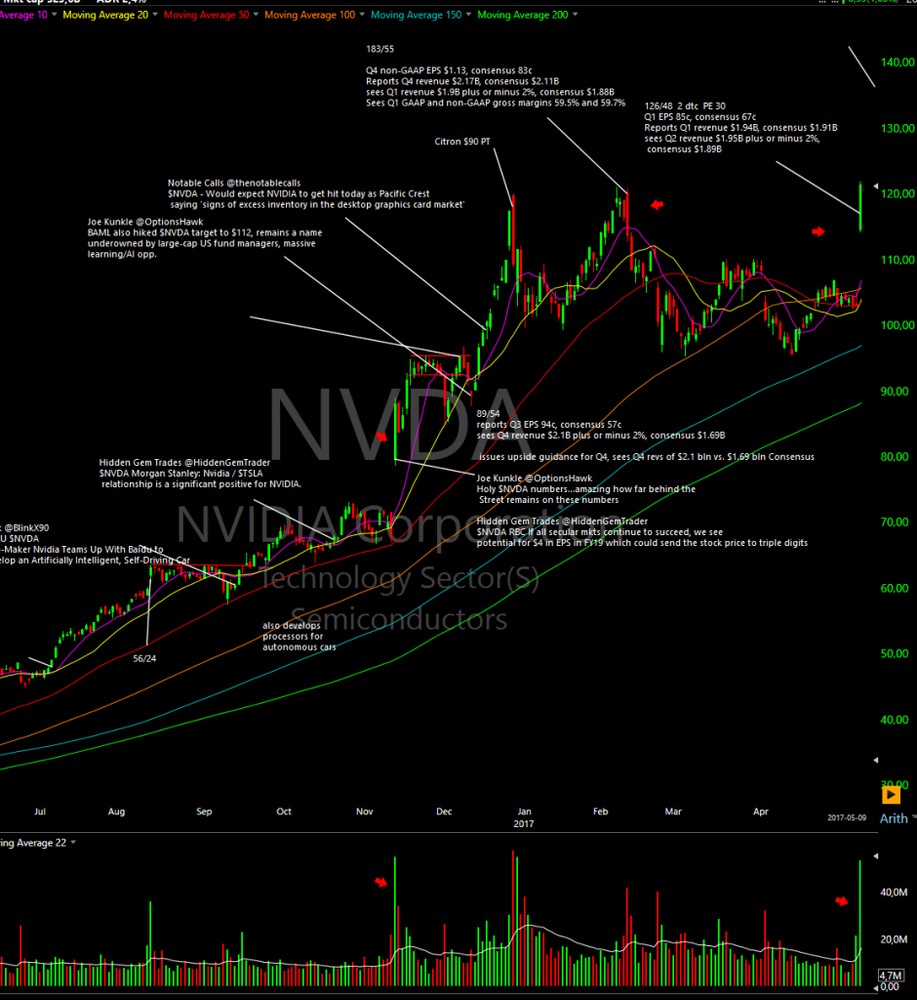

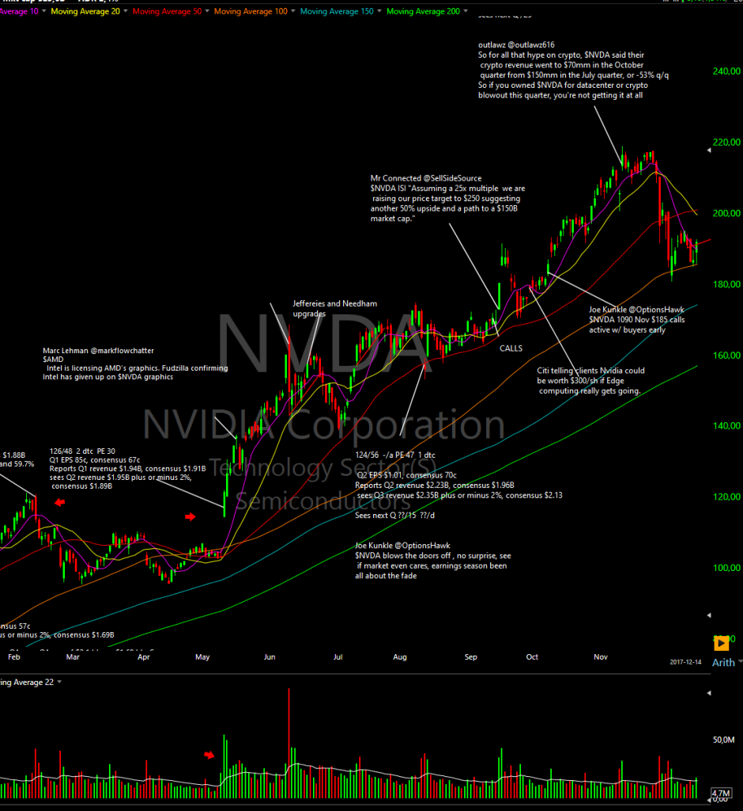

That earnings report started a move that lasted 6 months and where the stock almost doubled.

The next one is $FSLR in 2007. I don't have the exact numbers on that earnings report as I did the work on it 10 years after it happened, but the earnings and revenue were close to triple-digit, if not triple-digit. Look at that gap up and volume.

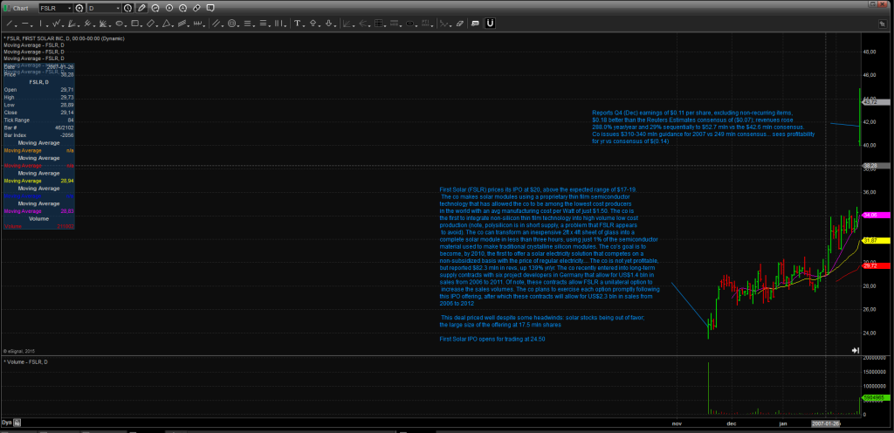

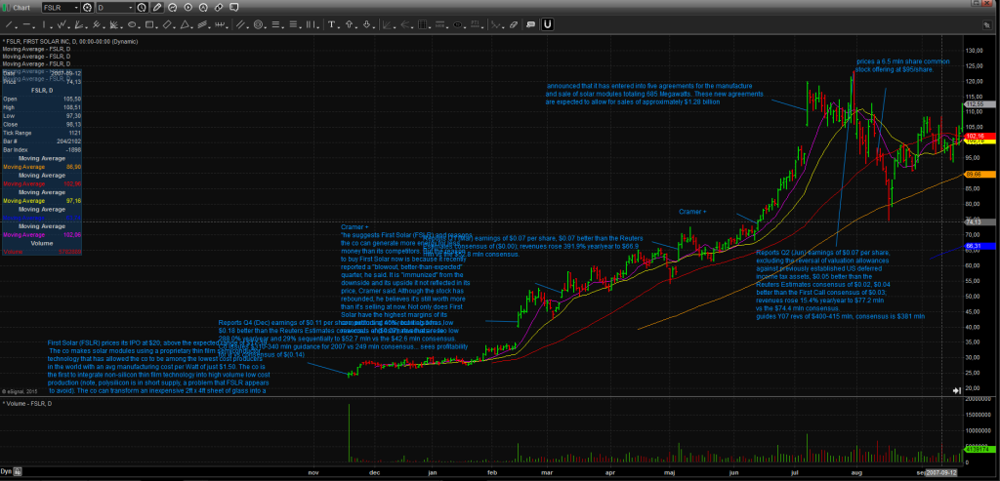

Same thing with $BB ($BBRY) in 2004.

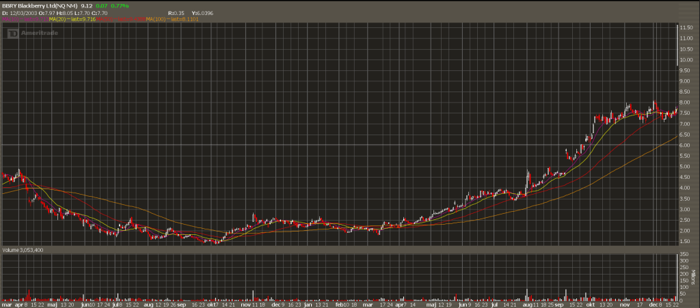

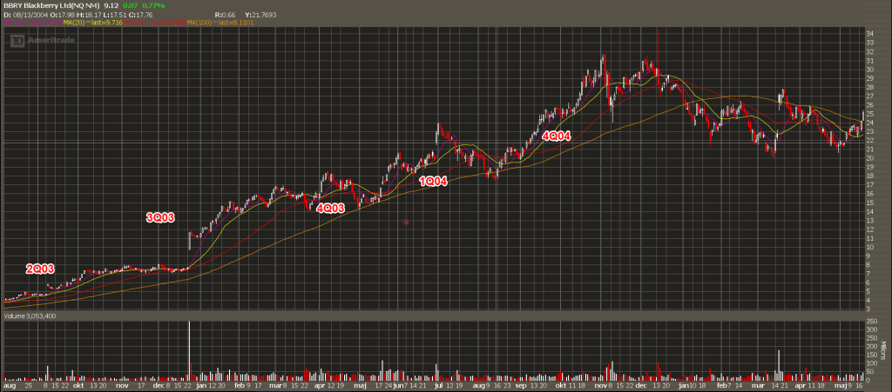

Learn this setup, it takes 4–8 earnings seasons (1–2 years) to get good at this setup and understand it. Once you learn it, you need to do very little work to find these. You literally let them come to you.

Create your own sell rules. You can trail these with the 20- or 50-day moving average, or whatever you find to work the best.

### The steps to this setup are:

1. Gap up 10%+.

2. Big volume. If the volume is not there in premarket, it needs to come in at the open. Many times the best ones have traded their average daily volume in the first 15–30 minutes after the open.

3. If an earnings or earnings guidance related EP, there have to be big growth numbers, preferably mid/high or even triple digit EPS and revenue growth and a significant beat to analyst expectations. Many times the smaller stocks don't have analyst coverage, you just have to trust the numbers and volume.

4. It's best if the stock has not rallied over the past 3–6 months. If the stock has already made a big, multi-month move into the gap-up, is it really a surprise to the market? It's your job to figure it out!

Happy hunting!

### How do you trade this setup?

1. Identify the setup. This can usually be done in after-hours or pre-market as we are looking for stocks gapping up on news/earnings.

2. Enter opening range highs. ORH can be the highs of the first 1-, 5-, or 60-minute candle. The stop is at the lows of the day.

3. Trail your stop with the 10- or 20-day moving average once they surpass your initial stop.

## The Parabolic Short (or long)

Think of stocks as rubber bands. If they get really stretched short term, they can have powerful snapbacks. This is by far the riskiest setup if done wrong or if you have issues with not obeying your stops.

Most of these are short setups, but sometimes there are also good long setups, but they don't occur as often.

### These are the steps for this setup:

1. A stock up 50–100%+ in a few days or weeks (if larger cap) or 300–1000%+ (if smaller cap).

2. The stock should be up 3–5+ days in a row. Many times you have examples where a stock trends higher for weeks or months and then starts speeding up; some just explode from nowhere.

### How do you trade this setup?

1. When you think you have identified a candidate you can short on the opening range lows (1-minute, 5-minute candles). You can wait for the first red 5-minute candle in case the stock goes straight up from the open. You can wait for the stock to have the first crack, bounce back into VWAP (the only intraday indicator I really use) and if it fails at VWAP you can enter (or add). The fail could be the first red 1- or 5-minute candle into the VWAP. The stop is highs of the day or, if VWAP fail, a reclaim of the VWAP. The key is to get relatively tight and defined stops.

2. The target area is the 10- and 20-day moving averages; that's where these stocks usually bounce.

3. Don't be too early. WAIT for the right setup. Let the amateur shorts get run over; that's where your edge comes in.

4. This setup is not like the Breakout or the EP where you can sometimes get a 30–50x+ risk reward on your trade. This setup is more like 5–10x risk reward, but if you wait for the perfect setups your win rate is probably going to be higher.

#### $LAZR in 2020, daily and 5-min intraday:

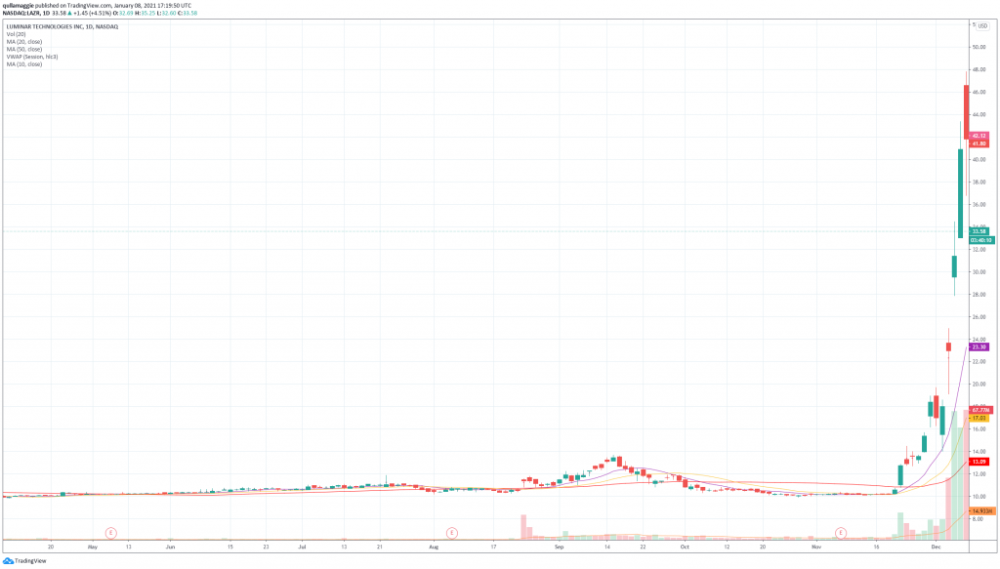

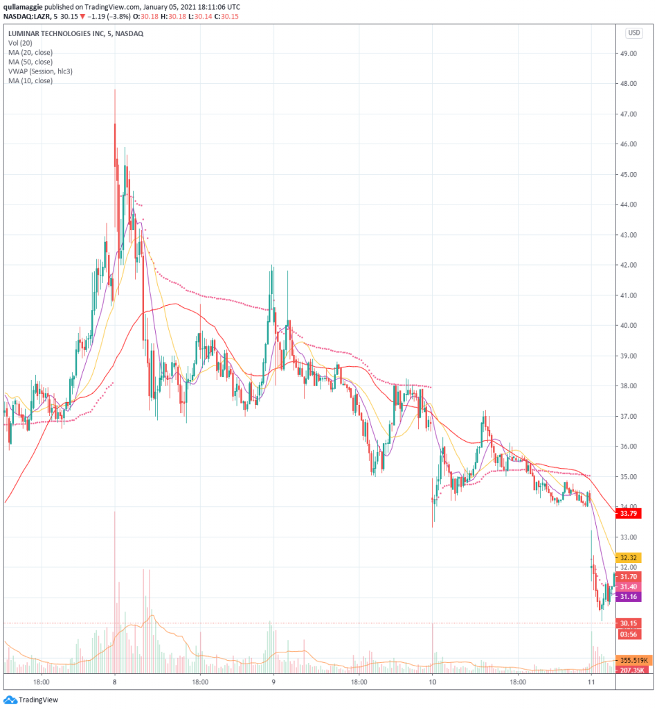

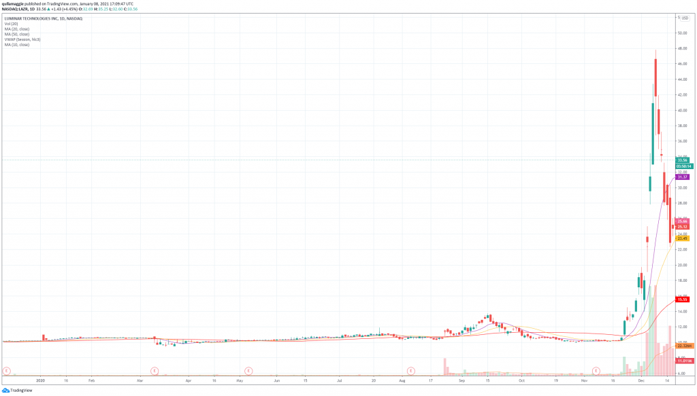

#### $AIG in 2009, daily and 5-min intraday:

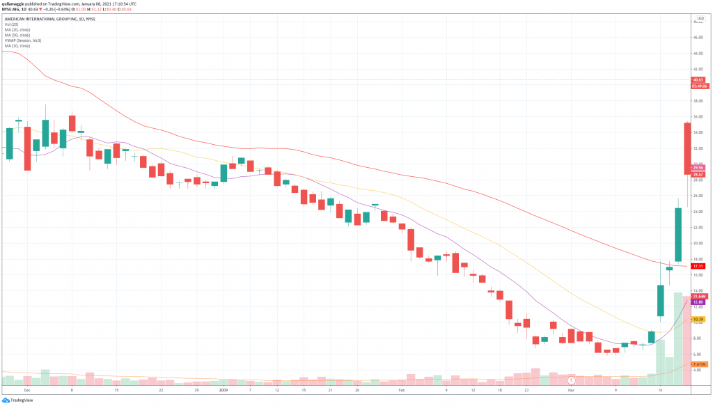

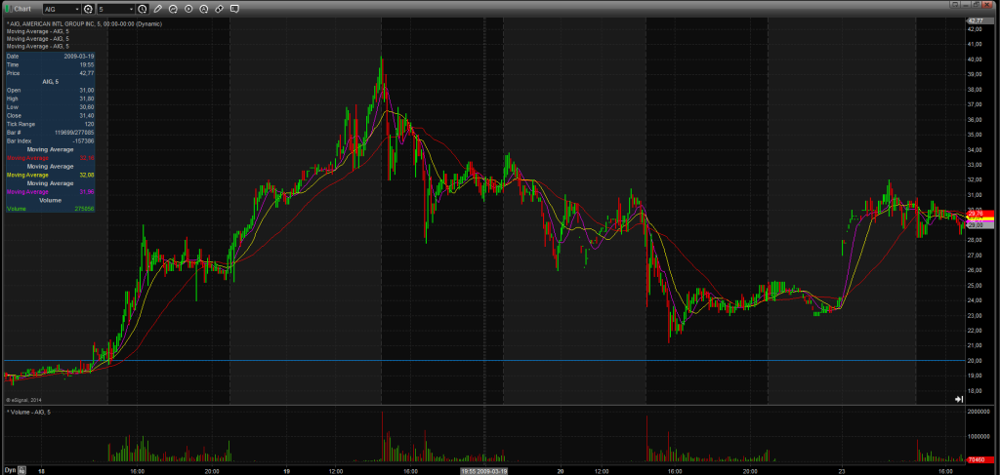

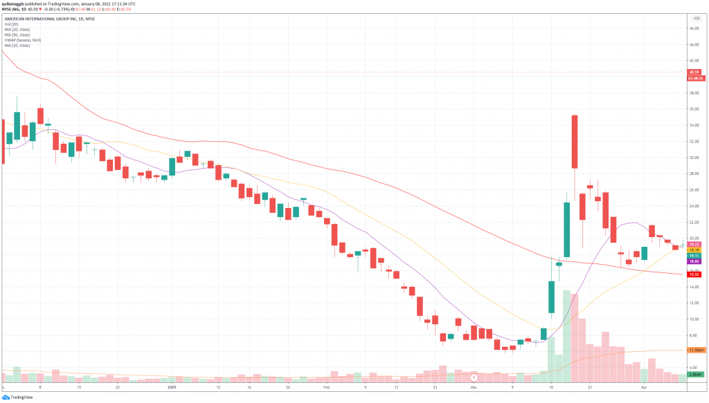

#### $AMTD in 1999, daily and 5-min intraday:

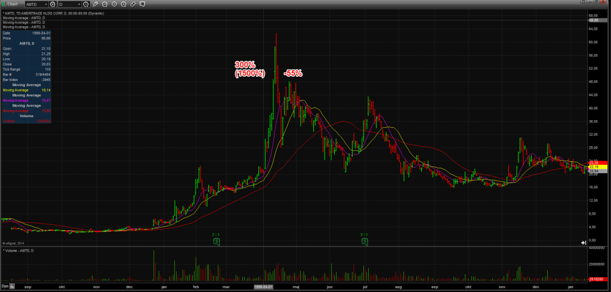

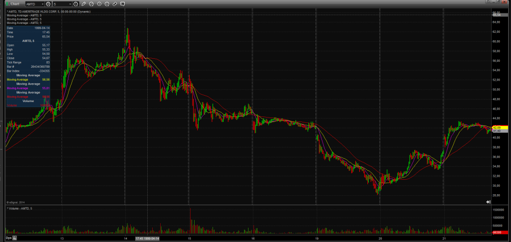

Let's take a look at a parabolic long setup. These are not very common, but any time a successful parabolic short goes down 50–60%+ in a few days, that's the premise for the long setup. Entry is opening range highs or the first green 5-minute candle or any range break to the upside if the stock doesn't rally out of the gate, which they usually do. These things can bounce 50–100% in a few days.

#### $GBTC in 2017, daily and 5-min intraday:

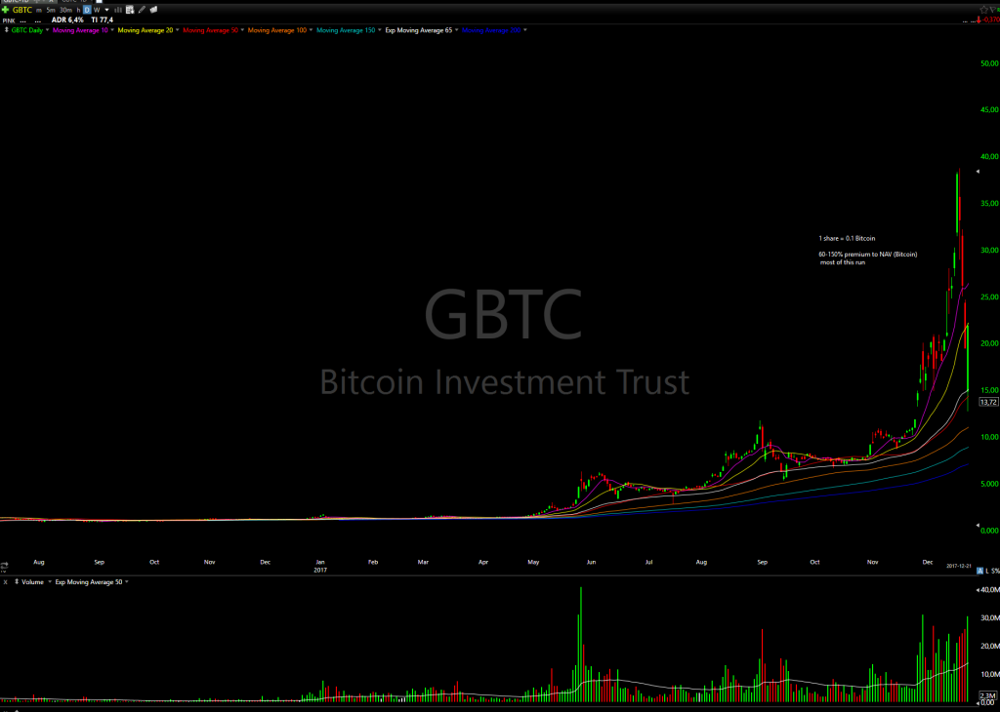

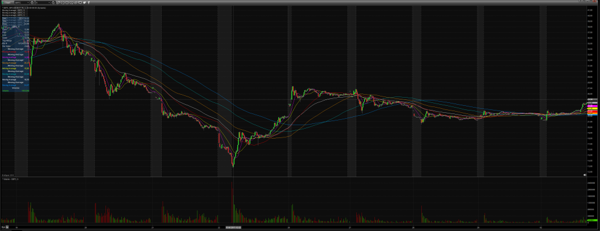

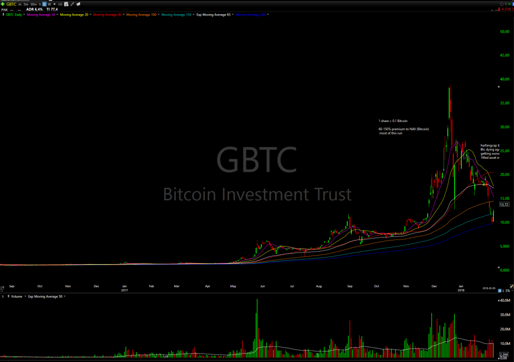

All of my setups are about finding low risk entries on fast moving stocks. It's all about finding tight, high probability areas to enter, so you can have high risk/reward on your trades. It's all about making 5–20+ times your initial risk. You can be wildly profitable with just a 25–30% win rate; it's all about having small losses and big winners.

I have an Evernote database I worked on for 7–8 years where I track these setups and I have a collection of thousands of them. Most of these charts are from my Evernote database. I have probably spent 1000+ hours building it and went back decades on thousands of stocks to find these setups.

Be creative. There are at least a couple of other setups I can think of that you can trade with great success, but I have chosen these three for myself. You need to look at every stock in the US stock markets as far back as you can and look for recurring patterns. I personally have also checked the biggest stocks in every international stock market.

If you want to become financially independent and change your life, if you want to be filthy rich or just want the security and the freedom that comes with it — you have to put in the work!

Good luck!

> "There is nothing new on Wall Street or in stock speculation. **What has happened in the past will happen again, and again, and again.**"  
> — Jesse Livermore

---

## Q&A from the comments

*Selected threads only, from the comment section of the source article: questions that Kristjan Kullamägi answered with a substantive, actionable response. Unanswered questions, thank-you notes, and replies without practical value were omitted. Long questions and answers are lightly condensed; spelling is corrected.*

### Setups, entries and filters

**Q (Dave, 2021-02-09, condensed):** Are your setups mainly breakouts? How much do fundamentals, momentum and theme matter? Do you buy breakouts with market or limit orders? Does the overall market matter, or only individual/group stock action?

**A:** In bullish markets, yes. Momentum is the #1 important thing, and many times the fast growers have lots of momentum — it gives me a little bit more conviction knowing the growth is there versus trading something random. Lithium stocks are trading off future expected growth, and just knowing the theme can add conviction to the trade; many moves in this market are pure theme/story. I use market orders mostly. Limit orders are for people who want to miss a good breakout. And yes, I look at the market, but individual/group stock action trumps all.

---

**Q (Justin, 2021-02-24):** If you missed a breakout by one day, do you buy the retrace to the breakout area, or do you look for the next breakout?

**A:** Sometimes I buy the retrace.

---

**Q (Reilly, 2021-07-29):** In bullet #4 of how to trade breakouts, you say beginners should stop out after a close below the 10 MA. Does that mean beginners should have tighter risk rules, but with more experience they can use more discretion and let things ride longer — maybe using the 20 MA instead?

**A:** Yes, exactly right.

---

**Q (Dariusz, 2021-07-29):** I cannot fully understand the entry into the Episodic Pivot strategy. Do I enter after the gap appears, for example on the first 60-minute candle, or do I enter on the breakout of the top of a closed candle with a gap?

**A:** If it goes up after the open, you can buy.

---

**Q (ABEN, 2021-06-16):** How do you manage stocks that show up in momentum scans but then move out of the scans during consolidation or correction? Do you track them separately? For example, BILI.

**A:** Focus on scans.

---

### Scans, tools and process

**Q (simplifyleading, 2021-03-28):** In TC2000 there are many different scans for 30-day and 60-day jumps — which specific ones do you use? When you say "it's too thin", do you mean volume is low? And what are the numbers with a slash that you write on charts?

**A:** Check the link in my Twitter bio for scans. "Too thin" means dollar volume. The numbers on the charts are earnings and revenue growth YoY in %.

---

**Q (Nikk, 2021-07-29):** How frequently do you run your 1-month, 3-month and 6-month scans — weekly, or at the end of a bull leg?

**A:** Weekly.

---

**Q (Cornel M. Mancas, 2021-05-19):** In your Swing Trading School video you said you would post the ADR code on the blog. I looked everywhere but can't find it. Could you post the code?

**A:** It is on the About Me page.

---

**Q (Willingtoworkforit, 2021-03-03):** Is the Stockbee membership site still active? Do you provide a course, or is Stockbee's website sufficient for learning the basics?

**A:** Stockbee is sufficient, and my content is sufficient too. Check this link: https://chartsandstories.com/start-here/

---

**Q (Charlie, 2021-04-10):** Can one have success day trading using only the 1-hour and 30-minute charts? I keep getting chopped up on 1-, 2- and 5-minute charts.

**A:** Yes, you can day trade using only 30/60 min. You need to educate yourself on how stocks move, then whatever you use will become easy. Education, education.

---

### Risk, psychology and market conditions

**Q (artek338, 2021-02-03):** I've been trying to emotionally disconnect from P&L for a long time. Could you share some tips to get emotions under control?

**A:** Decrease size until you get confidence in your setups and sell rules.

---

**Q (Joey, 2021-04-17):** Your techniques are more suited to bull markets. What are you mostly doing during a lull, a pullback or a bear market — sitting back and waiting, or adjusting positioning?

**A:** Fewer or no trades.

---

**Q (Tylo, 2021-03-04):** What are your thoughts on trading options premium as an instrument instead of stocks, given the higher reward and defined risk?

**A:** I think options are much more complex, and adding more complexity into an already incredibly difficult profession is not optimal. Also, for every successful options trader I know of or have read about, there are 50 stock traders — so for me, avoiding options is a no-brainer. But do what works for you; there are no absolutes in trading. Good luck!

---

**Q (Karl, 2021-05-19):** Do you have any advice on using margin?

**A:** If you have to ask, you don't get to use it.

